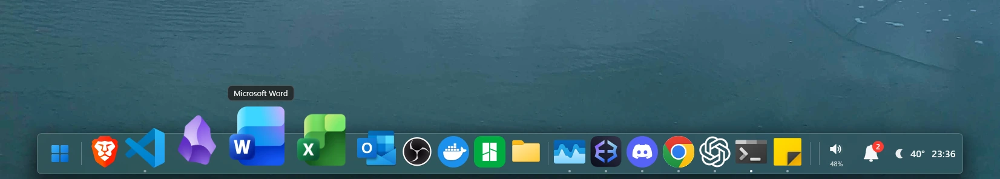
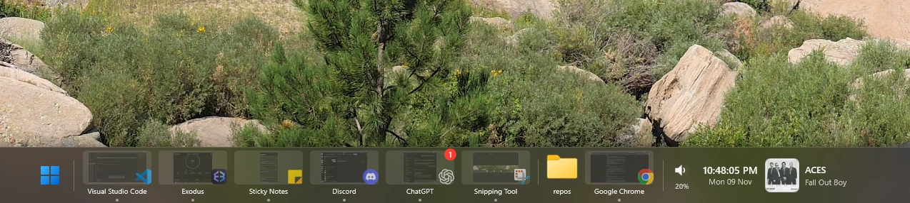
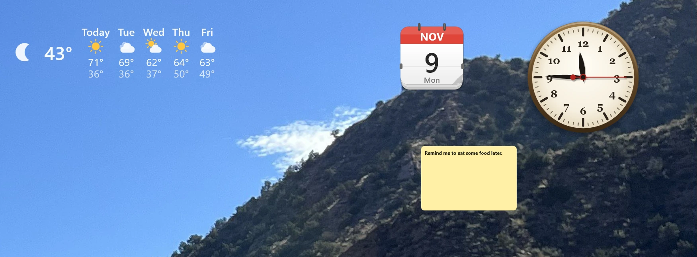
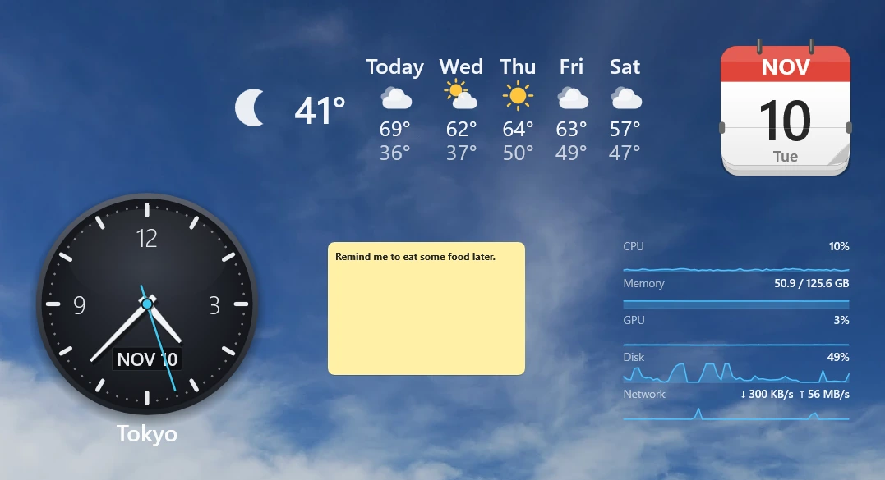
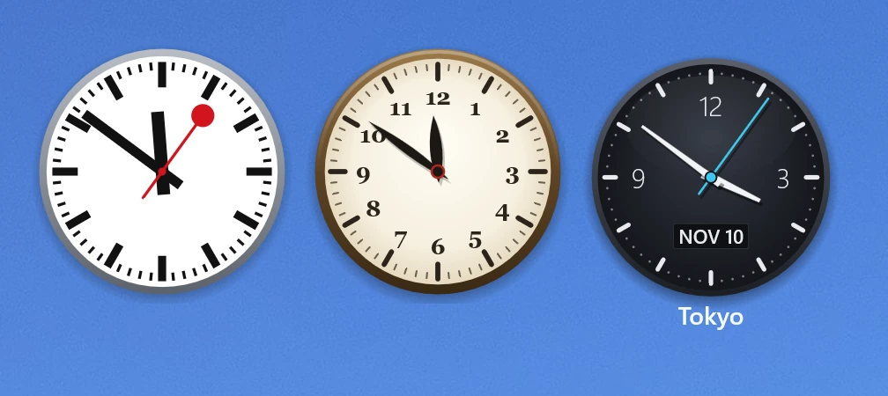
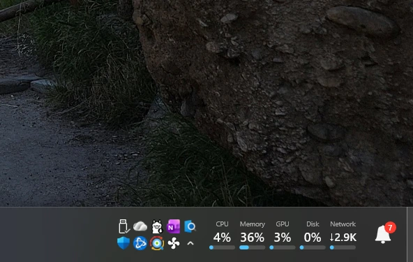
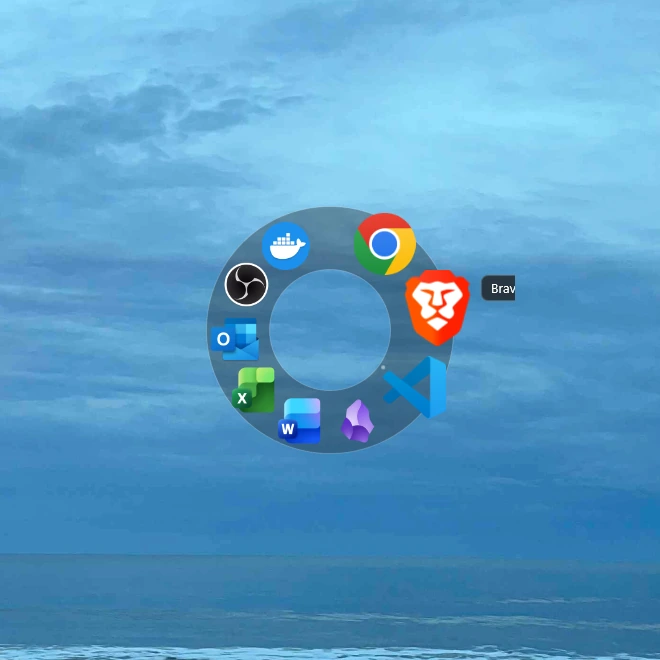
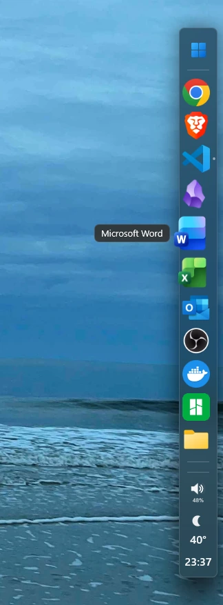

<h1 align="center">ViberDock</h1>

<p align="center"><b>A macOS-style dock for Windows 11. Free, open source, one small exe.</b></p>

<p align="center">
  <a href="https://github.com/CommonDocsOrg/code-viber-dock/releases/latest"></a>
  <a href="https://github.com/CommonDocsOrg/code-viber-dock/releases"></a>
  <a href="LICENSE"></a>
  
  
</p>

<p align="center"></p>

ViberDock replaces the Windows taskbar with a dock: a translucent bar of icons that grow under the
mouse, with your pinned apps, folders, the running apps and their window previews, a clock, the
weather, the system tray, notifications and script widgets. Put it on any edge of any monitor, bend
it into a half circle or a circle, run several at once, or drop widgets straight onto the desktop.
It is written in C++ against Win32, Direct2D and DirectComposition, compiles to a single static
exe, and spends nothing while idle. The internal name (exe, config folder, window classes) is
**WinDock**; the product is **ViberDock by CodeViber.org**.

## Download

**[Get the latest release](https://github.com/CommonDocsOrg/code-viber-dock/releases/latest)**:
download `ViberDock-<version>-x64.msi`, run it, and click **Start ViberDock now** on the last page.

- Windows 11, 64-bit. No runtime to install: the exe is statically linked.
- The installer is unsigned, so SmartScreen may warn on first run: choose **More info**, then **Run anyway**.
- The first start opens **Quick setup**: pick your docks, a look and how they behave, in four steps.
- The Windows taskbar is hidden while the dock runs and comes back when you quit (right-click the
  dock > **Quit**, or the tray icon). If it ever stays hidden, run `WinDock.exe --restore-taskbar`
  from the install folder (`Program Files\ViberDock`).
- Upgrading: run the newer MSI over the old one. Your settings live in `%LocalAppData%\WinDock`
  and are never touched by install or uninstall.

Prefer to build it yourself? See [Build](#build) below.

## Screenshots

<table>
  <tr>
    <td colspan="2"></td>
  </tr>
  <tr>
    <td colspan="2" align="center"><sub>Running apps with window pictures, a folder, volume, the clock and what is playing.</sub></td>
  </tr>
  <tr>
    <td colspan="2"></td>
  </tr>
  <tr>
    <td colspan="2" align="center"><sub>Widgets on the desktop, no dock needed: weather, a calendar page, an analog clock, a note.</sub></td>
  </tr>
  <tr>
    <td></td>
    <td></td>
  </tr>
  <tr>
    <td align="center"><sub>A second time zone, a system monitor with graphs, and more.</sub></td>
    <td align="center"><sub>Clock faces: station, classic, modern dark. Make your own in JSON.</sub></td>
  </tr>
  <tr>
    <td></td>
    <td></td>
  </tr>
  <tr>
    <td align="center"><sub>The system tray taken over from Windows, a system overview and the notification centre.</sub></td>
    <td align="center"><sub>A circle dock. Half circles and bars on any edge work the same way.</sub></td>
  </tr>
  <tr>
    <td colspan="2"></td>
  </tr>
  <tr>
    <td colspan="2" align="center"><sub>The Windows 7 layout: Aero glass, the Start orb, apps as buttons, previews on hover.</sub></td>
  </tr>
</table>

<p align="center"><br><sub>A sidebar on the right edge.</sub></p>

## Highlights

- **The dock**: icons magnify under the mouse, with the app's name, running dots, window previews
  (live or snapshots), launch bounce, drag to reorder, drop files on apps and folders, custom
  icons, glow / reflection / 3D shelf effects. Auto-hide off, always or only when a window
  overlaps; full-screen games are left alone.
- **Anywhere**: bottom, top, left or right of any monitor, centred or offset, full width or
  floating, half circle or circle, on the desktop layer under your windows, with reserved screen
  space or a peek strip. Several docks at once, per monitor or on every monitor.
- **Everything on it**: pinned apps, folders (grid or list popups), shortcut groups, separators,
  the Recycle Bin, running apps (stacked per app or one slot per window, titles under the icons),
  the clock with custom faces and a month calendar, the weather with forecasts, the **system tray**
  (Windows' notify icons in a grid, or pinned as items), the **notification centre** with badges.
- **Widgets**: analog clocks, calendar page, agenda, volume, now playing, Start, Search, battery,
  system monitor, stocks, notes, show desktop, and your own: small sandboxed JavaScript programs
  (QuickJS-ng) that draw on the dock, open popups, read settings you declare, and fetch the web
  from an allow-list. Drag any widget off the dock and it keeps running on the desktop.
- **Calendars**: ICS feeds (Google, Outlook, files) in the month view, dots on the clock, an agenda
  widget and reminder banners.
- **Desktop folder windows**: titled panels on the desktop showing a folder's files, with rules
  that sort the Desktop into them.
- **Customize on the dock**: customize mode with drag, remove badges and an add drawer with live
  previews; a settings panel attached to each dock; layouts (Basic, Modern, Minimal, Sidebar,
  Windows 7, Windows and labels, Dashboard, Performance); looks you can save, import and export;
  50 steps of undo for every change made anywhere; settings search.
- **Light on the machine**: one process, one UI thread, one-shot timers, nothing ticking while
  idle; GPU rendering with a software fallback; no services, no background helpers.

## For users

Five minutes with the [Quick start](docs/quick-start.md) covers the first start, pinning an app,
customizing the dock in place, layouts and quitting. The same guides open inside the app: press
F1 in any settings window, click the **?** beside a card, or choose **Help…** from the dock menu.

- Right-click an empty part of the dock for the dock menu; right-click an item for its own.
- Everything is also a file: `%LocalAppData%\WinDock\config.json` (schema in
  [Configuration](#configuration)); edit it and choose **Tools > Reload config**.
- Something wrong? [Troubleshooting](docs/troubleshooting.md) covers a missing taskbar or dock,
  crashes, full-screen games, lost changes and resetting to defaults.

## For developers

- **Stack**: C++20, Win32, Direct3D 11 / Direct2D / DirectComposition, DirectWrite, WIC; MSVC via
  CMake presets and Ninja; a static CRT. The only vendored dependency is
  [QuickJS-ng](third_party/quickjs-ng) for widgets. Build steps are in [Build](#build); the MSI
  comes from `installer\build-installer.cmd` ([Installer](#installer)).
- **Layout**: `src/` (the app; `App`, `DockManager`, `DockWindow`, elements, popups, settings
  pages, `QuickJsEngine.cpp` for the script bindings), `widgets/` (the built-in widgets, each a
  `widget.json` and a `main.js`), `res/` (icons, clock faces, presets, the embedded guides),
  `docs/` (user guides, compiled into the exe), `examples/` (annotated starter widgets), `tests/`
  (the ICS parser cases), `tools/` (doc checks and the smoke-test module), `installer/` (WiX).
- **Write a widget**: a folder with a manifest and a script, validated with
  `WinDock.exe --validate-widget <folder>`; the full API is the
  [widget developer reference](docs/widgets.md) and the [examples](examples/README.md).
- **Tests**: `WinDockTests` (ICS parser) plus registered window messages that let a script read
  the dock's state and drive its commands ([Automation](#automation-for-tests),
  `tools\smoke\`). `tools\check_docs.py` and `tools\check_widget_docs.py` keep the guides and the
  API docs in step with the source.
- **History**: [ROADMAP.md](ROADMAP.md) has the design notes of every round, [STATUS.md](STATUS.md)
  what each phase did and verified.
- **License**: [GPL-3.0](LICENSE). Issues and pull requests are welcome.

## Documentation

Guides for people using WinDock (the same pages open inside the app: F1 in any settings window,
the "?" beside each card, the Help row of App settings, the dock menu's Help…):

- [Quick start](docs/quick-start.md): five minutes from the first start (Quick setup) to your own dock, customized on the dock.
- [Settings guide](docs/guide-settings.md): every settings window and the dock's panel, page, tab and card; undo and Saved.
- [Docks and displays](docs/guide-docks.md): placement kinds, moving a dock, names and titles, layers, floating docks, the dashboard, several displays, folder windows, standalone widgets, layouts and looks.
- [Items and widgets](docs/guide-items.md): adding items from the drawer, customizing a dock, apps, running apps, folders and groups, the clock, weather, the tray, notifications, widgets.
- [Troubleshooting](docs/troubleshooting.md): the taskbar is missing, crashes, full-screen games, a missing dock, lost changes, save errors, performance, widget errors, resetting.
- [All guides](docs/README.md).

For developers: the [widget developer reference](docs/widgets.md) (writing your own widgets).

---

Everything below is the **full reference**: building and running, every behaviour and setting,
the `config.json` schema, themes, animation and the automation messages used by the tests.
Third-party code: QuickJS-ng (`third_party/quickjs-ng`, MIT, compiled in); the Weather widget's
optional icon packs are Lucide's line icons (ISC, path data in `widgets/weather/main.js`) and Bas
Milius' Meteocons (MIT, converted into `widgets/weather/meteocons.js`).

## Build

Requires Visual Studio 2022+ (MSVC, CMake, Ninja) and the Windows 10/11 SDK. Run from a
developer environment so `cl.exe` and `ninja` are on `PATH`:

```bat
"C:\Program Files\Microsoft Visual Studio\18\Community\VC\Auxiliary\Build\vcvars64.bat"
cmake --preset x64-release
cmake --build --preset x64-release
```

Output: `build\x64-release\WinDock.exe`. Use the `x64-debug` preset for a debug build. It links
only Windows SDK libraries (Direct3D 11, Direct2D, DirectComposition, DirectWrite, WIC, the shell,
DWM, common controls, `windowsapp` for the JSON parser, `winhttp` for the weather widget, and
`dxguid` for the Direct2D effect ids of the icon glow).

### Installer

`installer\build-installer.cmd` (or `.ps1`; `-NoBuild` packages the exe already in
`build\x64-release`) builds the release exe and produces `dist\ViberDock-<version>-x64.msi`, a
Windows Installer package to distribute. It needs the .NET SDK: the script installs the WiX
toolset (pinned to 5.0.2) as a global dotnet tool and its UI extension on first use. The version
comes from `project(WinDock VERSION x.y.z)` in `CMakeLists.txt`; `res\app.rc` carries the same
number (the About page shows the exe's), so bump both for a release. The product name shown to
users (version resource, installer, Start menu, Apps & features) is **ViberDock by CodeViber.org**;
the exe, window classes, mutex, config folder and Run value keep their `WinDock` names.

The MSI (`installer\WinDock.wxs`) installs the exe per machine into `Program Files\ViberDock`,
adds a Start menu shortcut and an Apps & features entry, shows the license, and offers "Start
ViberDock now" on its last page (started as the user, not elevated). A newer MSI upgrades an older one in
place; before the exe is replaced or removed the installed exe is run with `--quit`, and on
uninstall also with `--restore-taskbar`, so the Explorer taskbar comes back. Uninstall also
deletes the user's "Start with Windows" Run value. `%LocalAppData%\WinDock` (config, widgets,
caches) is never touched. The MSI is unsigned: SmartScreen warns on first run of a copy
downloaded from the web. Quiet install / uninstall: `msiexec /i <msi> /qn`, `msiexec /x <msi> /qn`.

## Run

```bat
build\x64-release\WinDock.exe                     :: start the dock (only one instance runs)
build\x64-release\WinDock.exe --quit              :: ask the running dock to exit
build\x64-release\WinDock.exe --restore-taskbar   :: bring the Explorer taskbar back
build\x64-release\WinDock.exe --settings          :: open the App settings window (starts the dock if needed)
build\x64-release\WinDock.exe --welcome           :: open Quick setup: your docks, their looks, how they behave (starts the dock if needed)
build\x64-release\WinDock.exe --validate-widget examples\minimal   :: check a widget folder's manifest, print, exit
```

The very first start (no `config.json` yet) opens **Quick setup** once the dock is up (round 12
phase 12G; it replaced the welcome dialog; see Quick setup under [Settings](#settings));
`--welcome` opens it again later.

`--validate-widget <folder>` starts no dock: it prints the folder's manifest problems with their
fields and fixes and exits with 0 (no errors), 1 (errors) or 2 (not a widget folder); see
[docs/widgets.md](docs/widgets.md#validating-a-widget).

There are three menus (round 10 phase 10A; "…" marks the entries that open a window or a dialog):

- **The dock menu**: right-click an empty part of the dock. Grouped by task:
  - Round 12 phase 12A: while there is something to undo, **Undo “Icon size 48 → 64”** (the last
    change's label; DockCommand 157) and a separator come first (see Settings, "Undo, Saved, Keep /
    Revert, Keep / Cancel"). The tray-icon menu starts with it too; an item menu's Dock submenu
    does not.
  - Round 12 phase 12D: **Customize this dock** (**Done customizing** while it is on): customize
    mode on this dock (see Settings, "Customize mode").
  - **Dock settings…**: this dock's own settings panel beside it (see Settings), or brings it to the
    front.
  - **Add** submenu: **Clock**, **Weather**, **Running apps** (greyed while the dock has one),
    **Tray (notify icons)**, **Notification centre** (one each per dock), **Separator** (after the
    last pin); these are greyed while the dock is locked. Then **Apps, folders and more widgets…**
    (the dock's settings window on its Contents tab, whose add drawer lists everything that can be
    added, DockCommand 155) and **Folder window on the desktop…** (a folder picker, then a folder
    window at the pointer; was "New folder window…").
  - **Position on screen** submenu (radio items): **Bottom**, **Top**, **Left**, **Right**. Moves the
    dock to that edge of its monitor (`edge`; alignment and offset are kept) and saves it. The
    submenu ends with a reminder that **Ctrl+drag** moves the dock (see Position). See
    [Position](#position-edge-alignment-offset). Round 12 phase 12A: a move (and an auto-hide
    change below) shows Keep / Revert (12 s), as a banner beside the dock when no settings window
    is open.
  - **Auto-hide** submenu (radio items): **Off**, **Always**, **When a window overlaps**. Sets
    `autoHide` (`"off"`, `"always"`, `"intelligent"`) immediately and saves it.
  - **Lock dock** (checkmark; see Lock dock below).
  - Round 12 phase 12C: **Rename dock…** (its panel with the name edited in place), **Duplicate
    dock** (a copy named "<name> copy" on the next free edge of the same display) and **Save dock as
    layout…** (a name dialog; the layout goes to `layouts\`, see Layouts and looks).
  - **All docks** submenu: **Show dashboard** (checkmark; see Dashboard), and with more than one
    dock **Lock all docks** / **Unlock all docks**.
  - **App** submenu: **App settings…** (the App settings window, the one for every dock; it was
    called "App settings"), **Hide taskbar** (checkmark: hides or restores the Explorer taskbar
    immediately and saves `hideTaskbar`), **Start with Windows** (checkmark: writes or deletes the
    `WinDock` value under `HKCU\Software\Microsoft\Windows\CurrentVersion\Run`, the quoted path of
    the running exe; the checkmark shows whether that value exists and `startWithWindows` follows
    it) and **Show Windows taskbar temporarily** (was "Show taskbar until re-enabled"; greyed while
    the taskbar is shown): brings the taskbar back for this session only. "Hide taskbar" shows
    unchecked until you check it again; the config is not changed, so the next start hides the
    taskbar again. `WinDock.exe --restore-taskbar` does the same for a running dock. Round 12
    phase 12G: last, **Quick setup…** (see Quick setup under Settings).
  - **Tools** submenu: **Open config file**, **Reload config** (see Configuration), **Reload
    widgets**, **Widget console…** (both greyed while no dock shows a script widget), **Task
    Manager** (round 7: Windows' Task Manager, `taskmgr.exe`, which asks for elevation by itself as
    it does from the taskbar).
  - **Help…** (round 9): opens the Help window at the quick start (see [Help](#settings) under
    Settings and [Documentation](#documentation)).
  - **Quit**.
- **The tray-icon menu**: right-click (or click) WinDock's notification-area icon. The main place
  for app-wide commands: **App settings…**, **Docks** submenu (one "<id> settings…" entry per
  `docks[]` entry, folder windows and desktop widgets marked as such: that entry's settings
  window), **Show dashboard**, then **Show Windows taskbar temporarily**, **Hide taskbar**,
  **Start with Windows**, then **Tools** (as above), **Help…** and **Quit**.
- **An item's menu**: right-click an item on the dock. Its own entries first (what it does, how it
  looks, its settings, removal last), then a separator and a **Dock** submenu holding the whole
  dock menu above (Quit included). The entries per kind are listed with each kind below (apps,
  folders, groups, the Recycle Bin, separators). Round 13 phase 13B: every item menu (separators
  excepted) starts with a greyed header naming the item with its icon (an app's, a folder's or the
  Recycle Bin's own icon; a group's custom icon, else a group glyph), and the menus show small icons
  beside their main entries and submenus (the same icon for a command in every menu; the dock
  menu's **App** submenu shows WinDock's own icon). The widget kinds' header reads **Widget:
  <name>** ("Widget: Clock", "Widget: Weather", "Widget: Tray", "Widget: Notification centre", a
  script widget's display name) with the kind's icon, then the kind's own entries, **Widget
  settings…**, **Reload widget** (script widgets only), **Remove this widget** and the **Dock**
  submenu:
  - Weather: **Refresh weather** (every place's forecast now; greyed until this item has a place),
    **Show forecast** (this item's popup).
  - Clock: **Show calendar** (this clock's month calendar).
  - A script widget: none (**Reload widget** reloads its package and script).
  - Round 13 phase 13C, between the kind's entries and **Widget settings…** (separators around
    them): the widget's quick settings. A script widget's fields marked `"quick": true` (bools as
    check entries, choices as a submenu named after the field with a radio entry per choice; at
    most 8 fields; docs/widgets.md "Settings schema"; the built-in Weather (script) widget marks
    **Units**), the clock's **Show seconds** and **Show date** (`showSeconds` / `showDate`; 12 / 24
    hours is the `format` string, not a quick entry). A click writes the item's `settings` as its
    settings window does (saved, applied at once, one Undo step such as "Changed Show seconds of Clock").
  - The tray (a right click beside its icons): none (a right click on an icon is its app's menu;
    Ctrl + right click the tray's own icon menu, see The tray).
  - The notification centre: **Show notification centre** (its **Widget settings…** opens App
    settings > Notifications).
  **Widget settings…** (ItemCommand 854; was "<name> settings…") opens the widget's own settings.
  **Remove this widget** (ItemCommand 861; was "Remove from dock") removes the item as Dock
  settings > Contents > Remove does; it is greyed while the dock is locked. Round 16 phase 16E: a
  script widget **dragged up off the dock** (where a pin would be removed; it dims there) is not
  removed but moved to the desktop as a [standalone widget](#standalone-widgets) centred under the
  pointer (ItemCommand 867); round 16 phase 16G, the reverse: a standalone widget dragged onto a
  dock's bar (or its menu's **Move to dock**, ItemCommand 868) joins that dock where the marker
  shows. The weather commands left the dock menu: DockCommand
  111 (refresh every place) and 113 (the dock's first weather item's settings) still work.

### Magnification, name label, auto-hide

The descriptions below are for a bottom dock. On the other edges everything turns with the dock
(see [Position](#position-edge-alignment-offset)): "up" means away from the screen edge, "left /
right" means along the dock, the label and the popups open on the side facing the middle of the
screen, and auto-hide slides the dock off its own edge.

- **Magnification**: icons near the mouse grow, up to `magnification` times their size for the
  icon under the pointer, falling off with a cosine curve (or a straight line with
  `animation.magnifyFalloff: "linear"`) over `magnifyRange` neighbouring slots.
  Magnified icons grow upwards from their bottom edge and push their neighbours outwards. The
  layout is anchored at the pointer, so the icon under the pointer stays under it. The bar's width
  animates with the icons.
- **Steady bar growth** (round 9: `magnifyBar`, `"steady"` by default, Dock settings >
  Appearance > Size > **Bar while magnified**: **Grows once and stays** / **Follows the
  pointer** / **Always wide (never grows or shrinks)**): when the pointer first reaches something
  that zooms (9A follow-up 2: an icon that magnifies, i.e. a pin, a running app, a folder, the
  Recycle Bin, a group or a thumbnail, or a widget that grows while hovered, such as the analog
  clock with its `hoverScale` above 1), the bar grows at once (the usual 80 ms ease) to its
  magnified length, its resting length plus the most the magnification can add
  (`(magnification - 1) x icon x min(icons, magnifyRange)` plus 2 px), half at each end about its
  resting centre, and keeps that length until the pointer leaves the dock (9A follow-up: whatever
  it is over meanwhile, a widget, a separator or the padding, and while a menu, a popup or a drag
  of the dock's holds it; a right-click, a press, the wheel never shrink it). Until then the
  pointer over things that do not zoom (the digital clock, the system monitor, volume, media,
  separators, the bar's padding) leaves the bar and the icons at rest: nothing magnifies before
  the bar has grown. A widget counts as zooming when it grows within a second of the pointer
  coming onto it; one at the bar's ends then moves out with the end (so it slides out from under
  the pointer once). The widgets, separators and anything else before the first / after the
  last icon move out with the bar's ends once, when it grows, and stay there; only the magnified
  icons move as the pointer walks the dock (no "wobble" left and right). The run of icons slides
  inside the room this leaves beside it, so the icon under the pointer stays under it; where that
  room is used up (an end with no room: a bar at a monitor end, a start / end aligned bar whose
  margin is all the stage has; that end's half goes to the other end) the hovered icon drifts off
  the pointer by what did not fit. Clicks, right-clicks, middle clicks, the wheel, the hover label
  and a widget's own pointer events always go to what is drawn under the pointer: the hit test
  follows the magnified (grown) layout, not the resting one. A right-click (an item's or the dock
  menu, on an icon or an end widget) changes nothing: the menu holds the layout as it is, and when
  it closes with the pointer still on the dock nothing moves (with the pointer gone, the bar goes
  back to rest). `"always"` (9A follow-up) gives the resting bar that length: the room for the
  magnified icons is always there, half between the leading widgets (or the bar's start) and the
  first icon, half between the last icon and the trailing widgets (or the bar's end), so nothing
  but the magnified icons ever moves (not for a run that would then not fit the room along the
  edge). `"follow"` is the behaviour before round 9: the bar grows on both sides away from the
  pointer (like macOS) by what the magnified icons add there, so its ends move as the pointer walks
  the run. Rings, a scrolling run, a full-width bar and an anchored bar (round 7B: as long as the
  room) grow as they did before in every mode.
  The running-indicator dots keep their size and follow their icons. Everything moves through
  DirectComposition animations (80 ms while the mouse moves, 120 ms back to rest), so no
  surface is redrawn. Magnification updates are capped at about 60 per second. The return to rest
  (and every other duration in this section except the 80 ms follow and the delays) is divided by
  `animation.speed`; see [Animation](#animation).
- **Name label**: the app name fades in above the hovered icon after 250 ms, follows it while
  you move along the dock, and fades out when the mouse leaves (`animation.labelFadeMs`, 120 ms;
  0 = appears and disappears at once).
- **Window previews** (`previews`, on by default): rest the mouse on an app with two or more
  windows for `previewDelayMs` (600 ms) and a popup opens above the dock, centred on the icon, with
  one card per window: the window title (shortened with an ellipsis), a live thumbnail rendered by
  DWM, and a close button (x) in the card's top-right corner. Since round 7 the name label stays
  while the popup is open (before, it flickered: shown for a moment, then hidden by the popup): the
  popup opens `popupGap` above the label, so the two never overlap; the label still goes when the
  pointer leaves the icon (into the popup or away), and a label that had not appeared yet when the
  popup opened stays hidden. Apps with one window keep just the label.
- **Popup gap** (`popupGap`, DIPs, default 6, 0 - 64; round 7): every popup the dock opens over an
  item (window previews, the calendar, folder / group popups, the weather popup, script widget
  popups such as the volume controls and the passive volume bar, the notification centre, reminder
  banners) has its dock-facing side this far beyond a fully magnified icon (beyond the name label
  when it is shown with a preview; beyond the dock's title when it has one). Before round 7 the
  popups of a horizontal dock were placed 12 DIP beyond the dock window's whole stage, about twice
  as far from the icons. Dock settings > Behaviour > Popups.
  - Hover a card to highlight it. Click a card to bring that window to the front (restoring it if
    minimized); the popup closes. Click the x, or middle-click a card, to close that window
    (`WM_CLOSE`, so the app can still ask to save). Its card goes away once the window is gone; the
    popup closes when the app has no windows left. If the popup shrinks while the mouse is in it,
    it shifts so the pointer stays inside.
  - Moving to another app with several windows switches the popup to it; moving to an app with one
    window closes it. Leaving both the icon and the popup closes it after 300 ms (moving between
    them is fine). Clicking the dock, opening a menu, starting a drag, or the dock hiding also
    closes it; after a click or a menu it does not reopen for the same icon until you hover
    another icon or leave the dock.
  - The dock does not auto-hide while the popup is open.
  - At most 6 cards (fewer if they would not fit on the monitor); further windows show as
    "+N more". Thumbnails keep the window's aspect ratio inside a 200 x 130 DIP box. A minimized
    window shows its last frame if DWM kept one, otherwise the app icon.
  - The popup (class `WinDockPreview`) fades in and out over 120 ms (divided by
    `animation.speed`). With acrylic on it uses the same blurred backdrop as the bar (with the
    system's 8 DIP corners), otherwise `theme.background`. While it is open and the mouse is
    still, the dock does no work; DWM draws the thumbnails. Thumbnails are released as soon as
    the popup closes.
- **Auto-hide** (`autoHide`, `"always"` by default): when the mouse leaves the dock, it waits
  `hideDelayMs`, then slides down and fades out (180 ms at `animation.speed` 1;
  `animation.hideStyle` chooses slide only, fade only or instant). The hidden dock is a 1 px tall
  invisible strip along the whole bottom edge of its monitor, so it no longer covers anything
  except that bottom row of pixels. Push the mouse against the bottom edge and keep it there for
  `revealDelayMs` to bring the dock back. Leaving the edge sooner cancels the reveal. Moving
  back onto the dock while it is sliding away reverses the slide. The dock does not hide while
  one of its menus is open.
- The dock is not revealed while a fullscreen app, game, or presentation runs
  (`SHQueryUserNotificationState` reports busy, Direct3D fullscreen, or presentation mode).
- **Full-screen apps** (round 9: `settings.fullscreen`, `"hide"` by default; App settings >
  General > **Full-screen apps** > **Hide the docks while a full-screen app is in front**): any
  window placed above an exclusive full-screen game makes the game leave its full-screen mode, and
  a dock with auto-hide off (or a standalone widget on the "normal" layer) is a topmost window. So
  while a full-screen app is in front on a display, every WinDock window there that sits above the
  windows (docks of any auto-hide mode, the tray dock, floating docks and standalone widgets on the
  "normal" layer) is hidden (`ShowWindow(SW_HIDE)`: no activation and no z-order call at all
  until it comes back), its popups, name label and previews close and its auto-hide / magnify
  timers stop; docks and widgets on the desktop layers and folder windows are not topmost and stay.
  When the display is no longer full screen (the app closes, or another window comes to the front)
  they come back as they were (`SW_SHOWNA`, in their auto-hide state, topmost once; a calendar
  reminder that fired meanwhile shows then). A display is full screen when the foreground window
  (not WinDock's own, not the desktop / a taskbar / Start, visible, not cloaked, not minimized)
  either has its visible frame (DWM's extended frame bounds) over the whole display and is not an
  ordinary maximized window (maximized with a caption: with the taskbar hidden that covers the
  display too), or is on that display while `SHQueryUserNotificationState` reports Direct3D full
  screen or presentation mode, or is the window that was in front when an app bar dock on that
  display got the shell's `ABN_FULLSCREENAPP` (and the shell has not said it closed). Nothing
  polls: the test runs on the foreground watch's events (the WinEvent hooks below, which run
  whenever the guard is on) and on `ABN_FULLSCREENAPP`. `"ignore"` keeps the behaviour before
  round 9 (docks stay topmost; an app bar dock steps below the app on `ABN_FULLSCREENAPP`).
- A window that appears or flashes while the dock is hidden does not reveal it (with
  `"intelligent"`, a new foreground window that does not overlap the dock does, see below). A
  flashing app's dot is orange when you next reveal the dock.
- With `"autoHide": "off"` the dock stays visible. It still floats over windows and reserves no
  screen space.
- `"autoHide": "intelligent"` (menu: **When a window overlaps**) hides the dock only while the
  foreground window overlaps it, and shows it again by itself as soon as that window no longer
  does (no need to touch the bottom edge).
  - "Overlaps" means the foreground window's visible frame (without the invisible resize borders)
    intersects the bar's column, from the top of the resting bar down to the bottom of the
    monitor. A maximized window counts (the taskbar is hidden, so it covers the bottom edge), and
    so does a fullscreen app. A window beside the bar, or above it, does not, even if it reaches
    the bottom of the screen elsewhere.
  - Only the foreground window counts. Minimized, hidden or cloaked windows (another virtual
    desktop), the desktop, Start / Search and the other shell surfaces, and the dock's own
    windows never count, so clicking the desktop or opening Start shows the dock.
  - Becoming overlapped starts the usual `hideDelayMs` wait, unless the mouse is on the dock or
    one of its menus / the preview popup / a drag holds it; the dock then hides once the mouse
    leaves. While it is hidden, the bottom-edge strip still reveals it as with `"always"`; once
    the mouse leaves, it hides again if the window still overlaps it.
  - The fullscreen suppression above still applies: the dock does not show by itself, or from
    the strip, while `SHQueryUserNotificationState` reports a fullscreen app or presentation.
  - It reacts to activation, moves and resizes (dragged or programmatic, Win+Arrow snapping),
    maximize, minimize and restore, within about 100 ms, through WinEvent hooks
    (`EVENT_SYSTEM_FOREGROUND`, `EVENT_SYSTEM_MOVESIZEEND`, `EVENT_SYSTEM_MINIMIZESTART/END`, and
    `EVENT_OBJECT_LOCATIONCHANGE` limited to the foreground window's thread). The hooks exist
    while some dock is in this mode, a "desktop" widget or the dashboard needs them, or (round 9)
    the full-screen guard is on (`settings.fullscreen` "hide", the default); with none of these
    they are not installed. Nothing runs while no window changes.
    The location hook also reports the mouse cursor while it moves over some apps' windows
    (Chromium-based apps, for example); the first such event turns that hook off for 100 ms,
    after which it is turned back on and the overlap is re-tested once, so a moving mouse costs
    at most about ten cheap wake-ups a second instead of one per mouse move.
- At rest the dock window covers exactly the drawn bar, so clicks just above or beside it reach
  the windows underneath. When the mouse enters the bar, the window grows to make room above it
  for magnified icons and the label and beside it for the bar to grow; the cursor is on the bar
  at that moment, so the larger transparent area does not get in the way. Once the mouse has
  left, the label has faded out and the icons are back at rest (about 160 ms at speed 1), it
  shrinks back to the bar. While sliding in or out it covers the bar's column down to the screen
  edge (plus room above the bar for a `"spring"` overshoot). The 8 px margin below the resting
  bar belongs to the windows underneath too.
- If the mouse reveals the dock at the edge far to its side, the dock hides again after the
  delay, and stays hidden until the mouse leaves the edge and comes back.

### Displays and DPI

The dock follows DPI changes: it redraws every icon at the new pixel size and lays itself out
again. On display changes (resolution, monitors added or removed, work area changes) it moves
back to its place on its edge of its monitor (see Position and Multiple docks).

### Multiple docks and monitors

`docks[]` may hold any number of docks; every one is shown, each with its own items, edge,
position, auto-hide, lock and the other per-dock keys (they all run in the one WinDock process and
share the window list, the weather data and the foreground watch; each has its own window, renderer,
icon cache and popups). Per dock:

- `monitor`: `0` (default) = the primary monitor, `1`, `2` ... = the other monitors in
  `EnumDisplayMonitors` order (a dock window's Position > Display lists them), `"primary"` (the same as
  `0`, spelled out), or `"each"`: one copy of the dock on every connected monitor, all showing the
  same config (a change on one copy, such as a pin or a move, changes them all; state that is not
  saved, such as the order of the running apps after a drag, is per copy). A dock whose monitor is
  not connected is **parked**: it keeps its place in `docks[]` and in the automation numbering but
  has no window until the monitor is back. Display changes (`WM_DISPLAYCHANGE`,
  `WM_DEVICECHANGE`, a dock's `WM_DPICHANGED`) re-enumerate the monitors and park / unpark docks
  and add / remove the copies of an `"each"` dock (deferred while a dock menu or dialog is open).
- The running item's `filter` (round 13 phase 13D; was `docks[].runningFilter`): `"all"` (default) or
  `"monitor"`: the dock shows only the windows whose centre is on its monitor (a minimized window
  counts where it was restored); this applies to the running apps and to the dots and window lists
  of pinned apps. (A virtual-desktop filter is not planned.)
- `themePreset`: a theme preset (built-in id or theme file) for this dock only; empty (default) =
  the app look (the top-level `theme`: its preset and inline fields). Round 12 phase 12B: a dock
  with a `themePreset` has its own look, that preset plus its own inline fields `docks[].theme`
  (the same keys as the top-level `theme` object without `preset`; written only when it has one);
  the app's inline fields no longer apply to it. Migration: a file from before 12B with a
  `themePreset` and no `theme` loads as that preset with no fields of its own, so the app's inline
  fields no longer reach that dock (before 12B they applied on top of its preset, and a preset
  equal to the app's meant the app look). Dock settings > Look's ↺ (Use the app look again)
  writes `"themePreset": ""` and drops `theme`.

- `layer` (Dock settings > Position > **Layer**): where the dock lives in the z-order.
  - `"normal"` (default; "Normal (above windows)"): topmost, above every window.
  - `"desktop"` ("On the desktop, only while the desktop is showing"): the dock is shown only
    while the desktop is the foreground (after Win+D or a click on the wallpaper; also while one of
    WinDock's own windows, such as its popups or a settings window, is in front) and hides as soon
    as another window comes to the foreground; while shown it sits at the bottom of the z-order,
    directly above the desktop window (never topmost), so every window stays above it. It follows
    the same WinEvent hooks as intelligent auto-hide (no polling). It draws its bar without the
    acrylic blur.
  - `"behind"` (round 6 phase 6A; "On the desktop, under every window"): always shown, on the
    desktop layer under every app window, like [desktop folder windows](#desktop-folder-windows):
    the window is registered with the desktop layer (`DesktopLayer`), which keeps it (and its
    acrylic blur window, which it keeps) directly above the desktop window and drops every other
    z-order change (a click or an app's "bring to top" cannot raise it); it is re-placed when the
    desktop comes to the foreground and after an Explorer restart (`TaskbarCreated`). Auto-hide works
    as on any dock (hidden, its reveal strip is under the windows too, so it reveals only where the
    desktop shows). Script widgets' `dock.visible` follows the window's own shown state.

  A `"desktop"` or `"behind"` dock reserves no screen space; the **dashboard hotkey** (below) brings
  both to the front for a while. Switching the layer (Settings, Reload config) re-places the dock
  at once. `WinDock.QueryState` 52 / 53, 235, 239.

Docks on the same edge of one monitor overlap; move one (its window's Position tab, Ctrl+drag, or
App settings > Docks and displays).

**App settings > Docks and displays** draws every monitor to scale (its work area shaded) with
every dock on its edge at its alignment / offset (full width across the edge) in the dock's
identity colour, labelled with its id (and title). Click a dock to select it (its row in the list
below); double-click it to open its own settings window; drag it along its edge (it snaps to the
start, centre or end within 24 DIP, like Ctrl+drag on the dock; otherwise the nearest alignment
plus the offset), onto another edge (the edge nearest to the dragged dock's centre) or onto another
monitor (its `monitor` index; an `"each"` dock stays on every monitor, `"primary"` stays
`"primary"`). An outline shows where it will go; the dock moves and the config is saved when the
button is released (Escape or a lost capture cancels). A full-width dock only changes edge /
monitor. The list under the drawing shows the docks (a dot in the dock's colour, id, edge,
display, whether it is shown or parked), adds one (**Add ▾** > **Dock**: `id` `"dock"`, `"dock2"`
..., bottom of the primary monitor, the running apps and the clock), duplicates or removes the
selected one (never the last) and opens its window (**Open settings**, or a double click on the
row). **Each dock is edited in its own window** (round 5: Dock settings…; its items, position,
behaviour, running apps and theme preset); the selected row is only what that page's Open
settings, Duplicate and Remove act on: no Global page edits one dock (round 5). Each dock has an identity colour (`docks[].color`, `#AARRGGBB`; not
set: blue, orange, green, purple, pink, teal by its place in `docks`, repeating) used by its
window's header and caption, its row and its drawing. The dock menu of each dock (and the tray
menu, for the first dock) acts on that dock; with more than one dock it also has **Lock all docks**
/ **Unlock all docks** (`WinDock.DockCommand` 124 / 125; Docks and displays has the **Lock all
docks** check box, round 8 phase 8D).
Folder windows (round 4 phase 12, [Desktop folder windows](#desktop-folder-windows)) are `docks[]`
entries too: the list shows them (Edge: "Folder window", the folder after the state) with **Add ▾**
> **Folder window…**, Remove (the last plain dock cannot be removed while folder windows remain)
and **Open settings**, and the drawing shows them as rectangles that can be dragged to another
place or display (moving only; they are resized on the desktop).

### Position: edge, alignment, offset

Per dock, `edge` puts the dock on the `"bottom"` (default), `"top"`, `"left"` or `"right"` edge of
its monitor, `align` places it along that edge (`"center"`, default; `"start"`: the left end of a
bottom / top dock, the top end of a left / right one; `"end"`: the other end, both 8 DIP from the
monitor's end), and `offset` (DIPs, i.e. pixels at 100 % scaling, default 0, -16000 - 16000) moves
it from there along the edge, toward the right / bottom when positive. The dock never leaves its
monitor: an offset that would push it off is cut at the monitor's end. The dock menu's
**Position on screen**, Dock settings > Position and `WinDock.DockCommand` 120 - 123 set the
edge; missing keys mean the defaults, and every save writes all three. Round 12 phase 12E:
`edgeGap` (DIPs, 0 - 200, default 0) moves the bar off its edge toward the middle of the screen
(not for a full-width bar, a ring or a floating bar); the dock's window grows by it, so auto-hide,
the reveal strip and the peek strip still work from the screen edge and a reserved band includes
the gap. In customize mode a plain drag on an empty part of the bar sets `offset` (along the edge,
the alignment kept, a centred dock snaps to 0 within 14 DIPs, round 14 phase 14B: unless
`settings.snapToScreen` is off) and `edgeGap` (toward the middle),
with a readout beside the pointer; dragged onto another edge's zone it moves there as Ctrl+drag does.

The layout is computed once for every edge in "main" (along the dock) and "cross" (across it,
toward the screen edge) coordinates and then mapped onto the screen, so an edge changes where
things go, not how they behave:

- **Bottom / top** docks are horizontal; a top dock is a bottom dock mirrored: the icons stand on
  the edge-facing side of the bar (the top), the running dots sit between the icons and the screen
  edge, magnified icons grow downward, the name label, the window previews and the folder /
  weather / calendar popups open below the dock, and auto-hide slides it up off the screen into a
  1 px strip along the top edge.
- **Left / right** docks are vertical: the icons stack along the edge (in config order, top to
  bottom), magnification grows along the edge and away from it, the label is drawn beside the
  magnified icon toward the middle of the screen (upright, vertically centred on the icon), and
  the popups open beside the dock, centred on the item along the edge and kept on the monitor.
  The dots are on the screen-edge side of the icons. While the mouse is on a vertical dock its
  window is wide enough for the longest label (about 400 DIP across), at rest it is just the bar.
- **Widgets on a vertical dock** stay upright and are laid out narrow: the clock puts every word
  on its own line (`14:45` over the date's `Mon` / `02` / `Nov`; a 12-hour format puts `PM` under
  the time), the weather widget puts its glyph above the temperature. Their height is their
  length along the dock.
- **Icon effects**: reflections point toward the screen edge, so they are drawn under the icons of
  a bottom dock and above the icons of a top dock (the icon's top mirrored about its top edge);
  left / right docks have no reflections (Settings says so under Icon effects). The glow is the
  same on every edge. The perspective tilt rotates about the bar's screen-edge side (about the X
  axis on horizontal docks, the Y axis on vertical ones), so the side facing the middle of the
  screen recedes.
- **Placement at the monitor's ends**: with `"start"` / `"end"` (or an offset that brings the dock
  near an end), magnification cannot grow the bar past the monitor's end; it grows away from it
  instead (the icon under the pointer then drifts a little off the pointer at the very end).
- The Explorer taskbar handling is unchanged: it is hidden whatever edge the dock is on.

**Moving the dock by dragging**: hold **Ctrl** and drag the bar (anywhere on it, icons included)
of an unlocked dock. The dock follows the pointer along its edge (it stays on the monitor); on
release it snaps to the centre or to an end when it is within 24 DIP of it, otherwise it keeps the
nearest alignment (centre, start or end) plus the distance from it, saved as `align` and `offset`.
Round 14 phase 14B: with App settings > General > Moving docks > **Snap to the screen's corners and
centre** off (`settings.snapToScreen` false) it does not snap: `offset` is the exact distance from the
nearest alignment, and customize mode's centre detent is off too.
Drag it out of its edge's band (a quarter of the monitor) toward another edge and the dock dims;
releasing there puts it on that edge, at the pointer. Escape cancels; a Ctrl + click without a
move is an ordinary click. A locked dock does not move (`locked`, **Lock dock**). A full-width
dock only changes edges. `WinDock.QueryState` 46 reports the drag.

**Full width** (`fullWidth`, default `false`): the bar spans the whole edge of the monitor, flush
with the screen edge (no margin) and with square corners (also the acrylic blur). The items sit in
it at its start, centre or end per `align`, moved by `offset` (with item anchors: in their groups,
see below), and keep the bar's padding from the
monitor's ends. Magnification grows the run of items inside the bar (the bar's own ends slide past
the monitor's, where the window cuts them off, so the bar always looks full); auto-hide works as
usual (the whole bar slides off the edge).

**Maximum length** (`maxLength`, DIPs along the edge, default 0 = no limit, else 96 - 8000; round
7): the bar never gets longer than this. A shorter run of items is hugged as always (the bar is as
long as its items); once the run is longer than the cap, the dock's `overflow` mode takes over at
the cap exactly as it does at the monitor's ends: `"scroll"` (the default) keeps the bar at the
cap and the run scrolls inside it (wheel, drag, edge fades), `"shrink"` makes the icons smaller
until the run fits the cap; `"clip"` is not capped (the bar goes on to the monitor's end as
before). The bar is still aligned on its edge by `align` / `offset`. Ignored for a ring (`shape`
`"arc"` / `"circle"`) and a full-width bar (Settings greys the control then); a floating bar is
capped too. Dock settings > Position > Maximum length.

**A bar of a fixed size** (`length`, `thickness`, DIPs, each default 0 = automatic; round 14 phase
14A): `length` (96 - 8000) keeps the bar exactly that long along its edge (no longer than the
monitor's edge minus its margins), whatever it holds: the run of items sits inside it at its
start, centre or end per `align` (the `offset` moves the bar, not the run), a longer run overflows
inside it per `overflow` as at `maxLength` (which is ignored while `length` is set), and the bar
never grows when its icons magnify (the magnified run grows inside it, as on a full-width bar;
`magnifyBar` "steady" / "always" do not apply). For a bar on an edge that is not full width and a
floating bar (anchors on a floating bar then apply too); a ring and a full-width bar ignore it.
`thickness` (24 - 1000) makes the bar that thick across its edge, for every bar (a ring ignores
it); the automatic thickness (the icons, their titles and reflections, an inside title) is the
floor, so a smaller value has no effect. The extra is split across the bar: the icon row (with its
widgets, dots and titles) stays centred in it, and the room above it for magnified icons is
unchanged. Dock settings > Position > **Size of the bar**.

**Item anchors: custom positioning** (`items[].anchor`, `items[].offset`; round 7): any item (apps,
folders, separators, the running apps, widgets, the clock, the tray, groups, ...) can have a place
of its own along the bar. `anchor` puts it in the **start** group (`"start"`: the left end of a
horizontal dock, the top of a vertical one), the **centre** group (`"center"`) or the **end** group
(`"end"`); without one (the default, no key) it is in the group the dock's `align` names (`"center"`
-> the centre group, and so on). `offset` (DIPs along the edge, -4000 - 4000, default 0) shifts the
item **and the items after it in its group** (positive: right / down). For example, on a left dock:
the clock with `"anchor": "start"` sits at the top, the weather with `"anchor": "center"` and
`"offset": 40` sits 40 DIP below the middle, and a separator, the pins and the running apps with
`"anchor": "end"` sit at the bottom. How it lays out:

- As soon as one item has an anchor or an offset (and the dock is a bar), the bar is **as long as
  the room along the edge**: the monitor's edge minus the 8 DIP margins, or `maxLength` when that
  is set (full width: the whole edge, as always). The bar itself is still placed by `align` /
  `offset`, so it effectively reaches from margin to margin. A dock without any anchor or offset is
  laid out exactly as before (the bar hugs its items).
- The start group is packed from the bar's start padding, the end group back from the bar's end
  padding, the centre group is centred on the bar as a block; within a group the items keep their
  order and their usual spacing. Groups never overlap: an item pushed into its neighbour (by an
  offset, or a centre group too long for its half) pushes it along, as far as the bar's ends, and
  nothing leaves the bar's padding.
- The items are kept in **group order** in `items` (start, centre, end; items without an anchor
  keep their relative order): reading the file, changing an anchor or the dock's alignment, adding
  or moving an item all sort them stably, so the Contents strip shows the dock's order. An item
  given a new anchor keeps its place relative to the other items of its new group (an item moved
  from the start of the list to `"end"` becomes the first of the end group).
- **When the run does not fit** the room (it is longer than the bar could be), the anchors are
  ignored while it overflows: the dock lays out one run with its `overflow` mode (scroll / shrink /
  clip), as without anchors, until it fits again.
- **Dragging on the dock**: an item dropped among another group's items takes that group's anchor
  (between two groups: the one nearer the pointer, the gap's midpoint deciding); on an anchored bar
  an empty group counts as a point at its place (start, middle or end), so dragging an item there
  starts that group. A group that is the one `align` names is written as no anchor, so a dock
  without anchors never gains `anchor` keys from a drag (and its drags are unchanged). The running
  apps share the running item's group (moving one among them keeps it). A pin pinned from a running
  app stays in the group it showed in; files dropped among a group's items join it.
- Magnification works as on any bar: the magnified run grows away from the pointer, so magnified
  icons may close a gap between groups a little. Rings (`shape` `"arc"` / `"circle"`) ignore
  anchors (their items stay in group order). A floating bar has no room of its own: anchors apply to
  it only with `maxLength` or `length` set (the bar is then that long).
- Settings: the Dock window's Contents tab, the selected item's **Position on the dock** and
  **Offset (DIPs)**.

**Reserve screen space** (`reserveSpace`, default `true`; any edge, full width or not): the dock
registers its window as an app bar (`SHAppBarMessage` `ABM_NEW` / `ABM_QUERYPOS` / `ABM_SETPOS`)
so the shell takes the resting bar's band (from the screen edge to the bar's far side, its margin
included) out of the work area: maximized windows stop at the dock and popups / the settings
window stay clear of it, while the dock stays completely visible. An app bar always spans the
whole edge, so a dock that is not full width still reserves a strip along the whole edge of its
monitor. The band does not grow while icons magnify: magnified icons, the label and popups
overlap windows as before. Each dock reserves its own band on its own monitor (two docks on one
edge stack, like two app bars do). **Only a dock with `autoHide` `"off"` reserves
space**; with `"always"` or `"intelligent"` nothing is reserved (like Explorer's auto-hide
taskbar: an intelligent dock would otherwise never be overlapped, so it would never hide). The
registration follows the bar (edge, monitor, DPI), answers `ABN_POSCHANGED`, and steps out of the
topmost band while the shell reports a fullscreen app (`ABN_FULLSCREENAPP`). It is removed when
any of those conditions goes away, before the Explorer taskbar is restored or hidden again (so
the saved work area never includes it), on quit and when the dock window is destroyed; the crash
filter removes it too, and after a hard kill the shell drops the dead window's band by itself.
With the Explorer taskbar shown on the same edge (hide taskbar off) the shell stacks the two, so
both reserve their height. `WinDock.QueryState` 43 tells whether the dock is registered.

**Peek strip** (`peekPx`, DIPs, default 0 = off, 0 - 64; `peekOpacity`, default 0.5, 0.05 - 1):
while auto-hide keeps the dock hidden, that much of the bar's far side (the top of a bottom dock)
stays on screen at that opacity instead of the invisible 1 px strip, and hovering it for
`revealDelayMs` reveals the dock as before. The dock always slides to the peek position (also with
`hideStyle` `"fade"`); the acrylic blur is not shown on the strip. `WinDock.QueryState` 44.

**Title** (`title`, default empty, up to 128 characters): a label in the name label's font, colours
and pill, drawn outside the bar on the side facing the middle of the screen (above a bottom dock,
beside a vertical one), centred on the items. It takes no part in hit testing (hovering or
clicking it does nothing), hides and slides with the dock, and the resting window includes its
band. `WinDock.QueryState` 45.

**When the icons do not fit** (`overflow`, round 4 phase 11a): what happens when the run of items is
longer than the room along the edge (the monitor's extent minus the 8 DIP margins; full width: the
whole edge minus the padding). A dock that fits is not affected at all (same layout, same pixels).

- `"scroll"` (default): the bar takes the whole room and the run scrolls inside it. **Mouse wheel**
  over the bar: two icon slots a notch (precision-touchpad fractions add up), when no element takes
  the wheel (a volume widget does) and the dock's `wheel` action is `"none"`; **Shift + wheel**
  always scrolls (the way to scroll a dock whose `wheel` is `"cycle"`), so does a horizontal wheel /
  tilt. **Drag the bar** with the left button: a press on the bar's surface that is not an icon box
  (the padding, the spacers, the band of the running dots under the icons, or any slot of a locked
  dock) moved along the bar drags the run with the pointer; released while moving it glides on
  (an ease-out whose start speed is the pointer's, about half a second; reduce motion: it stops).
  A press that does not move is a click. A press on an icon still drags that icon (reorder), and
  Ctrl + drag still moves the dock. While more content lies beyond an end, the slots there **fade
  out** over about one and a quarter icon slots (each slot's opacity follows its own position
  exactly, also while it glides) and are cut at the bar's ends; a thin **scroll thumb** along the
  bar's far side shows where the view is and fades out 0.9 s after the last scroll.
  **Magnification** works as anywhere: the icon under the pointer magnifies where it is on screen
  and its neighbours make room by moving within the bar (the run is pushed past the ends, where it
  fades and is cut, instead of the bar growing). **Dragging an icon** (or a file, a group member, a
  tray icon) near either end of the view scrolls the run that way, faster the closer to the end, so
  an icon can be moved from the first place to the last; the insertion marker and the drop target
  follow. Opening a slot's popup (folder, group, calendar, weather, the tray drawer, the
  notification centre) first scrolls that slot fully into view. Labels, previews and popups use the
  slot's place on screen. Slots outside the view are not touched while it scrolls (their placement
  is only tracked and set again when they come near the view); nothing runs once a glide has
  ended. The hairlines between icons and trailing / leading widgets are not drawn on a scrolling
  bar (they would have to scroll with the run); the title is centred on the view. The scroll
  offset is kept while the dock runs (not saved) and clamped when items come or go.
- `"shrink"`: the icons get smaller (down to 16 DIP) until the run fits; gaps, padding, spacers and
  widgets keep their sizes (thumbnail tiles shrink with the icons). Magnification still uses
  `magnification` of the smaller size.
- `"clip"`: as before this option existed: the bar starts at the monitor's start and runs past its
  end, which cuts it off.

Dock settings > Position > **When the icons do not fit**. The key is written only when it is not
`"scroll"`. Automation: `QueryState` 128 - 144, `ItemCommand` 831 - 834 (see Automation).

**Shape: half circle and circle** (`shape`, round 4 phase 11b; default `"bar"`):

- `"arc"`: a half ring whose diameter lies on the screen edge (`edge`), placed along it by `align`
  / `offset` like a bar (its diameter is the bar), the items in config order along the arc: on a
  bottom dock from the left end over the top to the right end, on a top dock from the left over the
  bottom, on a left dock from the top over the right, on a right dock from the top over the left.
- `"circle"`: a full ring that floats on its monitor; `x` / `y` (DIPs) put its centre that far from
  the work area's top-left corner (missing: the middle of the work area); it ignores `edge`,
  `align`, `offset`. The items start at the top and run clockwise, with a gap of a slot and a quarter
  at the top where the run's ends meet. **Ctrl + drag** moves it anywhere on the monitor (saved as
  `x` / `y`; an arc moves along its edge or onto another edge, like a bar); dragging it on the
  App settings > Docks and displays (the drawing) sets `x` / `y` too.
- `radius` (DIPs from the centre to the icons' centre line; default 0 = automatic: just large enough
  for the items, so they never overlap; otherwise 60 - 2000), both kept between a minimum (a hole of
  24 DIP, 1.5 icons) and what the monitor holds (the work area for a circle). `rotateIcons` (default
  `false`): the icons turn with the ring, their tops facing outward; otherwise they stay upright.
  Widgets and text are always upright.
- **Layout**: the run is laid out exactly as for a horizontal bar and wrapped onto the ring
  (`DockGeometry::Polar`: arc length along the ring is the main axis, the radial distance the cross
  axis), so magnification, the drag maths, drops, the scroll viewport and the fades are those of a
  bar: the hovered icon keeps its angle and grows outward (it scales about its side facing the
  centre), its neighbours move apart along the arc. The dots are on the inside of the ring. More
  items than the ring holds at its largest radius scroll along it (`overflow` `"scroll"`, also for
  `"shrink"`: a ring grows instead of shrinking its icons; the slots fade out at the ends, there is
  no thumb), `"clip"` lets them run on past the ring's end.
- **Look**: the ring / half ring in the theme's fill with its edges as the hairlines (the glass
  shelf is not drawn); no acrylic blur (Windows draws a system backdrop over the whole window
  rectangle and ignores a window region, so a ring uses the theme's plain `background`); no
  reflections, no perspective tilt, no titles under the icons, no peek strip. The hover label
  opens outside the ring at the icon's angle; the title (`title`) sits in the middle of a circle and
  outside the middle of an arc. Popups open outward from the slot: on the side the outward
  direction mostly points to, with their near corner at the slot when it points diagonally, kept
  on the work area. A launch bounce still goes up.
- **Windows**: at rest the dock's window is the ring's box with a window region of the band, so
  clicks in the hole (and around a half ring) go to the windows below. A ring reserves no screen
  space (`reserveSpace` is ignored) and is never full width.
- **Auto-hide**: an arc slides into its edge (the 1 px strip along the edge reveals it, as for a
  bar); a circle shrinks about its centre to a hub of 44 DIP (at 90 % opacity) that stays on screen,
  and hovering the hub grows it back.

Dock settings > Position: **Shape** (Bar / Half circle / Circle, 2169), **Radius** (2171, 0 =
automatic), **Turn the icons with the ring** (2173). Each key is written only when not the default.
Automation: `QueryState` 145 - 154 (see Automation).

**Floating docks** (`floating`, round 6 phase 6A; default `false`, written only when `true`): a bar
dock that is not on an edge but placed anywhere on its monitor. `x` / `y` (the circle's keys, same
meaning: DIPs from the monitor's work area's top-left; missing = centred) are the top-left corner of
the resting bar; the bar is kept on its monitor. `edge` says which way it **faces**: a floating dock
facing `"bottom"` behaves like a bottom-edge dock lifted off the edge (its icons magnify upward, the
hover label, previews and popups open above it, the dots sit under the icons), `"top"` / `"left"` /
`"right"` like those edges (magnification grows down / right / left; left and right make a vertical
bar). Internally it is an edge dock whose "screen edge" is its own outer side (no margin), so
magnification, labels, previews, popups, the acrylic blur, the glass shelf, reflections,
perspective, the glow's extra height, thumbnails and titles all work as on an edge dock. `align`,
`offset`, `fullWidth`, `reserveSpace` and the peek strip do not apply (Settings greys them), and
**auto-hide is always off** (`Config::Sanitize`; Settings greys it with the note "A floating dock
is shown by its layer and the dashboard hotkey"): its `layer` decides when it shows. A floating dock
is a bar: `"floating"` with another `shape` reads as not floating.

- **Moving**: drag the bar's **background** with the left button (the padding at its ends, the
  spacers, the band above / below the icon boxes; not an item and not a widget) while the dock is
  not `locked`; Ctrl + drag works anywhere on the bar as on edge docks. The bar follows the pointer
  (the grab offset is kept), **snaps within 8 DIP** to the work area's edges and to the other
  floating docks' bars (round 14 phase 14B: and its centre to the work area's horizontal and
  vertical centre lines, so the corners, the middle of each edge and the screen's centre are all
  reachable; a circle snaps the same way, its ring's box to the edges and its centre to the centre
  lines; nothing snaps with `settings.snapToScreen` off), and stays on its monitor; on release `x` / `y` are saved (the settings
  windows follow). Escape or a lost capture cancels; a press without a move is an ordinary click
  (on an icon's band: that icon). App settings > Docks and displays drags it too (its top-left,
  kept on that display's work area).
- **New floating dock**: App settings > Docks and displays > **Add ▾** > **Floating dock** (a bar dock
  `floating`, layer `"desktop"`, centred on the primary display, the running apps and the clock;
  useful for folders and files), or check **Floating** on a dock's Position tab (it keeps its
  layer). Its header and the Docks and displays drawing show it as a small bar where it is.
- `WinDock.QueryState` 236 (floating), 237 / 238 (the resting bar's rect).

### Dashboard

Round 6 phase 6A: **one global hotkey** (`dashboard.hotkey`, default **Win+Shift+D**) toggles
**dashboard mode**: every dock with layer `"desktop"` or `"behind"` is shown (revealed if it
auto-hid), raised above every window (topmost; a full-screen game or presentation is not fought:
the dock does not try to get above an exclusive full-screen app) and works as usual (magnification,
popups, drags). The first of them takes the keyboard (the hotkey's input allows it). It ends when:

- the hotkey is pressed again,
- **Escape** is pressed while one of those docks has the keyboard (a popup of theirs closes on
  Escape first; press it again on the dock), or
- **another window comes to the foreground** (a click on any other window, Alt+Tab, a launched app):
  the shared foreground watch (the WinEvent hooks intelligent auto-hide uses; no global input
  hooks) runs while the mode lasts. A click on the wallpaper makes the desktop the foreground,
  which **keeps the dashboard up** (the docks are on the desktop anyway); WinDock's own windows
  (a settings window, a dock menu) keep it up too.

Round 6 phase 6B: [standalone widgets](#standalone-widgets) with layer `"desktop"` or `"behind"`
are lifted the same way (after the docks; with no such dock the first of them takes the keyboard,
and Escape there ends the mode).

Leaving it gives the foreground back to the window that had it (when one of the docks still has it)
and puts each dock back under its layer's rules: a `"desktop"` dock hides again unless the desktop
is the foreground, a `"behind"` dock goes back under the windows, auto-hide applies again. Normal
docks are never touched. The tray / dock menu has **Show dashboard** (checked while it is on;
DockCommand 145); App settings > General > **Dashboard** has the hotkey editor (click the box
and press the combination: Win, Ctrl, Alt, Shift and a key; Backspace or Delete clears it (no
hotkey); the box shows the canonical text), whether it is registered (a combination another app
already holds cannot be registered: the line says so and the debugger output logs it; choose
another one), and **Show the dashboard now** (DockCommand 146). The hotkey is registered with
`RegisterHotKey` on WinDock's app window and registered again when it changes and on Reload config.
Nothing runs while the dashboard is off (no timer, no hook beyond what the docks use anyway).
`WinDock.QueryState` 234 (on), 240 (hotkey registered).

### Dock items

- Left click: launches the app if it has no windows; otherwise activates, minimizes, or cycles
  through its windows. While an app is launching its icon bounces, until a new window shows up or
  5 s pass (`animation.launchStyle` can make it a single hop, an opacity pulse, or nothing).
- Middle click on an app (`middleClick`, Dock settings > Behaviour): starts a new instance (the
  default; it bounces until its window appears), minimizes all its windows, closes all its
  windows (each gets a normal close request, so apps can still ask to save), or does nothing.
  Folders and the Recycle Bin always open in Explorer.
- Mouse wheel over an app (`wheel`, Dock settings > Behaviour): nothing (the default), or switch
  between its windows: each notch towards you brings the next window to the front (in the order
  the windows appeared, wrapping around), away from you the previous one; with one window it is
  brought to the front.
- Right click (round 10 phase 10A): the app's name, (round 13 phase 13D, an app that runs but is not
  pinned: **Running apps settings…** with the running apps glyph, then a separator), **New window** (shows as **Open** when the app
  is not running), **Open file location** (for path-based items), **Close "<title>"** for each
  window and **Close all windows** (several), **Customize icon** (a pinned app; see **Custom
  icons** below), then **Pin to dock** / **Unpin from dock**, then the **Dock** submenu (the dock
  menu). The app's name is a greyed header with the app's icon (round 13 phase 13B: the shell's
  icon for the pin's file or the app's package, else its window's icon), and the entries show small
  icons. Folders, groups, separators, the Recycle Bin and the widget kinds have their own menus
  (below and under Menus above; a widget's starts with "Widget: <name>", then its entries, **Widget
  settings…**, **Remove this widget**; round 13 phase 13C: before Widget settings… its quick settings,
  the manifest's fields marked `"quick": true` as check entries / radio submenus, the clock's Show
  seconds and Show date, applied and saved at once as one Undo step). The dock menu has **Lock dock** (checked while the dock is
  locked, see below) and **Add >** **Clock** (added at the end), **Weather** (before a clock that
  ends the list, else at the end), **Running apps** (after the last pin; greyed while the dock has
  a running apps item) and **Separator** (appended to the pinned items). Several clocks or weather
  widgets are allowed.
- **Lock dock** (`locked` in the dock's config, also **Lock** / **Unlock** in the header of its Dock settings):
  while locked nothing can be dragged (no reordering, no unpinning by dragging an icon away),
  files dropped between icons are not pinned (the pointer shows "no drop"; dropping a file on an
  app to open it, or on the Recycle Bin, still works), the dock menu's Add entries for the dock's
  own items and the widget kinds' Remove this widget are greyed. The settings window still changes
  everything.
- Drag an icon to reorder: press on it and move past the system drag threshold. The icon follows
  the pointer (slightly enlarged and translucent), magnification and the name label pause, the
  dock does not auto-hide, and the other icons slide apart to open a gap where it would land (the
  slot under the pointer). Release to drop it there; the new order is saved within 300 ms. Press
  Escape while dragging (or let another window take the mouse) to cancel: everything slides back.
  A press and release without moving past the threshold is still a click.
  - Pinned icons move within the pinned section only.
  - A running app that is not pinned can be moved anywhere among the running apps; that order
    lasts for the session (it is not saved, and newly started apps are added at the end). Dropped
    on a pinned slot, it is pinned at that position. Windows without a usable app identity (shown
    with a class-name fallback) can be reordered among the running apps but not pinned.
  - Drag a pinned icon well above the dock (more than 1.5 bar heights above the bar) and release
    to unpin it: the icon dims while it is in that zone and fades out when released. This only
    applies to pinned apps with no open windows; a running pinned app dropped there just goes back
    to its slot (use the menu's Unpin for those).
  - The clock and the weather widget can be dragged the same way (a press and release without
    moving is still a click). The widget follows the pointer in front of the icons, the other
    items make room, and on release its item moves to the new place in the dock's `items` list
    (saved within 300 ms). It goes in front of the first item whose centre is right of the
    pointer; the running apps count as one block, so a widget released over them lands before or
    after the whole block, whichever side of the block's centre the pointer is on. (Move the
    running apps block itself on Dock settings > Contents.) A widget cannot be dragged off the
    dock; remove it in Settings. When the widget's new place changes the dock's width (the gaps
    around widgets move with it), the dock settles at once instead of animating the landing.
  - On a dock with item anchors (round 7, see **Item anchors** under Position), an item dropped
    among another group's items joins that group (it gets that group's `anchor`); while dragging,
    the other items show the groups as they will be.
- Drag files onto the dock. What a drop does depends on where the pointer is:
  - Over the middle 70 % of an app's slot: the icon grows a little (no marker) and dropping opens
    the files with that app. When the app is registered for the file type (the first file's
    extension), the files are handed to it the way Explorer's **Open with** does; otherwise the
    app is started with the quoted file paths as arguments (a shortcut pin: its target with the
    shortcut's own arguments first; a Store app: its app execution alias, or the activation
    manager with arguments).
  - Over the middle 70 % of the Recycle Bin: the bin grows the same way and dropping moves the
    files to the Recycle Bin (with undo, and the shell's progress window for a large delete).
  - Anywhere else (between icons, over a folder or a separator): `.lnk`, `.exe` files and folders
    are pinned. The icons open a gap at the insertion point with a thin accent-coloured marker in
    it (between the two icons whose centres the pointer is between, within the pinned section);
    dropping pins them there. Files whose app is already pinned are skipped; other file types do
    nothing there. A locked dock pins nothing there.

  Dragging files to the bottom screen edge reveals a hidden dock immediately. File drops use OLE
  drag and drop, so they work from Explorer and any other drag source running at the same
  integrity level (not from an elevated app).
- Pinning a running app adds it to the end of the pinned list, and the icon moves to that slot.
  Unpinning a running app keeps its icon until its last window closes. The icon moves to the
  running section in first-seen order, as on macOS.
- When a pinned file no longer exists, its entry stays in the config and the dock shows a
  placeholder icon. The dock never deletes pins silently.
- **Folders** ("stacks"): a pin whose path is a folder, or a shortcut to a folder, is a folder
  item. It shows the folder's own icon (custom `desktop.ini` icons included) and the folder's name
  (`C:` for a drive root); there is no launch bounce and no running dot, because Explorer's
  windows belong to File Explorer. A folder and a shortcut to it are the same item (shown once).
  Pin one by dropping it (or a shortcut to it) on the dock, with **Add folder…** on the Dock
  contents page, or in config.json.
  - A left click opens the folder's contents in a popup above the icon (beside it on a left /
    right dock); clicking the icon again closes it. The popup shows the folder's name, an **Open
    in Explorer** button and its entries: sub-folders first, then files, in Explorer's name order
    ("file2" before "file10"), hidden and system entries left out, with the shell's icons. Two
    layouts, chosen per folder item with `"view"` (right click > **Contents layout**, or the
    folder's own settings window: right click > **Folder settings…**):
    - `"grid"`: cells with the icon and a two-line name, up to 6 columns and 8 rows visible;
    - `"list"`: a scrolling list ("stack list") 340 DIPs wide, up to 14 rows visible: icon, name,
      and the size and date at the right (folders: the date);
    - `"auto"` (the default): a grid up to **48** entries (exactly the round-3 popup), a list for
      more.
    Both scroll when there are more entries than fit: the mouse wheel (a grid row, or three list
    rows, a notch, animated unless reduce motion is on), dragging the contents up / down, or the
    thin scrollbar at the right edge (it fades in while scrolling and on hover, out after a
    second; drag its thumb, click above / below it to page). Only the rows on screen have
    surfaces, so a folder with thousands of entries costs a screenful (icons load as rows scroll
    in). Nothing runs while the popup is still.
  - In the popup, click a file to open it (the popup closes), click a sub-folder to show its
    contents in place (the header then shows the path from the pinned folder, `Downloads › Photos
    › 2026`, leading parts shortened to "…" when it does not fit, and a back arrow), the back arrow,
    Backspace or Alt+Up to go up again (never above the pinned folder; the sub-folder you came
    from is selected), middle-click a sub-folder to open it in Explorer. Keyboard: arrows, Home /
    End, Page Up / Down move the selection (scrolled into view), Enter opens it, typing selects
    the next entry whose name starts with the typed text (keys within a second extend it).
    Right click an entry: **Open**, **Open in Explorer** (a folder) / **Show in Explorer** (a file).
    Escape, clicking anywhere else (another window, the dock), a menu, a drag or the dock hiding
    close it. While it is open the dock does not auto-hide.
  - Drop files onto the popup to move or copy them into the folder it shows, or into the
    sub-folder under the pointer (it is highlighted), as Explorer does: a move on the same volume,
    a copy across volumes; Ctrl copies, Shift moves. The shell's own file operation does it (undo,
    progress and conflict dialogs included) on a thread of its own; the popup then shows the new
    entries. Dropping onto the folder's icon on the dock still pins the files (below).
  - Middle click on the icon opens the folder in Explorer. Right click: the name, **Open in
    Explorer**, **Show contents** (the popup, ItemCommand 806), **Contents layout** (Automatic /
    Grid / List; was "View"), **Customize icon**, **Folder settings…**, then **Unpin from dock**,
    then the **Dock** submenu.
- **Shortcut groups** (`{ "kind": "group", "name": "Tools", "items": [ ...apps / folders... ] }`):
  one slot for several shortcuts, like a folder on a phone's home screen. Its icon is a rounded
  tile with the first four members' icons in a 2 x 2 grid (or a custom icon: Choose icon… /
  Choose image…); its label is its name ("Group" when it has none).
  - Make one by dragging an icon onto another pinned app or folder and **holding it there for
    0.6 s**: while the pointer is over the middle half of that icon the others stop making room,
    after the hold the target grows a little, and releasing makes a group of the two at the
    target's place (a running app that is not pinned can be dragged in too). Drag an icon onto a
    group to add it (no hold needed); release before the hold time or outside the middle and it is
    an ordinary reorder.
  - A click opens its popup (the folder popup's look: grid or list per its `view`, scrolling,
    keyboard, type-to-select): click a member to start it, or bring its windows to the front when
    it runs. Right click a member: **Open**, **Remove from group**, **Move to dock** (a pin right
    after the group). Drag a member out of the popup onto the dock to make it a pin there (the
    insertion marker shows where). Drop `.lnk` / `.exe` files or folders onto the group's icon or
    its popup to add them; other files get the no-drop cursor. The last member removed removes
    the group. Middle click on a group does nothing.
  - Running members: the group shows a dot while any member runs (bright while one of them is
    the active app, orange when one wants attention). The running apps themselves also appear as
    usual with the dock's `running` item (they are not pins); the group has no window previews.
  - Right click the group: its name, **Show contents**, **Rename…** (a small dialog), **Contents
    layout**, **Customize icon**, **Group settings…**, then **Ungroup (shortcuts stay pinned)**
    (the members become pins at its place) and **Unpin group and its N shortcuts**, then the
    **Dock** submenu. The group's own settings window (**Group settings…** in its menu) edits the name, the view and the members (Add app…,
    Add folder…, Remove, Move up / down); Dock settings > Contents shows a group as "Group" with its members.
  - Older versions (before round 4 phase 7) do not show a group; they keep its `kind` and `icon`
    but drop its name and members if they save the file.
- **Recycle Bin** (`{ "kind": "recycleBin" }` in the dock's `items`, or **Add Recycle Bin** on the Dock
  contents page): shows the bin's empty or full icon, which follows the bin (the dock asks the shell to
  tell it when the bin changes; nothing polls). Its name label reads "Recycle Bin (12 items,
  3.4 MB)", or "Recycle Bin (empty)". A click opens the Recycle Bin; files dropped on it are
  recycled. Right click: **Open**, **Empty Recycle Bin** (the shell's own confirmation; greyed when
  the bin is empty), **Customize icon**, then **Unpin from dock**, then the **Dock** submenu.
- **Separators** (`{ "kind": "separator" }` in the dock's `items`, any number; **Add** > **Separator** in the dock
  menu or on Dock settings > Contents): a thin vertical line in `theme.separator` in a narrow slot
  (12 DIPs). It has no name label and no dot, is never magnified (its neighbours are) and does not
  react to clicks. It can be dragged to another place or off the dock like any pin; right click
  shows **Remove separator**, then the **Dock** submenu.
- **Running apps** (`{ "kind": "running", "settings": { ... } }`, one per dock: **Add** > **Running apps**;
  round 13 phase 13D): the apps that run but are not pinned, one slot each (or one per window). Its
  `settings` object holds every running-apps setting of the dock (before 13D they were `docks[]`
  keys); each key is optional, a missing or invalid one takes its default:
  - `filter`: `"all"` (default) or `"monitor"` (only the windows whose centre is on the dock's display).
  - `windows`: `"stacked"` (default) or `"unstacked"`; `titles`: `"off"` (default), `"one"`, `"two"`;
    `titlesVertical`: `"under"` (default since round 13 phase 13G), `"beside"` or `"off"` (see **Running apps: windows and titles**).
  - `thumbnails`: `"off"` (default), `"live"`, `"snapshots"`; `thumbnailIntervalS` (default 5, 1 -
    3600), `thumbnailSize` (DIPs, default 0 = twice `iconSize`, else 16 - 512), `thumbnailAcross`
    (round 14 phase 14D: the tile's thickness across the dock, DIPs, default 0 = the icon size and
    not written, else 16 - 512; a thicker tile makes the bar thicker), `thumbnailFps` (default 10, 1 - 60).
  - `badges`: `false` (default) or `true` (notification badges on the app icons).
  - `gap`: DIPs between the running slots, `-1` (default) = the theme's `iconGap`, else 0 - 48. Each
    icon slot holds half its own gap on each side, so between a pinned app (the theme's gap) and a
    running app the space is the mean of the two gaps.
  - `padding`: DIPs before the first and after the last running slot (0 - 64, default 0; never
    magnified).
  - `order`: `"firstSeen"` (default: the order the apps started in, changed by dragging them for the
    session) or `"name"` (alphabetical by display name; apps of the same name keep their first-seen
    order).

  The window slots, titles, thumbnails and badges also apply to pinned apps' windows; a dock without
  a running item uses the defaults for them. A new running item gets every key written with its
  default. Its settings window: Dock settings > Contents > the item's **Running apps settings…**, or
  right-click a running app > **Running apps settings…** (the first entry after the header).
- **Custom icons**: any pin (app, folder, Recycle Bin; not separators) can have its own icon,
  stored as the entry's `"icon"` (see Configuration). The right-click menu of a pinned item has a
  **Customize icon** submenu (round 10 phase 10A; they were three top-level entries) with:
  - **Choose icon…**: the Windows Change Icon dialog, opened on the item's current icon (a custom
    icon, a shortcut's own icon, else the app's exe; shell32.dll's folder / Recycle Bin icon for
    those kinds). Browse to any `.exe`, `.dll` or `.ico` and pick an icon.
  - **Choose image…**: an open-file dialog for images and icon files (`.png .jpg .jpeg .bmp .gif
    .ico .exe .dll`). An image or `.ico` is used as it is; for an `.exe` or `.dll` the Change Icon
    dialog follows to pick which icon.
  - **Reset icon** (greyed when the entry has no `icon`): back to the default icon.

  Both dialogs belong to the dock: they open in front of it, and the dock does not auto-hide
  while one is open. What the dialog returned is stored as an absolute path (`"file,index"` for
  an icon in an `.exe` / `.dll`), saved within 300 ms and drawn at once; Dock settings > Contents in
  Settings has the same three buttons. Editing `"icon"` by hand and choosing **Reload config**
  also redraws the icon at once.

How a pin is matched with running windows:

- `.lnk` pins use the shortcut's own `System.AppUserModel.ID` when it has one. If the target is
  an app execution alias (for example `%LOCALAPPDATA%\Microsoft\WindowsApps\mspaint.exe`), the
  package AUMID stored in the alias is used instead. Otherwise the pin matches on the resolved
  target exe path. Launching a `.lnk` pin starts the shortcut itself, so its arguments and working
  directory are kept. The shortcut's file name is the item's name.
- `.exe` pins are matched the same way as a shortcut target. `aumid` pins match the AUMID.
- Some apps report more than one identity. An alias table in `AppIdentity.cpp` maps those to one
  key. For example, Explorer windows report `Microsoft.Windows.Explorer`, which is treated as the
  same app as `%WINDIR%\explorer.exe`.

While hiding the taskbar the dock writes `%LocalAppData%\WinDock\taskbar-hidden`, holding the
original taskbar state. If the dock is killed or crashes, the next start (or
`WinDock.exe --restore-taskbar`, which works without a running dock) restores from it. The Start
menu still opens with the Win key while the taskbar is hidden.

### Running apps: windows and titles

These are the keys of the running item's `settings` object (see **Running apps** under **Dock
items**; its own settings window since round 13 phase 13D). **Migration**: before 13D `runningFilter`,
`windows`, `titles`, `titlesVertical`, `thumbnails`, `thumbnailIntervalS`, `thumbnailSize`,
`thumbnailFps` and `badges` were keys of the `docks[]` entry. Loading such a file moves them into the
dock's first running item (`runningFilter` becomes `filter`; a key the item already has keeps the
item's value) and saves; a dock that has the old keys but no running item drops them. They are never
written at the dock level again.

- **One slot per window** (`windows`: `"stacked"` (default, one slot per app) or `"unstacked"`):
  every window gets a slot of its own with its app's icon, grouped by app in the app order the
  dock already uses (first seen; the windows in the order they appeared). Its hover label shows
  the window title, a click activates that window (minimizes it when it is already in front), the
  preview popup shows that one window (whatever `previewsSingleWindow` says), a middle click acts
  on that window, and the dot marks it: bright while it is the active window, none while it is
  minimized. **Minimize to dock**: a minimized window keeps its slot (its dot goes away) until it
  is closed. **A pinned app keeps its pin slot**, which works as before (a click launches the app or
  activates / cycles its windows, its dot and preview are the app's); its windows follow it as
  extra slots right after it. Window slots cannot be dragged (the order is the app order); their
  item menu is the app's (Close lists that one window).
- **Titles under icons** (`titles`: `"off"` (default), `"one"`, `"two"` lines): the window title
  in a window slot, else the app's (or folder's, or the Recycle Bin's) name, in the label's font
  (Segoe UI) at 10 DIP in `theme.clockText`, centred in the icon's slot and ellipsized (one line is
  about 8 characters at the default 48 DIP icon, two lines about 16). The bar gets taller by the
  text (2 DIP + one or two lines). With reflections the title sits under the reflection, which is
  unchanged. On left / right docks `titlesVertical` chooses: `"under"` (the default since round 13
  phase 13G) puts the title under each icon along the bar, as a bottom dock does, in a row the
  bar's width (centred, ellipsized; one or two lines as `titles` says): every icon slot gets longer
  by 2 DIP + the lines, the bar does not widen, and a magnified icon pushes its title down with
  it; `"beside"` (the default before 13G) is a 76 DIP column beside the icon on the screen-edge
  side (right-aligned toward the icon on a left dock), which widens the bar; `"off"` leaves them
  out. **Magnification**: titles do not scale; each title is a separate
  layer that follows its icon along the bar with the same animation as the dot, so it stays under
  its icon, is never redrawn while the dock magnifies, and the magnified icon grows away from it.
- **Live titles**: when a window's caption changes (the shell's `HSHELL_REDRAW`, coalesced with
  the window-list updates, no polling), its window slot's title, the hover label and the preview
  popup's card follow at once; the preview popup does that for stacked apps too.
- **Window thumbnails** (`thumbnails`: `"off"` (default), `"live"`, `"snapshots"`): each window
  slot (on a stacked dock: each app slot with windows, showing the app's active window) becomes a
  tile with the window's picture and the app icon in its bottom-right corner. A tile is
  `thumbnailSize` DIPs long along the dock (default 0: twice `iconSize`) and `thumbnailAcross` DIPs
  thick across it (round 14 phase 14D; default 0: an icon deep, so the bar keeps its height); on
  left / right docks the length runs down the bar, so a tile is `thumbnailAcross` wide and
  `thumbnailSize` tall (landscape: thickness larger than the length, e.g. 100 / 180). A tile thicker
  than the icons makes the icon row that thick while a tile is on the dock (the automatic bar grows
  to fit it; `docks[].thickness` stays a floor on top); the tiles stand on the row's screen-edge
  side and the icons are centred across the row (with reflections they stand on that side too, so
  the reflection stays under them); widgets keep their size and are centred as before. With no
  tile on the dock the bar is as thin as before. On a ring tiles stay an icon thick. The frame keeps
  the window's aspect inside the tile; the corner icon, radius and border keep the icon's size. Tiles
  magnify like icons (the picture is kept at the magnified size, so it stays sharp); label, click
  and preview work as for the slot. Pins and folders stay icons; tiles get no glow or reflection.
  A minimized window keeps its last picture, dimmed (minimize to dock).
  - **Live (GPU capture)**: Windows.Graphics.Capture, one session per window, no capture border, no
    cursor. Windows sends a frame only when the window's content changed, and at most
    `thumbnailFps` (default 10, 1 - 60) a second; each frame is scaled into the tile on the GPU.
    Capture runs only while the dock is visible: hidden by auto-hide (or a desktop dock while
    windows are in front) every session is closed. Measured here: one window animating at 60 fps
    costs ~0.3 - 1.4 % of one core and ~0.1 % of the GPU's 3D engine at 10 fps; still windows cost
    nothing; hidden: 0. Each session holds one frame buffer the size of the window in GPU memory.
    Turning live on switches the dock's Direct3D device to multithreaded (capture requires it; the
    dock rebuilds its surfaces once).
  - **Snapshots (every N seconds)**: every `thumbnailIntervalS` seconds (default 5, 1 - 3600) one
    worker thread takes `PrintWindow` (`PW_RENDERFULLCONTENT`) of each window that is not minimized
    (or hung), scaled down; nothing runs in between and nothing at all while the dock is hidden. A
    new window gets its first picture when its tile appears. Measured: 8 ms (640 x 400) to 14 ms
    (1920 x 1080) per window on the worker, a few ms of CPU.
  - Neither shows DRM-protected video (it captures black). `"off"` changes nothing: no session, no
    timer, no thread.

### Weather and calendar

**Weather widget** (a `weather` item, off by default; Dock settings > Contents > Add > Weather): where
its item stands in the dock's list (by default left of the clock, after the separator), the current
conditions as a small glyph (sun or moon, partly cloudy, overcast, fog, drizzle, rain, snow,
thunder; drawn as vector shapes, so they stay sharp at any DPI), the temperature in the clock's
font and, when the item has one, its **label** under it in the date's colour. At an end of the dock
it moves with that end of the bar while the bar grows under the mouse. Without a location it shows
a map-pin glyph, and a click on it opens that item's settings.

**Per item** (round 5): every weather item has its own place, units, refresh interval and label
(its `settings` object, see Configuration), so a dock can show Seattle and Tokyo side by side. Its
settings are in its own settings window (**Weather settings…** in the dock menu over it, Dock
settings > Contents > **Settings…** on its row, the map pin). The dock runs **one forecast service per place**
(latitude, longitude, units and interval): two items of the same place share one, a place nobody
shows any more is stopped and dropped at once.

- A click on the widget opens the **forecast popup** above it (click again, Escape, or clicking
  anywhere else closes it; F5 refreshes): the place, a large glyph and temperature, the condition,
  humidity and wind, when the data was fetched, the **Weather data by Open-Meteo** credit (a link)
  and a refresh button; then 24 hourly columns starting at the current hour (hour, glyph,
  temperature, the chance of precipitation when it is above 0 %, and a thin line through the
  temperatures) and 7 daily rows (weekday, glyph, low and high, and a bar showing the day's range
  on the week's scale, coloured from cool to warm). While the popup is open the dock does not
  auto-hide.
- Data: [Open-Meteo](https://open-meteo.com) (free, no API key; weather data by Open-Meteo.com,
  licensed CC BY 4.0). One HTTPS request per place and refresh (`refreshMinutes`, default 30) to
  `api.open-meteo.com` with the configured latitude / longitude and units, `timezone=auto` (hours
  and days are the location's local time). The request runs on a short-lived worker thread
  (WinHTTP, the system's automatic proxy settings, 5 s timeouts, TLS only, at most 1 MB); between
  refreshes no thread exists and nothing polls: one one-shot timer waits for the next refresh. After
  a failure (offline, timeout, an HTTP error) the dock retries after 1, 2, 4 ... minutes, never
  later than the refresh interval, and keeps showing the last data, dimmed. The widget and the
  popup are redrawn only when the data, the theme or the DPI changes.
- The last good response of each place is cached in
  `%LocalAppData%\WinDock\weather-cache-<8 hex digits>.json` (an FNV-1a hash of the latitude,
  longitude and units; the file holds the time it was fetched, the coordinates and the units; the
  single `weather-cache.json` of earlier versions is still read for its place). At start the dock
  shows it at once, dimmed as stale, and fetches fresh data straight away.
- **The item's settings page** finds places by name (Open-Meteo's geocoding service, 10 results,
  as "Name, Region, Country"); picking one fills in the latitude, longitude and the name shown. It
  also has the name shown, latitude / longitude, units, the refresh interval, the label, the status
  of that place's service and **Refresh now**.
- Right-click the dock (the widget included) for **Refresh weather** (every place) and **Weather
  settings…** (the dock's first weather item).
- **Weather (script)** (round 4 phase 14): the same widget and popup written as a script widget
  (`widgets/weather`, id `weather`, the Widgets section below) on the `weather` provider. It shows
  the same data from the same service (one fetch per refresh whatever shows it), the same glyph and
  temperature in the slot, and a popup laid out like the built-in one with "Updated N min ago" and
  settings / refresh buttons; its own settings add a place of its own (the same Place field, units,
  interval and label as the native item: round 5), today's high / low or the place under the
  temperature, a glyph-only compact mode, what a click opens, and the popup's days and hours.
  Round 16 phase 16D: **Layout** presets for the slot (Automatic, Strip, Tiles, List, Card, or
  Custom with the current conditions beside / stacked, each day as a column / tile / line / icon,
  and the days after / under the conditions), up to 7 days, text options (the condition's name,
  day names, "Today", how a high / low pair is written), a size, and two icon packs: WinDock's
  filled glyphs or Lucide's line icons (ISC licence, https://lucide.dev, their path data embedded
  in the widget), coloured or in the text colour. Round 16 phase 16F adds **Meteocons** (MIT,
  https://meteocons.com, by Bas Milius): coloured, **animated** icons (the sun's rays turn, clouds
  drift, rain falls) whose loops Windows' compositor runs through the widget API's composition
  layers (docs/widgets.md "canvas", `layer`), so the dock never wakes for a frame; **Animated
  icons** turns the motion off, and reduce motion does too. Tiles put the day over the icon with the high
  over the low beside them, so a narrow dock gets a readable forecast.
  Without a place of its own it uses the app's default place. This is the only weather widget
  offered by the add menu, widget drawer and bundled dock presets. Legacy `{ "kind": "weather" }`
  items automatically become `{ "kind": "widget", "id": "weather" }` when loaded, keeping their
  position, place, units, interval and label. Existing weather script widgets that inherited a
  native weather item's place keep that place during migration.

**Clocks per item** (round 5): every clock item has its own format, seconds, date, face, click
action and two new settings: a **time zone** (`timeZone`: "" = the local time, else a Windows time
zone key name such as `"Tokyo Standard Time"`; the settings page lists "Local time" and then every
zone of this Windows by display name, sorted by UTC offset as Windows does; daylight saving follows
the zone's own rules) and a **label** (`label`, e.g. "Tokyo": drawn on the date's line in its
colour, before the date, or alone under the time without it). The clock still wakes only at the
minute (or second) boundary; every zone's offset is whole minutes, so the tick stays aligned.
The script clocks have the same two settings (round 5 phase D): **Digital clock (script)** and
**Analog clock** take a `timeZone` and a `label` (under the time / under the dial), **Calendar page**
a `timeZone` (its page turns over at that zone's midnight); they read the time through
`system.localTime(timeZone)` (docs/widgets.md "system").

**Calendar**: a click on the clock opens a month calendar above it: today's date in the locale's
long format, the month and year with previous / next arrows (also Left / Right and Page Up / Page
Down; a click on the month name or Home goes back to the current month), the weekday names from
the locale starting on its first day of the week, and six weeks of days with today on an
accent-coloured disc. Escape or clicking anywhere else closes it. With calendar feeds (below) it
also shows events.

**Calendar feeds** (round 4 phase 13; App settings > Calendar feeds, config `calendars`): ICS feeds only (no
Google / Microsoft sign-in): a web address (`https://`, `http://`, or `webcal://`, which is fetched
over https; for example Google Calendar's "secret address in iCal format" or an Outlook published
calendar) or an `.ics` file on this PC (a full path or a `file:///` URL).

- **In the month calendar**: days with events get up to three dots (the feeds' colours) under the
  number (`showDots`); a click on a day selects it (a day of the previous / next month shows that
  month) and lists its events under the grid: the feed's colour bar, the title, the start time or
  "All day" (all-day and continuing events first). The popup opens on today with today's events and
  grows with the list (up to six rows, then the list scrolls; it shrinks again for a quiet day). A
  hovered event (or one selected with Up / Down) shows its time, feed, location and description in a
  strip under the list; a click or Enter opens the event's `URL` when it is an http(s) address, else
  nothing. Navigating far ahead or back extends the expansion (below) on demand.
- **On the clock**: with `showDots`, a small accent dot after the date (after the time without a
  date; under the text on a vertical dock) while today has events.
- **Reminders** (13b): a feed's `reminderMin` (else `defaultReminderMin`; both 0 = off) minutes
  before each timed event (all-day events have none), a banner appears beside the first dock, over
  its clock (a `WinDockReminder` window that never takes the focus): the feed's colour, the title,
  "In 15 min · 10:00 AM" (or "Now"), the location, "+n more" while others wait, **Snooze 5 min**
  and **Dismiss**; a click on the banner itself dismisses it and opens the month calendar on that
  day. One timer waits for the earliest reminder (none while no feed has reminders); a reminder
  whose time passed while the dock was not running still shows until 5 minutes after the event
  started. Reminders and snoozes are not kept across restarts. Widgets hear them too
  (`calendar.onReminder`).
- **Widgets**: the `calendar` provider (permission `"calendar"`, docs/widgets.md): `feeds()`,
  `events({ from, to })`, `eventsOn(date)`, `today()`, `next(n)`, `refresh()`, `openPopup(date)`,
  `onChange(fn)`, `onReminder(fn)`; the Agenda widget uses it.
- **Fetching**: each web feed is fetched on a short-lived worker thread (WinHTTP, the system proxy,
  15 s timeouts, at most 32 MB), which also parses it; the `ETag` / `Last-Modified` of the last
  response go back as `If-None-Match` / `If-Modified-Since`, so an unchanged feed costs a `304`.
  One one-shot timer waits for the earliest feed that is due (`refreshMin` after its last fetch,
  default 30); after a failure the feed retries after 1, 2, 4 ... minutes (never later than its
  interval) and keeps its last data. The body is cached in
  `%LocalAppData%\WinDock\calendar-cache\<hash>.ics` (+ `<hash>.meta`: the URL, the validators and
  the fetch time) and shown at start, so a restart within the interval does not fetch again. A
  file feed is read at start and whenever the file changes: one thread waits in
  `ReadDirectoryChangesW` on the files' folders (no polling; changes settle for 300 ms). With no
  enabled feed nothing runs at all.
- **The parser** (own code, RFC 5545 subset): line folding, text escapes, `VEVENT` with `UID`,
  `SUMMARY`, `DESCRIPTION`, `LOCATION`, `URL`, `DTSTART` / `DTEND` / `DURATION`, all-day dates,
  UTC, floating times (the calendar's `X-WR-TIMEZONE` if known, else local), `TZID` with the file's
  `VTIMEZONE` (its STANDARD / DAYLIGHT rules); `RRULE` (`FREQ` daily / weekly / monthly / yearly,
  `INTERVAL`, `COUNT`, `UNTIL`, `BYDAY` with ordinals such as `2MO` / `-1FR`, `BYMONTHDAY`,
  `BYMONTH`, `BYYEARDAY`, `BYSETPOS`, `WKST`), `EXDATE`, `RDATE`, `RECURRENCE-ID` overrides (moved
  or cancelled instances), `STATUS:CANCELLED`; of `VALARM` only the first trigger's offset is kept.
  **Time zone fallback**: a `TZID` without a `VTIMEZONE` is looked up as a Windows time zone: the
  name itself ("W. Europe Standard Time"), else an IANA name ("Europe/Berlin") through a built-in
  table of about 90 common zones, else through ICU (`icu.dll`, `ucal_getWindowsTimeZoneID`, Windows
  10 1903 and later), with `/mozilla.org/…/Europe/Berlin` style prefixes stripped; a name that is
  still unknown is read as the local zone. Not supported: `SECONDLY` / `MINUTELY` / `HOURLY` rules
  (the event shows once), `BYWEEKNO`, `BYHOUR` / `BYMINUTE` / `BYSECOND` (ignored),
  `RANGE=THISANDFUTURE` (read as one instance). Nonexistent local times (a spring-forward gap) use
  the offset before the gap, ambiguous ones the first (daylight) instant.
- **Expansion**: occurrences are expanded into a window of local days, 31 days back to 92 ahead of
  today, extended when the calendar popup shows a month outside it (to about three years).
- The parser's tests: `tests/ics` (hand-written cases with their expected occurrences: the RFC 5545
  examples, DST transitions, `-1FR`, `EXDATE`, overrides), run by the optional `WinDockTests` target
  (not built by default: `cmake --build --preset x64-release --target WinDockTests`, then
  `build\x64-release\WinDockTests.exe`).

**Clock faces** (round 4 phase 14): `clock.face` is `"digital"` (the default: the clock as it has
always looked) or a face file: the shipped `default` (the same look as a file to start from),
`large-time-small-date` (a big light time with small seconds and AM / PM over a small upper-case
date in the accent colour) and `mono-pill` (a monospaced time and date on one line in a rounded
pill), or your own `%LocalAppData%\WinDock\clock-faces\<id>.json` (the clock item's settings page:
Face, **Open faces folder**). A face sets the lines (stacked, date first, one line), fonts, size ratios, colours
(or the theme's), the seconds' and the AM / PM's style, separators, an optional background pill and
the alignment on vertical docks; the format, seconds and date settings still apply
([docs/widgets.md "Clock faces"](docs/widgets.md#digital-clock-faces-format-2-the-docks-clock)).
A face that is missing or cannot be read draws the digital look. For an analog clock use the
Analog clock widget.

What a click on the clock opens is the item's `click` ("Clicking the clock opens" on its settings page):
`"calendar"` (the default), `"launch"` (the app, file or URL in its `clickTarget`, for example
Outlook or `https://calendar.google.com`) or `"none"`. With a `clickTarget` set, the calendar also
gets an **Open …** button at the bottom ("Open" and the file name, or the URL's host), so the popup and
the app are both a click away (`WinDock.DockCommand` 114 still opens the calendar in "launch"
mode).

### Widgets

A **widget** is a small JavaScript program that draws into a slot of the dock: a folder you can
write and edit without compiling anything. The full reference (every call, every manifest key) is
[docs/widgets.md](docs/widgets.md); the short version:

- **Where**: `%LocalAppData%\WinDock\widgets\<id>\` with `widget.json` (the manifest), `main.js`
  (an ES module), more modules and an `assets` folder if it needs them. Built in (their sources
  are in this repository's `widgets\` folder): **Hello** (`hello`: a label and a click counter),
  **Digital clock (script)** (`digital-clock`: a scripted copy of the dock's own clock, with the
  same format, seconds, date, time zone and label options as its settings; round 11: a date format
  of its own and the **Layout** "Taskbar", the Windows 7 clock: the time over the date in two
  centred lines of the same size), **Analog clock**
  (`analog-clock`: five faces as data files, `faces/*.json`: Classic, Minimal, Modern dark, Roman,
  Station; an optional second hand that ticks or sweeps smoothly, the date on the face, the time
  under the dial, a sweep-in animation, a time zone and a label; round 7: it grows to 1.6 times its
  size while the pointer is over it, its neighbours making room: **Grow while the pointer is over
  it**, 1 = off) and **Calendar page**
  (`analog-date`: today's date as a flip-calendar or flat page with the month or weekday in a
  coloured header; a click opens the month calendar; it wakes once a day, at midnight of its time
  zone), **Volume** (`volume`: the output level with a percentage; the wheel
  changes it in 2 % steps and shows a volume bar beside the dock until a moment after the last
  notch, a middle click mutes, a click opens a popup with a slider, Mute, Mute microphone, the
  output devices and Sound settings), **Now playing** (`media`: the current media session's art,
  title and artist (Spotify, browsers, Media Player ...); previous / play-pause / next over the
  whole face while hovered, always, or (round 7) as buttons beside it, previous on the left and
  next on the right (above / below on a left / right dock); a title or artist that does not fit
  scrolls while hovered, always or never, at a speed you set; middle-click for a popup; the wheel
  changes the volume with the same volume bar (a setting)), **Start**
  (`start`: the Windows logo, the Windows 7 orb (round 11: a glossy sphere with the waving flag,
  lighter and glowing under the pointer, darker while pressed) or your icon, opens Start; round 16:
  **Menu position** (`menuPosition`, Content) `"near"`, the default, opens the menu next to the
  button (above it on a bottom dock, beside it on a side dock, clamped to the monitor: the dock moves
  the Start menu's window there for that click and puts it back when the menu closes, so the Windows
  key still opens it at its usual place), `"windows"` where Windows puts it), **Show
  desktop** (`show-desktop`, round 11: the Windows 7 sliver at the end of the bar, a narrow
  translucent strip (6 - 24 DIPs; on a full-width dock as thick as the bar and, as the last item,
  flush with the screen's end: `measure()`'s `flush`, round 11 phase 11C) or a desktop glyph; a click shows the desktop (Win+D) or
  minimizes every window (Win+M); Aero Peek is not done), **Search** (`search`: opens Windows Search)
  **Stocks** (`stocks`, round 16: stock, ETF, forex and crypto quotes from Finnhub with your own
  free API key (Widget settings > Data); one symbol at a time (the wheel steps through them, or
  they cycle on a timer) or every symbol as a row of cells, a stacked list on a left / right dock or
  a table on the desktop; the price with the change since the previous close as a percent, an
  amount or both, coloured up / down, optional sparklines of the prices fetched over the last day,
  an optional "Updated 3 min ago" line under or after the prices; a
  click opens a popup with each symbol's last trade time, open, high, low and previous close, a
  refresh button and the Finnhub credit, and a click on a row opens the symbol on Yahoo Finance,
  Google Finance or Finnhub; refreshed every 5 minutes by default, one request per symbol),
  and **Notification bell** (`notification-bell`: a scriptable bell that behaves like the
  notification centre by default, the unread count in a badge and a click that opens WinDock's
  centre; its settings make it open Windows' notification centre (Win+N) instead, and with "Show
  the unread count" off nothing polls and a fixed badge number shows), and
  **Agenda** (`agenda`: the next event of the calendar feeds, "In 25 min" / "Now" / its time over
  its title with the feed's colour; a click shows the next events in a popup, the month calendar or
  an app / address; it wakes only when its text changes: at an event's start and end, each minute
  of the last hour before one, at midnight, and when the feeds change), and **Weather (script)**
  (`weather`: the weather item and its forecast popup on the `weather` provider, see Weather and
  calendar above; round 7: **Forecast on the dock** shows today's high and low under the
  temperature, or 2 - 5 day columns (weekday, condition, high over low) after it, rows under it on
  a left / right dock), and **Notes** (`notes`, round 6: a note per item; the tile shows its first line
  as a bold title and the lines under it as far as they fit, growing with the text up to a width
  you set, the wheel scrolls the lines; a click opens a small text editor window (Ctrl+Enter or OK
  saves, Escape cancels); paper yellow / pink / blue / the theme's panel / none, font size, text
  colour, bold title, lines, widest tile; **Note id** shares one note between items; on the
  desktop the whole note wraps in its window), **System monitor** (`system-monitor`, round 6: one
  performance metric (CPU, a core, memory, GPU, disks, network, battery, uptime or a HWiNFO sensor)
  as a graph, area, sparkline, bar, vertical bar, ring, gauge, dial, big percent, big value or a
  line of text; label, unit, decimals, scale, range, smoothing, thresholds with warning / critical
  colours, background, width; see Performance monitor below) and **System overview**
  (`system-overview`: CPU, memory, GPU, disk and network in one row of small bars on a dock, or a
  list with sparklines on the desktop) and **Battery** (`battery`, round 7: the battery's level,
  charging bolt, percentage and time left; a popup with the state and Power & battery settings; see
  Performance monitor below). A folder with a built-in's id replaces the built-in;
  your own clock faces go into an exported `analog-clock\faces` folder.
- **Adding one**: the widget drawer of Dock settings > Contents lists the installed widgets under
  the built-in kinds, each drawn live (round 6 phase 6E: its own `draw()` on sample data, see
  docs/widgets.md "Preview mode"; drag one onto the strip, or **Add**), or add `{ "kind": "widget", "id": "hello" }` to a dock's `items`
  (with an optional `"settings": { ... }` object). A widget can be dragged on the dock like the
  clock; a right click opens the dock menu, which then has **Reload widgets**.
- **widget.json**: `name`, `version`, `author`, `description`, `size` (the box per axis in DIPs:
  `{ "horizontal": { "main": 64, "cross": 40 }, "vertical": { "main": 44, "cross": 48 } }`),
  `refreshMs` (call `tick()` every so often, aligned to the clock), `timeLimitMs` (watchdog, default
  50 ms), `memoryLimitMB` (default 32), `permissions`, `watch`, and `settings` (a schema: bool,
  int, number, string, choice (also `choiceFrom`: one choice per package file matching a glob, or
  `"perf"`: the perf provider's metrics, listed by the dock),
  colour, font, place (a weather place: search, name, latitude / longitude) and timezone (round 5),
  with defaults; the values live in the item's `settings` object), `standalone` (round 6) and
  `preview` (round 6 phase 6E: `{ "settings": {...}, "width", "height" }`, what the widget
  drawer's live preview shows; `dock.preview` is true while it draws one, the providers answer
  sample data then: docs/widgets.md "Preview mode").
- **main.js** exports `draw(canvas, dock)` (required) and optionally `measure(canvas, dock)`
  (returns `{ main, cross }`), `tick(dock)`, `onPress(e)`, `onClick(e)`, `onMiddleClick(e)`,
  `onWheel(e)` (return `true` to use the wheel), `onHover(e)`, `onDrop(e)` (files dropped on it;
  needs the shell permission), `onSettingsChanged(settings)`, and for its popup `drawPopup(canvas,
  dock)`, `onPopupClick(e)`, `onPopupClose()`, and `onVisibilityChange(e)` (the dock was hidden /
  shown). Nothing is drawn per frame: the dock calls `draw()` when the widget asks for it
  (`requestRedraw()`), when a tick redraws it, and when the dock lays it out again; an animation
  asks for frames with a timer only while it runs and only while the dock is visible (docs:
  "Animation").
- **API**: `canvas` (rectangles, rounded rectangles, ellipses, lines, paths with arcs and Béziers,
  solid colours and linear / radial gradients, DirectWrite text and `measureText`, images from the
  widget's folder, clip, opacity, transforms, save / restore; DIPs, upright on every edge, drawn
  with Direct2D straight into the slot), `dock` (axis, edge, box size, scale, icon size, theme
  colours, hovered / magnified, reduce motion, visible, `itemKey` for per-item data), `timer` (`setTimeout`, `setInterval`, `clear`,
  `setRefresh` (aligned to the local time, or to a time zone's), `requestRedraw`), `console` (log
  / warn / error to the widget's log), `system` (local date and time computed by Windows, the time
  in any Windows time zone (`localTime(timeZone)`, `timeZones()`; round 5), strftime formatting,
  locale names, 12 / 24 h, units),
  `settings`, `storage` (a JSON store per widget in `%LocalAppData%\WinDock\widget-data\<id>.json`,
  written a second after a change; `onChange` hears the other items of the widget change a key), `http` (GET / POST ... to the hosts its manifest lists, as
  promises), `shell` (open files and URLs, list folders, file icons, `sendKeys` for a fixed list of
  Windows shortcuts: Start, Search, the notification centre ...), `audio` (the default output's
  level / mute, the microphone's mute, the outputs, switching the default output, change events),
  `media` (the current media session: title, artist, album, state, art, play / pause / next /
  previous, change events), `notifications`, `calendar`, `weather` (the dock's forecast: current
  conditions, hourly and daily arrays, place, units, state and age; `refresh()`, `onChange`,
  `openSettings()`, `icon(code, isDay)` for the dock's own condition glyphs), `perf` (round 6: the
  machine's performance and HWiNFO's sensors: `get()`, `metrics()`, `series(key, n)`,
  `setInterval(ms)`, `hwinfo()`, `onChange`), `popup` (a popup the widget
  draws, or the dock's folder / window-preview / month calendar popups, anchored on the widget;
  round 6: `editText({ title, text, multiline, maxLength, placeholder })`, a text editor window
  whose promise gives the typed text, or `null` when cancelled),
  `widget` (the widget's own package files: `files(glob)`, `read`, `readJson`).
- **Permissions** (`"permissions"` in widget.json): `{ "http": ["api.example.com"] }` for
  requests to those hosts, `"shell"` for opening files / URLs, listing folders, file icons, the
  folder popup, file drops and `sendKeys`, `"audio"`, `"media"`, `"notifications"`, `"calendar"`,
  `"weather"` and `"perf"` for the providers. Without them
  those calls throw. The audio and media providers run only while a widget uses them and never
  poll (Core Audio and media-session events).
- **Settings**: each widget item's own settings window is generated from its schema (**<name>
  settings…** in the dock menu over it, or **Settings…** on its tile in Dock
  settings > Contents); changes apply at once.
  App settings > **Widget library** lists the installed widgets (built-in / folder) with **Add to dock**,
  **Add to the desktop** and **More ▾** (round 8 phase 8D: **Add from folder…**, **Export built-in
  to folder** (to edit a copy), **Reload widgets**, **Open widgets folder** and **Console…**).
- **Developing**: `"watch": true` reloads a folder widget when one of its files changes (no
  polling); the **Console** (App settings > Widget library > More ▾, the dock menu's Widget console…) shows every
  widget's state and log with Reload / Open folder / Clear. **Export built-in to folder** copies a
  built-in with its sub-folders (the analog clock's `faces\`) and a README.md stub.
- **Examples**: this repository's `examples\` folder: `minimal` (one line of text), `http-json` (a
  public JSON API behind a host allow-list, on a refresh timer), `popup-list` (a list in a
  script popup with the shell's icons and clicks) and `edit-text` (a label renamed with
  `popup.editText`), each annotated and with a README. They are not
  built in: App settings > Widget library > **Add from folder…** installs one (into the widgets folder), then
  **Add to dock**.
- **Validation**: the manifest is checked whenever a widget loads; an error (a missing main module,
  a bad size, an unknown permission, a bad settings entry, a `choiceFrom` glob that matches nothing)
  stops it with the field and the fix on its tile and in the Console, warnings go to the Console.
  `WinDock.exe --validate-widget <folder>` runs the same check from a command line (exit code 0 / 1
  / 2), for authors and CI.
- **Settings page layout**: schema entries can carry `group` (section headers), `unit` (after a
  stepper), `visibleIf` (shown only for some value of another field) and (round 10 phase 10B)
  `common` (`true`: the field is one of the few the Dock window's Contents tab edits in its
  inspector; every built-in widget marks two to four, Hello its only one) and (round 10 phase 10C)
  `section` (`"content"` or `"appearance"`: the tab of the settings window the field is on; any
  other value is a manifest error; without it a colour field or one grouped Colours / Colors /
  Look / Face / Size / Slot / Display / Motion / Motion and size is Appearance, the rest Content).
  Every built-in widget sets it on every field.
- **Safety**: every widget has its own script engine (QuickJS-ng) with its own heap limit; a call
  that runs longer than its time limit is stopped and the widget suspended ("Stopped" tile), an
  uncaught exception shows an "Error" tile with the message; **Reload widgets** (dock menu) starts
  them over. Imports and images are read only from the widget's own folder. Widgets run on the
  dock's thread and cost nothing while they do not redraw (each widget's runtime is about 130 KB
  of script heap, about 400 KB of private memory with its surface).

#### Performance monitor

Round 6 phase 6D. **System monitor** shows one metric, **System overview** five at once; both
read the `perf` provider (docs/widgets.md "perf"), which any widget with the `"perf"` permission can
use too.

- **What it measures**: CPU total and per logical processor, the CPU's effective clock, processes
  and threads; memory used / available / total / percent, committed and the commit limit; GPU (the
  3D engine, the busiest engine, each engine kind: copy, video decode / encode, compute) and its
  dedicated memory; disks (active time, read / write per second, in total and per disk); network
  download / upload per second (in total and per interface); battery (on a laptop: level, charging,
  on mains power, the time left; round 7 added the last two); uptime; and
  every **HWiNFO** sensor reading (temperatures, fans, voltages, currents, power, clocks, usage) when
  HWiNFO64 runs with shared memory on. Values come from Windows itself (no driver, nothing
  installed); a source that is missing (no GPU counters) is left out of the list rather than shown
  as zero.
- **HWiNFO**: install [HWiNFO64](https://www.hwinfo.com), turn on **Settings > General > Shared
  Memory Support**, and run it (sensors-only is enough, minimized to the tray is fine). Its
  readings appear in the Metric list as "HWiNFO: <sensor> · <reading>" within 5 s of it starting.
  **The free version shares its sensors for 12 hours per start**: after that its readings show a
  dash until HWiNFO is restarted (HWiNFO Pro has no limit). A widget set to a HWiNFO reading keeps
  that setting while HWiNFO is closed (the list shows it as "not available now").
- **Settings** (each System monitor item): **Metric** (the list of everything above), label, unit,
  decimals, scale (automatic: KB / MB / GB, KB/s ... GB/s, days and hours; or raw), **Update
  every** (250 ms - 10 s); **Display**: the style (graph, area, sparkline, bar, vertical bar,
  ring, gauge, dial, percent, value, text), the history a graph shows (10 - 600 s), label / value /
  lowest and highest on or off, line width, fill under the line, the arc of a gauge / dial / ring,
  a range of your own, smoothing; **Colours**: the colour (the theme's accent by default), a
  warning and a critical threshold with their colours, a background (none, a dark panel, the
  theme's label panel), the text colour; **Size**: its width on a top / bottom dock (a square on a
  left / right dock; on the desktop it fills its window). System overview: which rows, one row or
  a list, bars or sparklines, values on / off, the colours and thresholds (percent).
- **Cost**: one sampler thread for all of them, running only while such a widget exists, at the
  fastest **Update every** any of them asks for (1 s by default); each widget redraws once per
  sample and keeps no history of its own (the dock keeps the last 600 samples per metric). With no
  such widget nothing runs. Measured on this machine: STATUS.md, round 6 phase 6D.
- **Battery** (`battery`, round 7): a battery glyph filled to the level (the accent colour or your
  own; red at or below **Low from**, 20 % by default), a bolt while charging, the percentage beside
  it (under it on a left / right dock) and optionally the time left ("2 h 10 m", on battery when
  Windows knows it). A click opens a popup with the level, the state (Charging, On battery,
  Plugged in, not charging, Full), the time left and **Power & battery settings**. On a PC without
  a battery it shows a crossed battery and "No battery", or takes no room at all (**Take no room on
  a PC without a battery**). It asks the sampler for a sample every 10 s and redraws only when the
  battery changed.

### System tray (notify icons)

Off by default. **App settings > Tray icons > Show the notification area icons in the dock** (or the dock
menu's **Add > Tray**, which also turns it on) makes the dock take over the notification
area: it owns a hidden window of class `Shell_TrayWnd` above Explorer's, so every app's
`Shell_NotifyIcon` (and `Shell_NotifyIconGetRect`, `SHAppBarMessage`) reaches the dock first; a
`TaskbarCreated` broadcast makes the running apps register their icons again. Every message is
passed on to Explorer too, so Explorer keeps every icon: quitting, a crash or turning the tray off
loses nothing (the dock destroys its window and broadcasts `TaskbarCreated` again; after a crash
a marker file `tray-hosted` makes the next start ask the apps once more). App bar messages and the
taskbar's private messages go on to Explorer and are answered by it. Explorer's own items
(network, battery, input language, its clock and volume) are not notify icons and stay with
Explorer, whose taskbar the dock hides anyway; the volume, media and date widgets cover them.

- **The `tray` item** (`{ "kind": "tray", "rows": 1, "columns": 8, "iconSize": 20 }`, one per
  dock; Add > Tray, or System tray in the widget drawer of Dock settings > Contents): the
  icons as a grid in one
  widget slot (it does not magnify, like the clock), in registration order (`order`: icon keys
  shown first; 8b lets the grid be reordered by dragging). Round 16 phase 16B: `rows` and
  `columns` are as seen on screen on every edge (rows stacked top to bottom, columns left to
  right; both 1 - 20): across the bar are the rows on a bottom / top dock and the columns on a
  left / right one (before 16B columns always ran along the dock, so a vertical dock's grid looked
  transposed; the default 1 x 8 looks the same on every edge, so there is no migration). Cells
  are the icon plus 3 DIPs on each side, filled along the dock first. Across the bar, one or two
  cells always fit (two of large icons shrink to half the room each); more fit only when they
  fit at full size in the box's room at rest: the icon row plus the titles beside the icons and
  `docks[].thickness`'s extra (Dock settings > Position > Fixed thickness); the rest of the
  asked-for cells across are dropped (the drawer has every icon). Icons an app hid
  (`NIS_HIDDEN`), without a picture or without a callback message (they cannot be clicked) are
  not shown; neither are the dock's own tray icon and the keys in `hidden`.
- **Overflow and the drawer**: with more icons than cells, or icons hidden from the grid, the last
  cell is a chevron; a click opens the drawer (the folder / group popup in tray mode, titled
  "Notification area") with every icon, scrolling past eight rows. Its cells behave like the
  grid's.
- **Arranging** (8b): drag an icon within the grid to move it there (the grid's order is saved as
  the item's `order`; a hidden icon dragged from the drawer into the grid is shown again); drag
  it out of the grid or the drawer onto the dock's icon row to pin it there as a **`trayApp`**
  item at the insertion marker. **Ctrl + right click** on an icon (plain right click is its app's)
  opens the tray menu: Hide from / Show in the tray grid, Pin to the dock / Unpin from the dock,
  Tray settings… (the tray item's own settings window, below).
- **Its settings window** (round 5 phase D: an Item window of its own, one per tray item; the tray
  menu's **Tray settings…**, **Tray settings…** at the top of the dock menu opened over the grid,
  **Settings…** on its tile in Dock settings > Contents, `WinDock.DockCommand`
  142 / `ItemCommand` 854): **Rows**, **Columns**, **Icon size**, **Icons in the grid** (every icon
  in the grid's order, a check box each: unchecked = only in the drawer; icons of apps that are not
  running are listed while they are hidden or ordered), **Move up** / **Move down** (the selected
  icon; the list's order becomes the item's `order`), **Reset to Explorer**, and in the footer
  **Reset to factory defaults…** (round 10 phase 10D: was Reset to defaults; it asks first) (1 row,
  8 columns, 20 DIPs, nothing hidden, the registration order).
- **Pinned tray icons** (`{ "kind": "trayApp", "id": "<icon key>" }`): one icon as a full-size dock
  icon that magnifies like an app (its picture drawn at the icon size: the icon's own resource at
  that size when Windows still knows it, else the app's handle scaled). Its tooltip is the label;
  clicks go to the app like the grid's (no hover popups for version 4 icons here); Ctrl + right
  click > Unpin from the dock puts it back into the grid. While it is pinned the grid leaves the
  icon out (the drawer still lists it). When its app is not running the slot keeps its place
  with the placeholder icon and comes back to life when the app registers the same key again.
  It is not dragged on the dock (Dock settings > Contents moves it).
- **A dock of its own** (8b): App settings > Tray icons > **Put the tray in its own dock** makes a new dock
  (id `tray`) at the bottom right of the same display holding only the tray item of the first dock
  that has one beside other items (with its rows, columns, hidden icons and order; no dock has a
  tray: a new tray item), with the same theme, always shown and reserving no screen space, and
  turns the takeover on; a tray that already has a dock of its own is left alone (the page says
  so). App settings > Docks and displays moves or removes it (`docks[]` like any other).
- **App settings > Tray icons**: the takeover (**Show the notification area icons in the
  dock**), **Put the tray in its own dock** and a note on where each tray item's settings are. It
  edits no dock's tray item (round 5 phase D).
- **Input** goes to the icon's app exactly as Explorer delivers it (`uVersion` 3 / 4 semantics:
  version 4 gets the anchor point in `wParam` and `MAKELPARAM(event, uID)`): a left click sends
  button down / up and `NIN_SELECT`, a double click `WM_LBUTTONDBLCLK`, a right click button down
  / up and `WM_CONTEXTMENU` (the app's menu opens at the pointer), a middle click
  `WM_MBUTTONDOWN` / `UP`, moving over an icon `WM_MOUSEMOVE` (at most every 100 ms); the app may
  take the foreground (`AllowSetForegroundWindow`). **Ctrl + right click** on an icon opens the
  tray menu (below) instead; on the chevron or beside the cells a right click is the dock's menu.
  The hover label shows the icon's tooltip; a version 4 icon without `NIF_SHOWTIP` draws
  its own popup instead: it gets `NIN_POPUPOPEN` when the pointer rests on it (the label delay)
  and `NIN_POPUPCLOSE` when it leaves.
- **Where the icon is**: `Shell_NotifyIconGetRect` (apps place their windows by it) answers the
  icon's cell, the drawer's cell while the drawer shows it, or the chevron when it is only in the
  drawer.
- **Balloons** (`NIF_INFO`) are captured (the last 32). Explorer, which gets every message too,
  shows them as Windows toasts, unless `notifications.balloons` is on (see Notifications and
  badges): then the copy Explorer gets has `NIF_INFO` cleared and the balloon goes to the dock's
  notification list only.
- **Icon owners that quit** without removing their icons: each owner process is waited on (a
  thread-pool wait, no polling) and its icons go when it exits; a click that cannot be delivered
  removes the icon as well.
- Cost: nothing runs while the icons do not change. An app that re-sends the same icon (Logitech
  G HUB does every second) wakes the dock briefly (the picture is compared, nothing redraws).
- Limits: an elevated app's icon shows, but a dock that is not elevated cannot click it (Windows
  blocks the message; Explorer's tray has the same restriction for elevated apps, which allow
  it explicitly). Explorer may raise its hidden taskbar above the dock's window (seen once right
  after it is hidden): the dock raises its own again and repeats the broadcast 1.5 s later (at most
  three times a minute), so for a moment some apps may talk to Explorer only.

### Notifications and badges

Off by default (round 4 phase 9). The dock reads Windows' notification centre through
`UserNotificationListener`: every toast with its app, title, text and time. Windows allows an
unpackaged app to read it without a prompt as long as Settings > Privacy & security >
Notifications ("Let apps access your notifications") is on; the access is checked on every poll.

- **The notification centre** (`{ "kind": "notifications" }`, one per dock; a widget: drag it onto
  the dock from the widget drawer of Dock settings > Contents, or dock menu Add >
  Notification centre; it works as soon as it is on the dock, nothing else turns it on): a bell with the
  unread count in a bubble (theme `badgeFill` / `badgeText` / `badgeSize`; dimmed while access is
  denied). A click opens the centre above the bell (beside a vertical dock): one row per
  notification, newest first, with the app's icon, the title, two lines of text and the relative
  time ("now", "5 min", "3 h", "yesterday", then the date), scrolling past six rows. A click on a
  row brings its app to the front from the dock (its windows, or it starts: shell:AppsFolder for
  an AUMID, the exe for a path; Windows does not let another app activate the toast itself) and
  dismisses the notification; the hovered row's cross (or Delete on the selected row) dismisses
  it; **Clear all** dismisses every listed one. Up / Down / Home / End select, Enter opens,
  Escape or another window coming forward closes it. With nothing listed it says "No
  notifications"; without access it shows the reason and **Open Windows settings**
  (ms-settings:privacy-notifications). New notifications appear while it is open (it polls every
  second meanwhile). Older builds skip the item. There is no Do not disturb switch: Windows has no
  public API to read or set it (the quick settings have one). The Notifications widget is the
  scriptable alternative (`notifications.openCentre()` opens this same list over the widget).
- **Badges** (the running item's `badges`, default off; round 13 phase 13D: was `docks[].badges`; the Running
  apps settings window > **Notification badges on app icons**; DockCommand 132 toggles it; a dock without a running item has none): a bubble with the
  number of unread notifications of each app on its slot, at the icon's outer corner (top right
  on bottom and left docks, bottom right on top docks, top left on right docks). It is part of the
  icon: it magnifies and bounces with it. "99+" above 99. A shortcut group shows the sum of its
  members'; on an unstacked dock the badge sits on the app's pin slot (an app without one: its
  first window slot). Theme keys `badgeFill`, `badgeText`, `badgeSize` (see Themes).
- **Which app**: a toast's AppUserModelId is matched against the dock's app keys
  (case-insensitive): `PackageFamilyName!App` (packaged apps) as that AUMID; an explicit id such as
  `Chrome` as that id (it matches windows and pins with the same AppUserModelId: Chrome's windows
  and an `"aumid": "Chrome"` pin); `{KnownFolderGUID}\path\app.exe` (or with `/`) as the exe's
  full path (the folder resolved with `SHGetKnownFolderPath`), which matches a pinned / running
  exe; a full path as that path; `Microsoft.Windows.Explorer` as `explorer.exe` (the dock's alias
  table). Toasts whose app cannot be read (Windows throws for some) count for no slot.
- **Unread / read**: a notification counts until it is dismissed in Windows (the next poll sees it
  gone) or its app is activated from the dock (`notifications.clearOnActivate`, default on: a
  click on the slot marks that app's notifications read; nothing is removed from Windows).
- **Polling**: Windows offers no change event to an unpackaged app (`NotificationChanged` throws
  without package identity), so while the feature is on a worker thread asks for the list every
  `notifications.pollS` seconds (default 2), every max(pollS, 5) s once nothing changed for a
  minute, every second while the notification centre popup is open, and goes back to pollS on any
  change. Only the ids are compared; a new toast's details are read once. The worker exists only
  while something needs it: a dock whose running item has `badges`, a widget that uses the `notifications` provider,
  or the open centre; otherwise nothing polls. Cost measured here with 46 notifications in the
  centre: about 25 ms of CPU per poll, almost all of it inside Windows' `GetNotificationsAsync`
  (1.3 % of one core at the 2 s cadence, 0.5 % at 5 s; it grows with the number of notifications).
- **Access denied**: the service stays idle apart from checking the access at the same cadence;
  QueryState 113 reports 2.
- **Tray balloons**: with `notifications.balloons` (and the tray takeover running) a tray icon's
  balloon is a notification of the dock's list (attributed to the icon's exe: it badges that app)
  and Explorer no longer shows it as a toast. Off (default), Explorer shows it as a toast, which the
  dock reads like any other; Explorer files those toasts under an AUMID of its own
  (`NotifyIconGeneratedAumid_<number>`), so they badge no dock slot.
- **Overlay icons and progress** (`ITaskbarList3`) do not reach the dock: they are not window
  messages to `Shell_TrayWnd` (checked with the tray takeover's window above Explorer's, nothing
  arrived). While the takeover runs apps' `ITaskbarList3::HrInit` fails with `E_NOTIMPL` and
  `SetOverlayIcon` with `E_FAIL` (the taskbar they would draw on is hidden anyway).
- **Widgets**: the `notifications` provider (permission `"notifications"`, docs/widgets.md) and
  the Notifications widget's unread count.
- **Settings**: a dock's own window, **Behaviour** tab, section Notifications: **Notification badges
  on app icons** (`docks[].badges`); the centre itself is added and removed on the Contents tab like
  any widget (the "Show the notification centre on this dock" check box went in round 5 phase E).
  **App settings > Notifications** (every dock): Show tray
  balloons in the centre instead of Windows toasts, Clear an app's badge when it is opened from the
  dock, the poll interval (seconds), the access status with **Open Windows settings**, and **Badges
  per app**: the apps of every dock and every app with a notification now, with a check box each
  (unchecked: in `notifications.excluded`, no badge on any dock). Since round 5 phase D no Global
  page has a per-dock control.

### Desktop folder windows

A folder window (round 4 phase 12, Fences-like) shows a folder's contents in a titled panel on the
desktop: under every window, above the wallpaper and the desktop icons. Add one from the dock
menu (**Add** > **Folder window on the desktop…**, round 10; was "New folder window…": pick a
folder, the window opens at the pointer) or on App settings > Docks and displays (**Add ▾** > **Folder window…**); each is a `docks[]` entry of kind `"folderWindow"` (see
[Configuration](#configuration)).

- **The window**: the folder's name (or `title`) in the title bar, the theme's acrylic (the dock's
  `WinDockBackdrop` window, kept directly beneath it) or its bar fill and hairline. Move it by the
  title bar, resize it by its edges and corners (at least 160 x 80 DIPs); it snaps to the work
  area's edges and to the other folder windows within 8 DIPs (round 14 phase 14B: a move also snaps
  its centre to the work area's centre lines; nothing snaps with `settings.snapToScreen` off). A double click on the title (or a
  click on its chevron) collapses it to the title bar and back. The position and size are saved in
  DIPs relative to the work area of its display; a window whose display is not connected is parked
  like a dock.
- **Contents**: folders first, then the files by `sort` (name in Explorer's order, date modified
  newest first, type, size largest first); hidden entries only with `showHidden` (never the
  protected system files such as desktop.ini). `view` `"auto"` shows a grid up to 48 entries and a
  list above (icon, name, size and date), like the folder popup. Icons come from the shell (the
  system image list; above 48 px the shell's icon at that size) as rows scroll into view. The
  window follows the folder live: one `SHChangeNotifyRegister` per window, changes coalesced into
  one reload 250 ms after the last notification; nothing polls.
- **Mouse and keyboard**: a click selects (Ctrl + click adds / removes one, Shift + click a range, a
  click on the background selects nothing), a double click or Enter opens the entry with the shell's
  default verb (folders open in Explorer; `singleClick`: a click opens). Ctrl+A, the arrows, Home /
  End, Page Up / Down and typing a name select; F2 renames inline (Enter or a click elsewhere
  commits, Escape cancels); Delete sends the selection to the Recycle Bin (with Explorer's
  confirmation when it is turned on there); F5 reloads; Alt+Enter shows the properties. A click on
  the window gives it the keyboard without bringing it in front of other windows.
- **Context menus**: right-click an entry for the shell's own menu (Open, Open with, Send to, Cut,
  Copy, Rename (inline), Delete, Properties, and every shell extension's entries); right-click the
  background or the title for the window's menu: Open in Explorer, Refresh, Paste, Contents layout
  (was View), Sort by, Show
  hidden items, Open items with a single click, Collapse, New folder window…, Remove this folder
  window.
- **Drag and drop**: entries drag out as the shell's data object, so Explorer, the desktop, other
  apps and other folder windows accept them; files dropped on a folder window are moved (same
  volume) or copied (another volume; Ctrl copies, Shift moves) into its folder, or into the
  sub-folder under the pointer, with Explorer's file operation (progress and conflict dialogs,
  undoable). A drop onto another folder window moves like Explorer.
- **Several entries** (12b): Ctrl / Shift selections drag, open, delete and copy as a whole. **Ctrl+C**
  / **Ctrl+X** put the selection on the clipboard as the shell's data object with Explorer's
  "Preferred DropEffect" (copy / move), so Explorer pastes them; **Ctrl+V** (or Paste in the
  window's menu) pastes files copied or cut in Explorer or another folder window (a copy into the
  same folder becomes "name - Copy"; after a cut is pasted the clipboard is emptied, as Explorer
  does).
- **Desktop rules** (12b): `rules` are file patterns (`*.png;*.jpg`): files on your Desktop matching
  them belong in this window's folder. With `autoSort` they are moved there whenever the Desktop
  changes (and once when the watch starts); without it only **Sort desktop now** (the folder
  window's own settings window, `DockCommand` 140) moves them. The first folder window whose rules match takes a
  file; folders, hidden and system files never move; a move never overwrites (a file of the same
  name makes it "name (2).ext") and is one undoable Explorer operation. The Desktop is watched
  (one `SHChangeNotifyRegister`, changes coalesced by 500 ms) only while some folder window has
  rules with `autoSort`.
- **Appearance** (12b): `opacity` (the panel, title and entries; the acrylic blur behind stays),
  `titleColor`, `hideTitle` (no title text: a 10 DIP strip with a grip to move it by),
  `labelLines` (1 or 2 lines of name in the grid), `transparentBackground` (no panel, no acrylic:
  the entries over the wallpaper, their names and the title with a dark shadow), `rollUpOnHover`
  (a collapsed window expands while the pointer is over it and collapses again 400 ms after it
  left; not saved). The folder window's own settings (round 12 phase 12I: a panel beside it) edit all of its keys (App settings > Docks and
  displays: **Open settings**, or WinDock.DockCommand 143); changes apply at once.
- **Where it lives**: the window is a top-level window directly above the desktop window
  (Progman). Its z-order is locked: activation, a click and `SetWindowPos(HWND_TOP)` leave it where
  it is; it goes back above the desktop when the desktop takes the foreground and after Explorer
  restarts (`TaskbarCreated`). It is not in Alt+Tab or on the taskbar, and Alt+F4 does not close
  it (Remove this folder window does).

### Standalone widgets

Round 6 phase 6B: a script widget can live **on the desktop by itself**, in a window of its own,
not attached to any dock: an analog clock or the weather alone, moved and resized freely. Each one
is a `docks[]` entry of kind `"widget"` (see [Configuration](#configuration)).

- **Add one**: the widget drawer's **Desktop** button on a script widget's row (Dock settings >
  Contents: it opens on that dock's display), App settings > Widget library > **Add to the
  desktop**, or App settings > Docks and displays > **Add ▾** > **Standalone widget ▸** (a
  submenu of the installed widgets). It gets the manifest's default size (`standalone.defaultWidth` /
  `defaultHeight`; else 200 x 200, or twice the dock size hint of a wide widget), the layer
  "behind" and the centre of the display; its settings open (round 12 phase 12I: the panel beside
  it, see Settings).
- **Drag one off a dock** (round 16 phase 16E): a script widget dragged up off its dock (the zone
  where a pin dragged there would be removed; the widget dims) and released there leaves the dock
  and becomes a standalone widget centred under the pointer, of the manifest's default size. The
  item's `settings` carry over (it looks and behaves as configured; the dock-only `anchor` /
  `offset` are dropped, and a standalone entry saves only `widget` and `settings` of it); `storage`
  is per widget id, so the same store; the script starts afresh. One undo entry ("Moved Hello to the desktop"; the dock menu's Undo puts it back). Escape
  during the drag cancels it. Refused (the widget only reorders, as before): a locked dock (it
  cannot be dragged at all), the built-in widget kinds (clock, weather, tray, notification centre),
  the running apps, and a widget whose manifest has `"standalone": { "supported": false }` (it needs
  a dock; such a widget is also never dropped on the desktop from the drawer nor added by Add to
  the desktop). The automation hook is ItemCommand 867.
- **Put one back on a dock** (round 16 phase 16G, the reverse): drag the standalone widget's window
  onto a dock's bar (the dock shows its insertion marker between the items while the pointer is
  over the bar) and release: the widget joins the dock there and its window goes. Released anywhere
  else it simply moves; Escape during the drag puts the window back where it was (a `"desktop"`
  layer window is never activated, so it gets no Escape: only a lost mouse capture cancels there).
  Or right click it > **Move to dock** > the dock (added at the end). The item (`widget`, its
  `settings`, its name) carries over; the entry's `x` / `y` / `w` / `h`, layer and lock stay behind.
  The script starts afresh on the dock (`storage` is per widget id: the same store). One undo entry
  ("Moved Hello to dock"; Undo brings the window back). Refused: a locked dock (no marker shows on
  it, its menu entry is greyed), a turned-off dock, and folder windows / other standalone widgets
  (not docks). A dock that is auto-hidden when the drag reaches its edge is not opened for it: the
  drop does not land there. The automation hook is ItemCommand 868.
- **The window is the widget's box**: the script sees `dock.standalone === true`, `dock.width` /
  `dock.height` = the window's size in DIPs and `dock.iconSize` = the shorter side / 1.5, so
  widgets that draw from their canvas or the icon size fill it (docs/widgets.md "Standalone
  widgets"). Background `"none"` (default) draws nothing under the widget (it is over the
  wallpaper); `"panel"` draws the theme's bar background (its acrylic when the theme has it, the
  theme's corner radius and the bar hairline).
- **Mouse**: clicks, middle clicks, the wheel, hovering and file drops go to the widget. A left
  **drag** (past the system drag distance) **moves** the window; a press and release without moving
  is the widget's click. The 8 DIP band along the edges and corners **resizes** it (the cursor
  shows it), redrawn live; the manifest's `standalone.minWidth` / `minHeight` / `aspect` apply
  (`"keep"`: the shape it had when it was made or last sized in Settings; a number: width / height).
  Moves and resizes snap within 8 DIP to the work area's edges, to floating docks and to the other
  standalone widgets (floating docks snap to standalone widgets too); round 14 phase 14B: a move
  also snaps the window's centre to the work area's centre lines, and with `settings.snapToScreen`
  off neither moves nor resizes snap; `x` / `y` / `w` / `h` are
  saved on release. **Locked** (`locked`): neither moved nor resized (clicks still reach the
  widget).
- **Right click**: "<widget> settings…" (its own widget settings: its settings panel's **Content**
  tab, beside the widget since round 12 phase 12I; the **Widget** tab until round 10 phase 10C),
  **Window settings…** (the panel's **Placement** tab, the **Window** tab until 10C), **Lock** / **Unlock**, **Reload widget**,
  **Move to dock ▸** (round 16 phase 16G: one entry per enabled dock, a locked dock's greyed, the
  whole submenu greyed when there is no dock to take it; ItemCommand 868),
  **App settings…** (was "Global settings…"), **Remove from desktop** (last since round 10).
- **Layers** (`layer`): `"behind"` (default: always shown, on the desktop under every window, like
  folder windows; with background "panel" and acrylic its blur window stays beneath it),
  `"desktop"` (shown only while the desktop is in front: Win+D or a click on the wallpaper; the
  shared foreground watch re-checks it, as for desktop docks) or `"normal"` (above every window,
  topmost). The [dashboard](#dashboard) hotkey brings the `"desktop"` and `"behind"` ones to the
  front with the docks of those layers (the first window of them takes the keyboard: Escape there
  ends it); they go back when it ends. After an Explorer restart they are placed again.
- **Popups**: a widget's popup opens above its window (below it when there is no room above);
  `popup.previews` does nothing for a standalone widget (it has no app windows); the notification
  centre opened from one has no app icons in its rows.
- **Cost**: a still standalone widget costs nothing (no timer; the widget's own refresh only). The
  windows share the folder windows' graphics device ("the desktop windows' device", made with the
  first such window and released after the last).
- **Settings**: one window (round 8 phase 8C; App settings > Docks and displays: **Open window
  settings**, WinDock.DockCommand 143 or 142, its menu's "<widget> settings…" / Window settings…)
  with the compact header (its display, layer, size, Locked chips; **Flash**, **Lock**, **⋯**) and
  two tabs: **Widget** (the widget's own settings, generated from its schema like a dock widget's
  Item window: the description on one line (its tooltip has all of it), a card per group, the
  place block, and a last card with **Reset to defaults** and **Console…**) and **Window**: a
  **Place and size** card (display, position x / y (empty: centred), width / height in DIPs (the
  hint gives the widget's minimum and shape)) and a **Layer and look** card (layer with a hint,
  background, **Locked** with the "drag it to move it" hint). Until 8C it was one page with
  **Open widget settings**, which opened an Item window for the widget (item 0 of the entry); a
  standalone widget has no Item window any more (the paths that opened one open the Widget tab).
  Round 10 phase 10C: the tabs are **Content**, **Appearance** and **Placement**, the structure
  every widget's settings share: Content and Appearance are the widget's own settings split by
  their manifest `section` (a widget whose fields are all of one section has only that tab, named
  for it), each with the last card **Reset to defaults** / **Console…** (round 10 phase 10D: **Reset
  to factory defaults…**, which asks first); **Placement** (was
  Window) has a **Place** card (display, layer with its hint, **Locked**), a **Look** card
  (background) and a closed **Exact position and size** expander (position x / y, width / height
  with the minimum-size hint).

## Settings

Settings live in three kinds of window (round 5), each a normal top-level window (Alt+Tab,
minimize; the dock stays the topmost window; round 12 phase 12E: except a dock's own settings,
which are a panel beside the dock, see Dock settings below). Any number can be open at once, they share nothing
but the configuration, and opening one that is already open brings it to the front:

- **App settings** (at most one; called "Global settings" until round 10, `SettingsKind::Global`
  in the code): what applies to every dock. **App settings…** in the tray-icon menu and the dock
  menu's App submenu, `WinDock.exe --settings` (asks the running dock to open it, or starts the
  dock and opens it), `WinDock.DockCommand` 107 and **App settings…** in a dock's panel header
  open it. Its title bar reads "App settings" (was "WinDock settings"), a line over the
  pages "App settings · apply to every dock".
- **Dock settings** (one per dock; any number open): one dock only. **Dock settings…** in that
  dock's menu, the tray-icon menu's **Docks** > "<id> settings…", **Open settings** (or a double
  click) on App settings > Docks and displays, and `WinDock.DockCommand` 143 open it. A desktop
  folder window has the same kind of window with only its Folder window page. Round 12 phase 12E:
  for a dock it is a **panel beside the dock** (no caption, not in the taskbar or Alt+Tab, Windows
  11's rounded corners, a 3 DIP band in the dock's colour on the side facing it): above a bottom
  bar, under a top one, beside a vertical one, centred on the bar and kept on the work area (round
  12 phase 12H: beyond a title drawn outside the bar too); a
  floating bar or a circle gets it on the side facing the screen's middle. It holds the dock shown,
  follows the bar when it moves (200 ms, none with Reduce motion; an "each" dock: beside the
  instance it was opened from), is sized by its three outer edges (a 6 DIP border; default 470 × 640,
  minimum 400 × 360, the room beside the dock at most; the size is remembered as the Dock size of
  `settings.windows`), and closes on Esc, its Close button (✕), Done in customize mode, or when
  another app's window or the desktop comes to the front (not while one of its dialogs or the Keep
  / Revert bar is up). Its header has two rows: the name and chips with Close; the save state,
  Customize, App settings… and ⋯ (Flash and Lock are in ⋯ there). Round 12 phase 12I: there is no
  captioned Dock settings window any more (the user's decision: the real dock is the preview).
  A folder window's and a standalone widget's settings are the same panel, beside that window on
  the desktop: on the side of it with the most room on its display's work area for the panel's
  size (right, left, above, below; each side scores the share of the panel that fits, the room
  breaks a tie), centred on the window and kept on the work area (over the window's edge when no
  side has room). It goes beside the window again (200 ms) when a drag or resize of the window
  ends, when the window is placed by the program (its Placement tab, a collapse, a display or DPI
  change), and closes when the window is gone (its display disconnected) or a standalone widget is
  hidden (the "desktop" layer's rule, the full-screen guard). Its header keeps its wording ("Folder
  window settings", the widget's name) and ✕; a standalone widget's ⋯ has **Flash this widget** and
  **Lock this widget** / **Unlock this widget** (its header's Flash and Lock buttons until 12H). The
  tabs are unchanged; the Look tab has no preview strip (the dock is the preview).
- **Item settings** (one per item; any number open): one widget, clock, weather, tray, folder or
  group item. Its entry in the item's own menu, named for the target (round 10: **Folder
  settings…**, **Group settings…**, **Clock settings…**, **Weather settings…**, **Tray
  settings…**, **<widget name> settings…**), the tray icon menu's **Tray settings…**, the button
  of the same name in the inspector of the dock window's Contents tab, the weather item's map
  pin, a widget's `weather.openSettings()`, `WinDock.DockCommand` 113 / 142 and
  `WinDock.ItemCommand` 854 open it. A [standalone widget](#standalone-widgets)'s widget has none
  (round 8 phase 8C): those paths open its own window on the Widget tab (Content since round 10
  phase 10C). Round 10 phase 10C: the window of a widget, clock or weather item has the tabs
  **Content** (what it shows and does: place, feeds, metric and data choices, time zone, labels,
  click and wheel actions, refresh) and **Appearance** (faces, styles, colours, fonts, sizes,
  motion) when its settings have both; one page without a tab strip when they are all of one
  kind (the weather item, Hello, Digital clock, Start, Search). **Reset to defaults** and
  **Console…** stay in the footer under both tabs. Round 10 phase 10D: the footer's reset is
  **Reset to factory defaults…** (it asks first) and a script widget with a place of its own gets
  **Reset to app default** beside it (see Common first, app defaults and the two resets).

What applies to every dock is in the App settings window, what applies to one dock in that dock's window
and what applies to one item in that item's window: no Global page acts on "the selected dock"
(round 5 phase D moved the last ones, the badges, the notification centre check box and the tray
item's grid, into the dock's Behaviour tab and the tray item's window).

A Dock or Item window opens centred on its dock's display, beside the dock (never over its bar;
round 12 phase 12E: a dock's is the panel right beside its bar);
an Item window opens 40 DIPs right of and below its dock's window when that is open (12E: still kept off the bar). Round 8 phase
8A: every window is **resizable** (a resize border and a maximize button) and remembers its last
size per kind (`settings.windows` in config.json, see Configuration; a maximized window remembers
the size it is restored to). Default sizes (client area, DIPs; round 12 phase 12F: from the display
it opens on when no size is saved): App 60 % × 70 % of the work area within 760 × 560 and
1280 × 860, Item the same share within 600 × 600 and 800 × 760, a dock's panel 470 × 640 (it widens
up to the room beside its dock), a folder window's or standalone widget's window 860 × 620; minimums
Global 700 × 500, Dock 780 × 540 (the panel 400 × 360), Item 520 × 480. Everything follows the size
(the header, the tab strip, the Global page list with its 200 DIP column (260 DIPs with a
description under each page's name from 1100 DIPs of width), the preview strip, the Item window's
footer, the pages: controls at a page's right margin stretch or move, notes wrap again); pages
scroll. Round 12 phase 12F: edits, drop-downs and sliders stop at 360 DIPs and text wraps at about
72 characters; a page at least 1000 DIPs wide puts its cards in two columns (a list, the gallery or
the canvas keeps the whole width); every page opens with one sentence under its title.

**How a page reads** (round 8 phase 8A): each section is a **card** (a rounded panel, its title
at the top, hairlines between its rows; a page without sections is one card); in the Global
window the page's title is over the cards, a Dock or Item window has none (the tab or the header
names the page). A label can carry a one-line muted **hint** under it ("0: no limit", "Above
every window"); the longer explanation of a setting is its **tooltip** (hover the label, its
hint, a check box's caption or a note; up to 360 DIPs wide, dark like the lists). No note is
more than two lines (round 8 phase 8C: a generated widget page's field descriptions are one-line
hints, see An Item window; the tooltip has all of it). Notes are as tall as their text at the
window's width, so nothing clips or overlaps. An **expander** ("▸ More: …", "▾ Less"; Space or
Enter on it, or a click) shows rows that are seldom needed, closed whenever the window opens:
Behaviour > Auto-hide has one for the hide and reveal delays, Position one for the seldom used
bar settings (round 8 phase 8B), a Place one for its name and coordinates (**Edit coordinates**,
8C). Round 8 phase 8D: a card can be headed by an expander ("▸ Bar · 2 changed" / "▾ Bar · 2
changed", like a card title with a chevron): it keeps its text when open and its card shrinks to
the heading when closed (the Themes field groups, Calendar feeds' Add or edit a feed).

**Common first, app defaults and the two resets** (round 10 phase 10D). Every Dock window tab
starts with its common controls: Look's first card (**Look and size** since round 12 phase 12B; was
Appearance's **Theme and size**) holds This dock's look, the gallery, Icon size and Magnification;
Position leads with Kind, Display and Edge; Behaviour with Auto-hide. Fine tuning sits in heading expanders named for what they hold, closed whenever a
window opens: Position **Exact offsets** (Peek when hidden, Peek opacity, Maximum length: only the
rows the placement kind uses; the card is gone for a half circle and a circle; round 12 phase 12E:
Position x / y and the offset moved to the first card, **Where on the screen**, with the new
Distance from the screen edge),
Behaviour **Delays and popup gap** (Hide delay and Reveal delay while auto-hide is on, Preview
delay while previews are on, Popup gap), Appearance **Magnification details** (range, Bar while
magnified), the Contents inspector's **Anchor and offset** (Position on the dock, Offset), App
settings > Animation **Motion and timings** (falloff, easing, name label fade; after the
Accessibility card now) and every Themes group (Bar is closed at first too). A heading counts the
values in it that differ from a new dock's / the defaults ("Exact offsets · 2 changed"; Themes
count the overridden fields as before; the inspector's counts the selection's anchor and offset).
Reserve screen space moved to the Placement card, Title to the **Layer and title** card; the
Popups card and the Size card are gone (their rows are in the expanders above). The other App
settings pages are shorter than two screens and were left as they were. The settings search
finds every control in a closed expander and opens it on Go to (as since 9B).

Where a dock or item value falls back to an app-wide one, the control says so: a dock's look
(round 12 phase 12B: the hint of **This dock's look** reads "The app look (Dark)" while
`themePreset` is empty, "Its own: Glass · 3 values changed" while the dock has its own look; the ↺
beside it is **Use the app look again**; until 12B the row was a drop-down whose first entry read
"Use app default (Dark)"), a
calendar feed's reminder (**Use the default reminder (15 min)** in the feed form: `reminderMin` 0,
the value of Display > Default reminder in brackets; cleared, the minutes row (1 - 1440) appears)
and a script widget's place (the Place hint "Its own place" / "This dock's Weather item's" / "The
default place"). While the value is local a **↺** at the end of its row (tooltip "Reset to app
default") makes it inherited again; the theme value rows of App settings > Themes keep "Reset to
the preset's value" (their fallback is the preset). Every other dock / item setting is local only
(no app default behind it: see the table in STATUS.md "Round 10", 10D). Item windows' **Reset to
factory defaults…** (was Reset to defaults; a standalone widget's Content tab has it as its last
card) asks first with a Yes / No message box owned by the settings window ("Resets all of Weather's
settings on main to the values WinDock ships with … App defaults are not changed.", No is the
default); a clock or weather item gets the settings a new one starts with (the top-level `clock` /
`weather` objects, WinDock's own unless edited by hand), a widget its schema's defaults, the tray
its grid's. A script widget with a place of its own has **Reset to app default** beside it in the
footer (drops `latitude` / `longitude` / `location`, as the place's ↺ does).

Keyboard: the App settings window's page list switches pages with Up / Down / Home / End while it has
the focus (in the order it lists them), a Dock window's tab strip with Left / Right / Home / End;
**Ctrl+Tab** / **Ctrl+Shift+Tab** go to the next / previous page or tab from anywhere in the
window. Tab moves into the page, Esc
closes the window, Enter applies the text in an edit box. Round 12 phase 12A: **Ctrl+Z** /
**Ctrl+Y** (or Ctrl+Shift+Z) undo / redo (below; an edit box that can undo its own typing keeps
Ctrl+Z), Esc cancels an open preset preview instead of closing the window. Round 12 phase 12H: on
the dock in customize mode (and its edit bar and drawer popup) Ctrl+Z / Ctrl+Y / Ctrl+Shift+Z work
too, one step per press (see Customize mode).

**Undo, Saved, Keep / Revert, Keep / Cancel** (round 12 phase 12A; guide-settings "Undo and Saved"):

- **One timeline** for the whole app (per process, not saved, at most 50 entries): every change of
  the config, made in any settings window, on the dock (pin, unpin, drag to reorder, drop files,
  moving the dock, a widget dragged) or from a menu, is one entry with a one-line label. A gesture
  is one entry: everything changed while one message is handled (a slider's release, a drag, a
  preset, Reset to factory defaults…, Reset all to preset). Labels: a page's own ("Moved Clock",
  "Added Weather to main", "Removed Clock from main", "Applied preset Modern", "Reset Clock to
  factory defaults", "Reset all to preset"), the dock's ("Pinned Paint", "Unpinned Paint", "Moved
  Paint", "Moved main to the left edge", "Auto-hide: Always", "Locked main", "Added dock dock2",
  "Turned off main", "Reloaded config.json"), else made by the window from the control that fired:
  `row label` `before` → `after` for a slider or a number ("Icon size 48 → 64"), `setting`:
  `value` otherwise ("Theme: Glass", "Auto-hide: Always", "Show previews: On"), "Change" when
  nothing names it. **Undo** (Ctrl+Z in any settings window; the dock menu's and the tray-icon
  menu's first entry **Undo “`label`”** while there is something to undo; a Dock window's **⋯** >
  **Undo**) restores the config before the change through the Reload config path (every dock and
  settings window follows) and saves it; **Redo** (Ctrl+Y, ⋯ > Redo) the other way; a new change
  clears Redo. **⋯ > Revert this window…** (a Dock window; asks first: "Undo the 6 changes made
  since this window opened?") brings back the config as it was when that window opened, as one
  entry (Undo brings the changes back). The settings windows' sizes are not changes. A snapshot is
  the config file's text (`Config::ToJson`, a few KB), so undo restores exactly what a save writes.
- **Saved**: the App settings window's subtitle line (at its right), a Dock window's header (left
  of its buttons) and an Item window's footer show **✓ Saved**, **Saving…** (the 300 ms debounced
  save is pending), **Not saved yet** (a preview holds the save) or **⚠ Not saved** (the last save
  failed). A failed save puts a bar over the page: "Couldn't save: config.json is read-only or
  locked." (`ERROR_ACCESS_DENIED`, sharing / lock violations, a write-protected disk), "Couldn't
  save: the disk is full.", else the system's message, with **Retry** (save now) and **Open
  folder** (Explorer with config.json selected). The config stays in memory; the next change saves
  again.
- **Keep / Revert**: a change that moves or hides a dock (its edge, floating or not, its display,
  auto-hide, its layer, turning it off) shows a bar over the page, "Dock moved to the left edge."
  ("Dock main …" with several docks), **Keep** and **Revert (12 s)** counting down; left alone the
  change is kept, another change keeps it too, Revert restores the config before it as an entry of
  its own ("Reverted “Edge: Left”"). With no settings window shown (the dock menu's Position on
  screen, a Ctrl+drag to another edge) the same bar is a small topmost banner beside the dock
  (`WinDock.KeepBanner`; never activated). App settings > General > **Changes** > **Ask to keep a
  dock that moved or hid** (`settings.confirmPlacement`) turns it off.
- **Keep / Cancel**: applying a layout or a look from the chooser (Apply, Add dock; any of its kinds
  Layouts / Looks / Mine since round 12 phase 12C), a tile picked in a theme gallery (12B; Themes
  or a dock's Look tab), Quick setup (one preview from its opening to Finish / Cancel, 12G) or
  DockCommand 153 is a preview: the dock changes at once, the chooser
  closes, a bar says "Previewing Modern on main." with **Keep** and **Cancel**. While it is open
  nothing is written (the save is held) and changes make no entries; Keep records one entry
  ("Applied preset Modern") and saves, Cancel, Esc in the window or closing the settings window
  it was chosen from restore the config from before it (Ctrl+Z also cancels it; Reload config and
  quitting end it unsaved).

**Find a setting** (round 9): **Ctrl+F** in any settings window, the **Find a setting…** box at
the top of the App settings window's page list (a click, or just start typing in it) and **⋯** > **Find
a setting…** in a Dock window's header open a search dialog over that window (600 × 440 DIPs,
resizable, dark like the settings windows; one per window, it closes with Esc and with its
window). It lists every setting of every window at once: the Global pages, each dock's,
standalone widget's and folder window's own window, and each clock, weather and widget item's
fields, in three columns, **Setting** (the label or check box caption), **Where** ("Dock main ›
Behaviour › Auto-hide", "App › General › System", "Clock on main › Content › Time"; round 10
phase 10C: an item field names its Content / Appearance tab when the item's window has both, and
Go to selects that tab) and **Value** (On /
Off, the chosen option, the text or number as the window shows it now). Type to filter: a row
matches when every word you type is in its label, hint, tooltip, card, page or window name or
value (an item field also by its config key); labels that start with what you typed come first,
then labels that contain it, then the rest. The line under the list counts them ("12 of 233
settings"). **Enter** (in the box or the list), a double click or **Go to** opens the setting's
window (as Dock settings… / App settings… / an item's Settings… would), switches to its page or
tab, opens the "More" section that holds it, scrolls to it, puts the keyboard focus on it and
flashes its row in the accent colour for about a second; the dialog moves aside if it would cover
the setting. **Change it right there**: Space on a check box or option row toggles or chooses it
(the Value column follows; it is saved as if you had clicked it in its window), Space on a
drop-down row (or a click on the Value cell of the selected row) opens a small drop-down over the
cell; text boxes, numbers and sliders are Go to only. Down in the box goes to the list, Up on the
first row back to the box, typing in the list goes on in the box; greyed settings are listed in
grey (the row's tooltip says why). Windows that are not open are opened invisibly to read their
values and closed again with the last search dialog (unless you went to one). Not searched: the
Contents tab (items are not settings), folder / group / tray item windows, and the dock menus.

**Help** (round 9): the guides of [docs/](docs/README.md) are built into WinDock and open in a
**Help** window (820 × 620 DIPs, resizable, dark like the settings windows; one per process): the
guides at the left (Quick start, Settings, Docks and displays, Items and widgets,
Troubleshooting, All guides), the chosen one at the right; a link to another guide or heading
opens it there, a web link opens your browser, Tab moves between the list and the guide, Esc
closes it. **F1** in any settings window opens it at the guide section of the page or tab you are
on (Behaviour → the settings guide's "Behaviour tab"); every card has a small round **?** button at
the right end of its heading (muted, in the accent while the pointer is on it, tooltip "Help:"
and the card's title, in the tab order: Enter / Space) that opens it at that card's section; the App settings window's
page list has a **Help** row after About, the dock menu (right-click the dock) has **Help…** and
About has **Quick start guide** (all three: the quick start). Every setting has a tooltip that says
what it does and its default (a widget field without a description of its own: its name and
default).

**Quick setup** (round 12 phase 12G; it replaced the welcome dialog): the very first start (no
config file yet) opens it once the dock is up; About > **Run quick setup again**, the dock menu's
App > **Quick setup…** and `WinDock.exe --welcome` open it on the current config. One window
(960 × 640 DIPs on a display wider than 1400 DIPs, else 760 × 540) with four steps, each one
skippable, listed in a rail on the left (each step with a one-line caption of what is chosen; a
click on a step goes there; round 13 phase 13H's redesign): **Docks** (up to three dock cards: a
picture of the dock's edge, name, a built-in layout, display, the edge as four buttons, and an ×
to remove it; **Add a dock** adds a Basic dock on the next free edge of the primary display),
**Look** (the gallery of looks as a grid, then **Same look for every dock** with two or more docks,
Quick look's Transparency and Corners), **Behaviour** (switches for **Start with Windows** and **Hide
the Windows taskbar**, the first dock's auto-hide as three tiles **Never** / **Always** / **When a
window overlaps**, Animation: Full = `animation.speed` 1 with `reduceMotion` "system", Reduced =
`reduceMotion` "on", Off = speed 0) and **Review** ("Everything is in place": a picture of the
desktop with every dock in its look, a summary with an **Edit** link per line back to its step,
**Finish** and **Show me around**). It is one Keep / Cancel preview from its opening: the docks change as you
choose, nothing is saved until **Finish** (one undo entry "Quick setup"); Cancel, Esc and closing
it put everything back (on the first start: the Basic layout with the seeded pins, as the welcome
dialog's Skip gave). Start with Windows and Hide the taskbar are only written at Finish. **Show me
around** finishes and then shows **three tips** on the dock, one at a time, in a small bubble beside
the first dock ("Right-click an empty part of the dock for its menu and settings.", "Choose
Customize this dock …", "While customizing, drag an empty part of the dock …"; **Skip tips**, **Next**
/ **Done**; Esc skips them too). A tip whose gesture you already made (the dock menu opened,
customize mode entered, the dock dragged) is skipped; `settings.tipsShown` keeps what was seen.
About > **Show the tips again** shows all three again.

**Layouts and looks** (round 9 as "Presets"; round 12 phase 12C: three kinds; guide-docks "Layouts
and looks"): predefined and saved dock setups to start from, and looks to apply. **App settings >
Docks and displays > Add ▾ > Dock from a preset…** adds a new dock from a built-in layout and
**Dock from a layout…** from a saved one (the chooser opens on Mine; the new dock's id is the
layout's, made unique: `modern`, `modern2` …; on the primary display), **⋯ > Apply a layout or
look…** in a dock's panel header (was "Apply a preset…") changes that dock, and Quick setup's first
step offers the built-in layouts for each of its docks (round 12 phase 12G; before it the round 9
welcome dialog did, on the first dock). The chooser (720 × 480 DIPs, dark like the settings
windows, modal to the window it was opened from) has a kind row at its top: **Layouts** (the
built-in presets below), **Looks** (every built-in theme and theme file, each with a tagline from
its Quick look values, "Glass · 40 % transparent · round corners · glow"; applying one changes only
the dock's look: "What it changes" / "What stays" at the right) and **Mine** (the saved layouts in
`layouts\`, see Configuration; **Rename…**, **Delete** (asks first; docks made from it keep their
settings), **Export…** (a save dialog: a copy of the file); "Nothing saved yet. Use Save dock as
layout… in the dock menu." while empty; a line names the files it skipped and why). A new dock
offers Layouts and Mine only. The list shows the chosen kind's entries with a one-line tagline; at
the right the chosen one's name and description, a preview (a small monitor with the dock where it
sits, a line on where and how it hides, and its items in order) and a strip that draws the bar in
its look with its icon size and magnification (sample icons: it shows the look, not your apps),
then **Keep my pinned apps and folders** (a new dock: **Copy my pinned apps from the first dock**;
on by default) and **Keep my current look** (12C; off by default). Up / Down choose, Enter (or a
double click) applies, Esc cancels. Applying a layout replaces every setting of the dock with the
layout's (a setting it does not name goes back to its default) except its id, name, colour and
display; its items become the layout's, with your apps, folders, groups, separators and the Recycle
Bin at the layout's "your pins" place when the box is checked (their item positions / offsets are
cleared so they stay there), or gone when not; a layout without that place (performance, dashboard)
says so instead of the box. Round 12 phase 12A: it is a Keep / Cancel preview (see above): the dock
changes at once, the chooser closes and nothing is saved until Keep. Clock and weather items start
from your defaults (the top-level `clock` / `weather`), with the layout's own keys over them.
**Save dock as layout…** (the dock menu, the panel's ⋯, Docks and displays' **Save as layout…**)
asks for a name and writes the dock's place, behaviour, items and look to `layouts\<name>.json`
(asking before it replaces one); it is listed under Mine at once.

| Preset | For | Dock | Items |
| --- | --- | --- | --- |
| **Basic dock** (`basic`) | the default experience | bottom, centred, 48 px, magnification 1.5 / range 2, steady bar, window previews, hides while a window covers it | your pins, running apps, separator, clock |
| **Minimal** (`minimal`) | a small, quiet dock | bottom, 36 px, no magnification, no previews, hides when the pointer leaves (200 ms), the Solid theme | your pins, running apps, clock without the date |
| **Modern** (`modern`) | a showy dock with widgets | bottom, 52 px, magnification 2.0 / range 3, previews, hides while covered, the Glass theme | Start, your pins, separator, running apps, separator, Volume, Media, notifications, weather, clock |
| **Windows and labels** (`windows`) | taskbar-like: every window | bottom, 44 px, no magnification, previews, one slot per window, one line of title, window pictures every 5 s, hides while covered | your pins, running apps, clock |
| **Windows 7** (`win7`, round 11 phase 11C) | the classic Aero taskbar | bottom, full length, items from the left, reserves its space (`reserveSpace`), never hides, 32 px, no magnification, previews (also of a single window), one slot per app, no titles, no badges, middle click opens a new window, the **Aero glass** theme (`aero`: glass, sheen, slot buttons, `iconGap` 28) | Start (the orb), your pins, running apps, then at the end: the System tray (one row of 8, 16 DIP icons), the Digital clock (`timeStyle` `taskbar`, `%#I:%M %p` over `%#m/%#d/%Y`), Show desktop (the strip, flush with the screen's end) |
| **Sidebar** (`sidebar`) | a bar along the left edge | left, full length, items from the top, 40 px, no magnification, one slot per window, titles beside the icons, hides while covered | Start, your pins, separator, running apps, separator, Volume, clock |
| **Floating performance** (`performance`) | system load at a glance | floating at the top right (`x` 16000 = against the right end, `y` 8), facing the top edge (popups open downward), on the desktop under your windows, 40 px, no magnification, locked | System monitor, System overview, Battery, clock (no pins) |
| **Desktop dashboard** (`dashboard`) | a desktop panel | floating in the middle, on the desktop under your windows, 56 px, no magnification | Analog clock, weather, Agenda, Notes (no pins) |

A layout picks a theme preset for the dock (`themePreset`): Modern uses Glass, Minimal Solid,
Windows 7 Aero glass. Since round 12 phase 12B that gives the dock its own look (the preset's values;
the app look's inline fields no longer apply to it), unless Keep my current look is checked; before
12B the app's inline fields applied on top of it. A saved layout carries the dock's own look (its
preset and fields) or "app". The System tray item is not in the Sidebar (it shows only a dim dot while the notification
area takeover is off): Volume is there instead. Windows 7 has it: applying a preset with a tray
item (or adding a dock from one) turns the takeover (`tray.enabled`) on, as adding the tray item
from the dock menu or the drawer does (round 11 phase 11C); App settings > Tray icons turns it off.
The Windows 7 look is finished by App settings > Animation > Launching an app: **None** (a global
setting, so the preset cannot set it); docs/guide-docks.md "Make it look like Windows 7" lists
what it does not reproduce.

**The App settings window** (pages in its left column; round 8 phase 8D: grouped under small captions:
**GENERAL** General, Docks and displays; **LOOK** Themes, Animation; **DATA** Calendar feeds,
Notifications, Tray icons; **WIDGETS** Widget library; then About after a gap):

- **General**: a line under the title on where each dock's own settings are, then a **System**
  card (Start with Windows, Hide the Windows taskbar, the renderer (`auto` / `software`; takes
  effect after WinDock restarts, its hint shows the one in use)) and a **Dashboard** card (round
  6 phase 6A: the hotkey box (click it and press the combination; Backspace / Delete clears it),
  whether the hotkey is registered, **Show the dashboard now**; see Dashboard). Round 9: between
  them a **Full-screen apps** card with **Hide the docks while a full-screen app is in front**
  (`settings.fullscreen`, on by default; its hint "Games keep their full-screen mode", the whole
  rule as its tooltip; see [Magnification, name label, auto-hide](#magnification-name-label-auto-hide)).
  Round 14 phase 14B: after it a **Moving docks** card with **Snap to the screen's corners and
  centre** (`settings.snapToScreen`, on by default; its hint "Also the edges and other floating
  docks"): a dragged floating bar, circle, standalone widget or folder window snaps to the display's
  edges, corners, the middle of each edge and its centre, and to its neighbours; a dock dragged
  along its edge snaps to the centre and the ends (also customize mode's centre detent and the
  Docks and displays drawing). Off: nothing snaps (widget and folder window resizes included). Round 12
  phase 12A: last, a **Changes** card with **Ask to keep a dock that moved or hid**
  (`settings.confirmPlacement`, on by default; its hint "Keep or Revert for 12 seconds; left alone,
  it is kept"). Round 8 phase 8A:
  **Open config file** / **Reload config** are on About only (General's Configuration file
  section is gone).
- **Docks and displays**: a drawing of every display (its work area shaded) with every dock on its
  edge in the dock's colour and every folder window, a one-line hint under it (the whole
  explanation is the drawing's tooltip), a toolbar and under it the list of docks and folder
  windows (a dot in the dock's colour, id and title, edge, display, state: shown / parked /
  disabled / locked). Click a dock in the drawing to select it and its row, double-click it (or its row) to
  open its settings (the panel beside it; round 12 phase 12I also for a folder window or a standalone
  widget); drag it along its edge (it snaps to the centre and the ends), onto another
  edge or onto another display: it moves when you let go. Round 8 phase 8D: the toolbar has
  **Add ▾** (a menu: **Dock**, **Floating dock** (round 6 phase 6A), **Dock from a preset…**
  (round 9: the chooser, see Layouts and looks above), **Dock from a layout…** (round 12 phase 12C:
  the chooser on Mine), **Folder window…**,
  **Standalone widget ▸** (6B: a submenu of the installed widgets)), the selected dock's line
  (while dragging: where it would drop) and at the right **Lock all docks**, a check box that is
  checked while every dock and standalone widget is locked (folder windows have no lock; a mix
  shows it unchecked): checking it locks them all, clearing it unlocks them all. Under the list,
  for the selected row: **Open settings**, **Duplicate**, **Remove** and (round 11 phase 11D)
  **Disable** / **Enable**: a disabled entry (`docks[].enabled` false, any kind) keeps its settings
  but has no window (listed as "Disabled", not drawn; its weather stops fetching, a disabled dock's
  tray gives the notify icons back to Explorer, a disabled folder window's rules stop), until it is
  enabled again; the last enabled dock cannot be disabled (greyed). Round 12 phase 12C: a second
  row with **Rename** (the selected dock's name edited in place in the list, as F2; Enter keeps it,
  Esc cancels; docks only) and **Save as layout…** (see Layouts and looks); the list and the drawing
  show each dock's name (`docks[].name`, else its id), and Duplicate names the copy "<name> copy",
  gives it the next palette colour and puts it on the next free edge of the same display (appended
  to `docks`). A floating dock is drawn as
  its bar where it is (labelled with its layer); dragging it sets its `x` / `y`. A standalone
  widget is a small rounded box where its window is (its name inside, or under it when
  selected), listed as "Standalone widget" with its widget and size; dragging it moves it (its
  display too).
- **Themes** (round 12 phase 12B / 12F: "The app look: the colours and effects every dock uses
  unless it has a look of its own"; the preview strip sits above the cards): first **Quick look**
  (open; see Quick look below), then a **Theme** card with the app look's theme as a **gallery**
  (`WinDock.SettingsGallery`: a tile per built-in preset, then your theme files from the themes
  folder by name, each a small dock drawn in that theme; arrow keys move, Enter or a click picks one
  as a Keep / Cancel preview; the tile in use is framed, "Current · 3 changed"; a `preset` that is
  not found is listed as "<id> (missing)"; the drop-down of earlier versions, 2402, stays hidden for
  automation; the hint counts your changes: "3 values changed") and a **⋯** button (round 8 phase
  8D; round 12 phase 12B: a menu with **Save as theme…** (a name dialog: `themes\<name>.json` with
  the look's values, asking before it replaces one; the look then uses it as its theme), **Import
  theme…** (an open dialog: a theme file is copied into the themes folder), **Export theme…** (was
  Export current theme…), **Apply to docks…** (a check list of docks: each checked one gets this
  look as its own), **Open themes folder** and **Reset all to preset**, greyed while nothing is
  changed), then one card per group of theme fields (see [Themes](#themes)): Bar (round
  11 phase 11A: with Sheen, Gap between icons and Bar padding), Name label, Indicator dots, **Slot
  buttons** (round 11 phase 11A: Slot style, then the frames' colours, corner radius and the light
  under the pointer, those rows hidden while Slot style is None; a one-line note; its "?" opens the
  Themes guide's Slot buttons section; see [Slot buttons](#slot-buttons)), Notification badges,
  Clock, Placeholder icon, Window previews, Icon effects. Each card's heading opens and closes it
  and counts its changed fields ("Bar · 2 changed"); every card is closed when the window opens
  (round 10 phase 10D; each window remembers what you opened until it closes). A colour row has a swatch (click it for the
  Windows colour picker; it replaces the colour and keeps the alpha), the `#AARRGGBB` value
  (applied on Enter or when the box loses the focus; an invalid value beeps and goes back) and the
  alpha 0-255. On / off keys are check boxes, numbers are number boxes with their unit (DIPs;
  percent for the 0 - 1 values such as the glow strength; degrees for the perspective angle), and
  the glow mode is a drop-down (Off, While hovered, Active app, Always). **Icon effects** holds the
  glow (mode, colour, radius, strength), the reflection (on / off, **Clip the reflection to the
  bar** right under it, height, opacity) and the 3D perspective (on / off, angle); see
  [Icon effects](#icon-effects). A changed field shows a small **↺** at the end of its row (its
  tooltip: "Reset to the preset's value"). A dock with its own look is edited on its panel's Look
  tab with the same cards (round 12 phase 12B; see Dock settings below). **Quick look** (both
  editors' first card): **Tint** (a swatch and `#RRGGBB`: the bar's fill and acrylic tint take the
  hue at their own alpha, the label background and slot buttons in proportion), **Transparency**
  (0 % solid - 100 % clear: the bar background's and the tint's alpha together), **Corners**
  (Square / Soft / Round: `cornerRadius` 0 / 8 / 16 and `slotCornerRadius` 0 / 3 / 6; "Mixed"
  when the radius was set to something else), **Icon effects** (Off / Glow / Reflection / Glow and
  reflection) and **Indicator dots** (off: the three dot colours clear); each writes its fields
  (`Theme::Derived`) and has a ↺ back to the preset's values.
- **Animation**: speed (Off, then 0.25× to 4× on a logarithmic slider), hide style (slide and
  fade, slide, fade, none), launch feedback (bounce until the app opens, hop once, pulse, none),
  magnification falloff (smooth / linear), easing (ease out, linear, spring), the name label fade
  (0-1000 ms) and reduce motion (follow Windows, on, off; the page shows whether Windows'
  animation effects are on). See [Animation](#animation).
- **Calendar feeds** (round 4 phase 13; round 8 phase 8D in three cards): **Feeds** (a one-line
  note, the calendar feeds (a check box enables / disables each; the status per feed: when it was
  updated and how many events, or the error and when it retries), **Add feed…**, **Remove**,
  **Refresh now**), **Add or edit a feed** (closed until **Add feed…** opens it empty or a double
  click on a feed opens it with that feed; its heading opens / closes it too: name, address or
  file, colour `#AARRGGBB`, the refresh interval, the reminder minutes, enabled, **Add feed** /
  **Save changes** and their result line; selecting a feed fills it as before) and **Display**
  (**Show dots on days with events**, the **Default reminder**).
- **Notifications** (round 4 phase 9; round 8 phase 8D in cards): **Centre** (where the centre
  widget comes from, tray balloons in the centre with its hint, clear on activate, the poll
  interval), **Access** (Windows' access status, **Open Windows settings**, a line on Do not
  disturb), **Badges per app** (every dock's apps; see Notifications and badges). A dock's badges
  and its notification centre are on its window's Behaviour tab.
- **Tray icons** (round 4 phase 8; round 8 phase 8D one **Notification area** card): show the
  notification area icons in the dock (with its hint; unchecking it is Reset to Explorer), a line:
  each tray item's grid and icons are in that item's own window, **Put the tray in its own dock**
  (a new dock; see System tray) with its result line.
- **Widget library**: the installed script widgets (name, id, built-in / folder, version), the
  selected one's live preview (round 6 phase 6E, fitted into 240 x 120 DIPs) beside its
  description, with **Add to dock** (with several docks it reads **Add to dock ▾** and a small
  menu asks which), **Add to the desktop** (round 6 phase 6B: a [standalone
  widget](#standalone-widgets) of the selected one) and **More ▾** (round 8 phase 8D: a menu with
  **Add from folder…**, **Export built-in to folder** (greyed unless a built-in that no folder
  replaces is selected), **Reload widgets**, **Open widgets folder** and **Console…**; see
  **Widgets** above), and the last action's result line.
- **About**: version, the config file path (click it to show the file in Explorer), **Open config
  file**, **Reload config**, the renderer in use, **Run quick setup again** (round 12 phase 12G;
  was round 9's Show the welcome dialog: Quick setup, see above) and **Show the tips again**.

The Themes and Animation pages have the **preview strip** (the app look): above the cards on Themes
(round 12 phase 12F), under the page on Animation.

**A dock's settings** (the Dock window until round 12 phase 12E; now the panel beside the dock,
see the list at the top of Settings; round 12 phase 12I: a folder window's and a standalone
widget's are the same panel, beside their window) edit exactly one dock. The **header** never scrolls. Round 12
phase 12E: two rows. The first: the dock's name in its identity colour (`docks[].color`, else a
palette by the dock's place in `docks`; round 12 phase 12C: `docks[].name`, else the id; a click on
it, F2 or ⋯ > Rename dock edits it in place: Enter or leaving the box keeps it, Esc cancels), the
chips on one line right of it (its edge, its display, how many items, Shown / Parked, Locked; chips
that do not fit are left out from the right) and **✕** (Close, as Esc) at the right end. The
second: the save state (**✓ Saved**; see Undo, Saved above), **Customize** (round 12 phase 12D:
customize mode on the dock, see Customize mode below), **App settings…** and **⋯** (a menu: round
12 phase 12A **Undo “`label`”**, **Redo “`label`”**, **Revert this window…** (back to the state
the panel opened with, asking first), then **Find a setting…**, **Apply a layout or look…** (was
round 9's Apply a preset…; see Layouts and looks above), **Save dock as layout…**, **Rename dock**
(F2), **Duplicate dock**, and **Flash this dock** (the dock shows itself and its border pulses in
its colour for about 1.5 s) and **Lock this dock** / **Unlock this dock**, which were header
buttons in the captioned window). The captioned Dock window of rounds 5 - 11 had one 72 DIP header
row with Flash, Lock / Unlock and ⋯ and a title bar in the dock's colour ("main · Dock settings ·
Bottom · Primary"); the monitor silhouette is on the Position tab. Tabs (round 8 phase 8B:
Contents, Position, Appearance, Behaviour, Running apps; round 12 phase 12B: Appearance became
**Look**; round 13 phase 13D: the Running apps tab became the running item's own settings window), each with one sentence under it (12F):

- **Contents** ("Items on the dock"; round 5 phase C, it replaces the Dock contents list of
  earlier versions):
  - **The item strip**: every item of the dock as a tile, in dock order from left to right
    whatever the dock's edge: apps, folders and the Recycle Bin with their icons (the custom icon
    if set), clocks, weather items, script widgets, the tray and the notification centre as a
    coloured letter tile, a separator as a narrow slot with a thin bar, the running apps as a wide
    tile of three dashed boxes; the name under each tile (a clock's / weather item's label or
    place: "Clock · Tokyo"). Click a tile to select it; **drag** a tile to another place (an
    insertion mark in the dock's colour shows where it goes; Esc cancels); a long dock scrolls
    (the scroll bar or the mouse wheel). Keyboard: Left / Right / Home / End select, **Ctrl+Left**
    / **Ctrl+Right** move the selected item, **Delete** removes it, Enter (or a double click)
    opens its settings. Changes from the dock itself (drags, drops, the menus) show up at once.
  - **The inspector** right under it (round 8 phase 8B: always shown, above the fold at the
    default size): the selected item's icon, name, kind and details (the target; the clock's
    format; the weather's place; a second running apps item reads "Not shown: only the first
    running apps item is used"; a kind this version does not know is listed as written),
    **◀ Move left** / **Move right ▶**, **More settings…** (a clock, weather, script widget, tray,
    running apps (round 13 phase 13D), folder (or a shortcut to one) or group: its Item window; round 10: named for its target,
    "Tray settings…", when the inspector shows no settings of the item above it; Enter or a double click on a pinned
    tray icon opens its dock's tray item's window, on the running apps their Running apps window (13D: was the tab), on
    the notification centre App settings > Notifications), **Customize icon ▾** (round 10 phase 10B; was
    More ▾) for apps, folders, groups and the
    Recycle Bin (a menu: **Choose icon…**, **Choose image…**, **Reset icon** (greyed without a
    custom icon), as in the dock's menu, see Custom icons) and **Remove**. Under them (round 10
    phase 10B) the item's **common settings, edited in place**: a folder (or a shortcut to one)
    **Contents layout** (Automatic / Grid / List, the item's `view`); a group **Name** and
    **Contents layout**; a clock **Time format**, **Time zone**, **Show the date under the time**,
    **Label**; a weather item its **Place** (a read-only line, "Seattle · 47.61, −122.33"; More
    settings… has the place search), **Name on the dock**, **Units**; a script widget the
    manifest fields marked `"common": true` (docs/widgets.md "Settings schema"; without any, its
    first three fields of a simple type), each while its `visibleIf` holds, at most six (a check
    box per `bool`, an up-down per `int`, a drop-down per `choice` / `timezone`, an edit box per
    `number` / `string` / `colour` / `font`; a place as a line; a `"choiceFrom": "perf"` choice is
    left to the Item window); apps, separators, the Recycle Bin, running apps, the tray and the
    notification centre have none. They write the item exactly as its Item window does (the same
    code: `settings` keys, `name`, `view`; applied at once and saved), an open Item window of the
    item follows and a change made there shows in the inspector. Under them, for every
    kind (round 7): **Position on the dock** (Follow the dock's alignment / Start (left / top) /
    Centre / End (right / bottom): the item's `anchor`, see Item anchors under Position; the
    strip then shows the items re-sorted into group order) and **Offset (DIPs)** (-4000 - 4000;
    "Shifts this item and the ones after it in its group"; Enter, focus loss or the up-down
    apply it). On a dock with anchors, an item moved on the strip (drag, Ctrl+arrows, Move left /
    right) or dropped / added between two items of another group joins that group.
  - **Add to the dock** (the drawer, on the right; round 12 phase 12H: under the selected item's
    box, full width, while the tab is narrower than 720 DIPs, as in the 470-DIP panel; round 8 phase 8B: always shown, and the only
    place that adds: the Add app… / Add folder… / Add separator / Add Recycle Bin buttons under the
    strip and the Hide / Show widget drawer button are gone). Round 12 phase 12D: a **grid of
    tiles** (the same control as customize mode's drawer popup, `WinDock.SettingsStrip` in drawer
    mode with `DrawerCatalog`; until 12D a list of rows with Add and Desktop buttons): a search box
    (name, note or id), the filter chips **All** / **Built in** / **Widgets** / **Apps and
    folders**, then the tiles: **App or shortcut…** (pick one or more `.lnk` / `.exe` files; a
    shortcut is pinned as the shortcut, apps that are already pinned are skipped) and **Folder…** (a
    folder picker; both open their dialog and pin after the last pin; a click only, no drag), the
    built-ins (Running apps, Clock, System tray, Notification centre, Recycle Bin, Separator; the
    weather is the Weather (script) widget since the native item was retired) and every installed
    widget with its version and its description's first line. Round 6 phase 6E: each widget's tile
    shows the widget **live**: its own `draw()` once, on a
    virtual 48 DIP bottom dock in the global theme's colours, with the providers answering
    sample data (62 % volume, "Sample Song", 3 notifications, two events today, a sunny 21 °C,
    CPU 37 %: docs/widgets.md "Preview mode"), over a small panel in the theme's background
    colour; the letter tile while it renders or when the widget fails. Rows render as they are
    painted (at most 40 ms of rendering per paint, the rest on the next one; 1.5 - 10 ms per
    widget), once per settings window; a theme change, Reload widgets, a watched widget's files
    or `DockCommand` 148 render them again. The inspector shows a selected widget item's preview
    larger (fitted into 200 x 100 DIPs) above its name, its buttons beside it.
    Drag a tile (not App or shortcut… / Folder…: they open a dialog) onto the strip, or onto the
    dock itself (its drop marker shows where), to put a new item there (a clock starts from the
    defaults, see Configuration; a separator too), or click it (or Enter on the focused tile) to
    add it at the end, where the dock menu's Add puts it (a separator / the Recycle Bin after the
    last pin). A widget's tile also has a small monitor button (round 6 phase 6B's **Desktop**), and
    a widget tile dragged onto the desktop does the same: it becomes a
    [standalone widget](#standalone-widgets) on this dock's display and its window opens. The
    running apps, the tray, the notification centre and the Recycle Bin are greyed and say "On the
    dock" (was "Already on the dock") while the dock has one. **Manage installed widgets in App
    settings > Widget library** opens that page. Round 8 phase 8A: the **Lock the dock** check box
    is gone (the header's **Lock** does it; since 12E ⋯ > Lock this dock).
- **Position** (round 8 phase 8B: the placement kind first, then only the rows that apply; the
  others are hidden, not greyed). A **Placement** card: **Kind** (**Bar on an edge** / **Floating
  bar** / **Half circle** / **Circle**: it sets `shape` and `floating`; a floating bar never
  auto-hides, so choosing it turns auto-hide off), **Display** (Primary, then `Display 2
  (\\.\DISPLAYn)` ... in the dock's order, or Every display), and then for a bar on an edge:
  **Edge**, **Alignment** (hint "Where the dock sits"; with full width or anchored items, where
  items without a position of their own sit), **Offset** (pixels at 100 % scale), **Full width**,
  **When the icons do not fit**; a floating bar: **Faces** (the edge it faces: where its icons
  grow and popups open), **Position x** / **Position y** (DIPs from the work area's top-left;
  empty = centred: its top-left), When the icons do not fit; a half circle: Edge, **Radius**
  (pixels, 0: automatic), **Turn the icons with the ring**; a circle: Position x / y (its
  centre), Radius, Turn the icons with the ring. At the card's right a small monitor shows where
  the dock sits (moved from the header: the bar on its edge with its alignment and full width, a
  floating bar at its place, the half circle or circle) with the display's name and size under
  it; it follows every change. A **Layer** card: Normal (above windows) / On the desktop, only
  while the desktop is showing / On the desktop, under every window, with a one-line hint. Bars
  only: the expander **More: reserve screen space, peek, maximum length, title** holds **Reserve
  screen space** and **Peek when hidden** (pixels) / **Peek opacity** (%) (a bar on an edge),
  **Maximum length** (round 7: `maxLength` in pixels at 100 % scale, 0 = no limit; a value from
  1 to 95 becomes 96, the spinner steps from 0 to 96 and back; not for a full-width bar) and
  **Title** (see Position). Round 10 phase 10D: Reserve screen space is in the Placement card
  (after Full width), Title in the **Layer and title** card, and Position x / y, Offset, Peek when
  hidden, Peek opacity and Maximum length in the closed heading expander **Exact offsets**. Round 9: a floating dock's Behaviour tab shows, instead of the
  auto-hide choices, a line saying why it has none and a **Position tab** link (no greyed
  controls). Round 12 phase 12E: the first card is **Where on the screen** (same id and "?" topic
  as Placement): Kind, Display, Edge, Alignment, then **Distance from the centre** (read "from the
  left / top / right / bottom" by alignment; a slider -400 - 400 and a box -16000 - 16000: `offset`)
  and **Distance from the screen edge** (a slider and a box, 0 - 200: `edgeGap`; greyed with "A
  full-width bar sits on its edge." for a full-width bar), a note "You can also drag the dock while
  customizing. It snaps to the centre.", for a floating bar or a circle **Position x** / **Position
  y** with **Centre it** (empties both), then Full width, Reserve screen space, the ring rows and
  When the icons do not fit. Exact offsets keeps Peek when hidden, Peek opacity and Maximum length.
  Round 12 phase 12H: in a panel too narrow for the silhouette beside the drop-downs (the default
  470 DIPs) the silhouette has a row of its own at the top of the card, and the distance sliders
  get shorter (down to 80 DIPs) so the boxes and "px" stay in view.
  Round 14 phase 14A: after Where on the screen, the card **Size of the bar** (bars only; collapsed
  for a ring): its sentence "Automatic: the bar fits its icons. Fix a size to keep it.", **Fixed
  length** (`length`; checking it takes the bar's current length, else `maxLength`, else 600;
  unchecking writes 0; a box 96 - 8000 in steps of 50 with "px" under it while checked; collapsed
  for a full-width bar) and **Fixed thickness** (`thickness`, hint "At least the icons' own
  height"; checking takes the bar's current thickness, else 72; a box 24 - 1000 in steps of 4).
  While a fixed length is set, Exact offsets' Maximum length row is collapsed (and not counted in
  its "n changed"); the Full width tooltip adds "A full-width bar has no fixed length."
  Round 12 phase 12C: the **Layer and title** card has Layer, **Show the title** (Never / On hover /
  Always: `titleShow`), **Use the dock's name** (`titleUseName`; the Title box is collapsed while
  it is on), **Title** and **Where** (Outside the bar / Inside the bar: `titlePlace`; disabled on a
  vertical dock or a ring with "Vertical docks draw it outside" / "A ring draws it outside"). Round
  12 phase 12F: a line says why rows are missing for a floating bar, a half circle or a circle
  ("… Choose Bar on an edge for them."), why Reserve screen space is greyed ("Reserving space needs
  auto-hide off (Behaviour tab)." / "… the Normal layer …") and that the peek needs auto-hide.
- **Look** (round 12 phase 12B; it was **Appearance** from round 8 phase 8B, the Theme tab's
  contents and Behaviour's Size card; round 10 phase 10D: one first card, then called **Theme and
  size**, with range and Bar while magnified in the closed **Magnification details** expander). The
  first card is **Look and size**: **This dock's look** (its hint "The app look (Dark)" or "Its
  own: Glass · 3 values changed"; until 12B a drop-down "This dock's theme" whose first entry read
  "Use app default (<the app's theme>)", kept hidden for automation as 2420), its **⋯** (Save as
  theme…, Import theme…, Export theme…, **Apply to other docks…**, Open themes folder, Reset all
  to preset) and **↺** (Use the app look again: `themePreset` "" and no `theme`), the gallery
  (tile 0 "App look (<name>)", then the built-in themes and theme files: a pick gives the dock its
  own look, as a Keep / Cancel preview), then **Size**: icon size (slider 16-128, the box goes on to 256), magnification (1.00-2.50),
  magnification range (1-4 icons) and (round 9) **Bar while magnified**: **Grows once and stays**
  (`magnifyBar` `"steady"`, the default) / **Follows the pointer** (`"follow"`) / **Always wide
  (never grows or shrinks)** (`"always"`; see
  [Magnification, name label, auto-hide](#magnification-name-label-auto-hide)). While the dock
  uses the app look a line says "This dock uses the app look. Changes to it are in App settings >
  Themes." with **Give this dock its own look** (copies the app's current preset and fields to the
  dock) and a **Change for every dock** link (App settings > Themes); the Quick look card and the
  theme field cards below then show the app's values read-only. With its own look they edit the
  dock's (`docks[].theme`), the same editor as the Themes page (ids 5640 - 5659, 6000 +). Before
  12B the theme's fields applied to every dock on top of a dock's preset. The preview strip is
  under this tab.
- **Behaviour**: auto-hide Off / Always / When a window overlaps the dock, hide and reveal
  delays (behind an expander; round 9: collapsed while auto-hide is off), window previews on /
  off, **Show window previews for apps with a single window** and the preview delay (round 9:
  collapsed while previews are off), **Popups** (round 7: **Popup gap**, DIPs between the dock
  and its popups, 0 - 64: `popupGap`; round 10 phase 10D: the hide / reveal delays, the preview
  delay and the popup gap are in the last card, the closed **Delays and popup gap** expander),
  what a middle click on an app does and what the mouse
  wheel over an app does, and (round 5 phase D) **Notification badges on app icons** (round 13
  phase 13D: moved to the Running apps window; in its place a note: "Window slots, titles,
  thumbnails and badges are set on the Running apps widget (Add > Running apps).", control 5846).
  Round 9: the Auto-hide card is never greyed: for a floating bar
  its radios, their note and the delays are collapsed and one line says "A floating bar has no
  auto-hide: it is shown by its layer and by the dashboard hotkey. To auto-hide it, choose Bar on
  an edge on the Position tab." with a **Position tab** link (it selects that tab). A change on
  one tab of a Dock window now updates what its other tabs show of it at once (before, choosing
  Floating bar / Bar on an edge in the Position tab's Kind left the Behaviour tab's auto-hide
  choices greyed or not until the window was reopened). **Titles on vertical docks** (Running
  apps) is collapsed while titles are off. Every control that can still be greyed (a list's Move
  up / down / Remove without a selection, Reset icon without a custom icon, Reset to Explorer
  while the tray takeover is off, Remove for the last dock, the Widget library's Add buttons
  without a selection, the Contents tab's inspector without a selection, Save changes without a
  feed) says why in its tooltip, which (round 9) also shows over a greyed control. Round 12 phase
  12F: Delays and popup gap shows a line when the hide / reveal delays or the preview delay do not
  apply ("Hide and reveal delays apply to a dock that auto-hides. Turn auto-hide on above to set
  them.").
- **Running apps** (until round 13 phase 13D a tab here; now the running item's own Item window,
  `RunningItemPage`: Dock settings > Contents > the running apps' **Running apps settings…**, or a
  running app's menu > **Running apps settings…**; the footer has **Reset to factory defaults…**):
  **Windows** (Stacked / One slot per window), **Show only the windows on this
  dock's display**, **Titles under icons** (Off / One line / Two lines), **Titles on vertical
  docks** (Off / Beside the icon or thumbnail / Under the icon or thumbnail), **Window thumbnails** (Off / Live (GPU capture) / Snapshots
  (every N seconds)) and, round 8 phase 8B only for the mode that uses them, the snapshot
  interval (Snapshots), the live frames per second (Live) and the tile length (either; round 14
  phase 14D: and **Tile thickness**, `thumbnailAcross`, 0 / 16 - 512 step 8, "DIP (0: the icon
  size)", with the hint "Across the bar; length: along it"); round 12
  phase 12F: a line says which rows the chosen mode leaves out and why, and one that Titles on
  vertical docks appears when Titles under icons is not Off; see
  [Running apps: windows and titles](#running-apps-windows-and-titles). New in 13D: the
  **Spacing** card (**Use the theme's gap**, checked by default; cleared: **Gap**, 0 - 48 DIPs
  between the running apps; **Padding**, 0 - 64 DIPs before and after them), **Order** (As they
  appear / By name) and the **Notifications** card (**Notification badges on app icons**, moved
  from Behaviour). Its values are the item's `settings` (see **Running apps** under Dock items).

The preview strip (round 8 phase 8B: only under the Appearance tab, which sets what it shows; Look
since 12B) drew this dock (its look, sizes and items) until round 12 phase 12I, which removed it
from the dock's panel: the real dock beside the panel shows every change at once. The strip stays
on App settings > Themes and Animation; the Look tab's look gallery and the Position tab's display
silhouette stay (they are pickers, not previews).

**Customize mode** (round 12 phase 12D; guide-items "Customize a dock"): one dock at a time is
edited on the dock itself. Enter: the dock menu's first entry **Customize this dock** (DockCommand
170), the panel header's **Customize** (5700), or a press held still for 600 ms on an empty part of
the bar (the same time as hold-to-group, which needs an item); a locked dock asks "Unlock this dock
to customize it?" (**Unlock** / Cancel; the unlock is an undo entry of its own). Leave: **Done** on
the edit bar, Esc (on the dock or in the drawer), the dock menu's **Done customizing**, or another
app's window coming to the front (a click on the desktop or beside the bar). While it is on the dock
stays shown (auto-hide held), nothing magnifies and its popups close; a dashed outline in the dock's
colour goes round the bar; the item under the pointer shows a remove badge (×) at its corner (a
pin or a widget item: a click removes it, undoable, no question; running app slots have none);
items reorder by a plain drag (no hold-to-group), with a gap where they will land; while an item is
dragged three anchor targets show outside the bar at its start, middle and end (a drop on one sets
the item's `anchor`); a **+** slot after the pinned run and one at the run's end open the drawer
(none on a ring, an anchored bar or a run that would scroll: the edit bar's Add items is there). A
plain drag on the bar's background (a bar on an edge that is not full width; a floating bar's
background drag and Ctrl+drag work as always) moves the dock: along the edge sets `offset` (the
alignment kept; a centred dock rests at 0 within 14 DIPs), toward the middle sets `edgeGap`, a
tooltip readout beside the pointer says "+40 px from the centre · 12 px from the edge" (also "0 px
from the edge" on the edge) or "Release to move it to the left edge" over another edge's zone (a release there switches the edge as
Ctrl+drag does, with Keep / Revert); one undo entry per drag. The **edit bar** (`WinDock.EditBar`,
topmost, never activated; beside the dock on the screen's side at its end: above a bottom dock's
right end) shows "Customizing <name>", the save state and **Undo**, **Add items** / **Hide items**,
**Settings** (the dock's panel) and **Done**. The **drawer popup** (`WinDock.DrawerPopup`, "Add to
<name>"; beyond the edit bar: above a bottom dock, beside a vertical one, never over the dock)
holds the same grid as the Contents tab with its search box and chips; a click on a tile adds it at
the end, a drag drops it onto any dock where its marker shows, a widget tile dragged onto the
desktop (or its monitor button) makes a standalone widget. Round 12 phase 12H: **Ctrl+Z** /
**Ctrl+Y** (or Ctrl+Shift+Z) undo / redo on the dock, the edit bar and the drawer popup as in a
settings window (one step per press; the drawer's search box keeps Ctrl+Z while it can undo its
typing), besides the edit bar's Undo and the dock menu's Undo entry. Entering the mode gives the
dock the keyboard (Esc); leaving it by Done or Esc gives the window that was in front before back
the foreground. Nothing ticks at rest.

**A folder window's settings** (round 12 phase 12I: the panel beside the folder window; a
captioned window until 12H) have the same header (its colour, id, display, Shown / Parked; no
Flash / Lock, App settings…, **⋯** and ✕) and its one page, **Folder window** (round 4 phase 12b):
its folder (Browse…), title, view, icon size, sort, show hidden items, single click, collapsed;
opacity, title colour, lines of name, hide the title, transparent background, roll up on hover;
the Desktop rules (patterns, move automatically, **Sort desktop now**). See
[Desktop folder windows](#desktop-folder-windows). A standalone widget's settings are the panel
beside the widget, with the same header (its display, layer, size, Locked chips; App settings…,
⋯ with Flash this widget and Lock / Unlock this widget, ✕) and the tabs **Content**, (Appearance,)
**Placement** (round 8 phase 8C, renamed in 10C; see [Standalone widgets](#standalone-widgets)).
Neither has the Position tab's silhouette (their pages have their place and size).

**An Item window** has no page list: a header (round 8 phase 8C: 92 DIPs, three lines beside the
item's icon (a letter tile for a widget, clock, weather or tray item): its name; "on <dock>" (a
link to that dock's window), "item k of n" and for a script widget its id and version
("system-monitor 1.0.0"); and the item's **description** on one line with "…" when it does not fit,
its whole text a tooltip over that line: a script widget's manifest description, the clock's "This
clock's own settings: other clocks keep theirs.", the weather item's "This weather item's own place
and units: other weather items keep theirs.", a folder's path, a group's member count, the tray's
grid; the caption in its dock's colour), the item's page (no title and no description note above
it since 8C), and a footer ("Changes apply at once", **Reset to defaults** for a widget, clock,
weather or tray item (round 10 phase 10D: **Reset to factory defaults…**, asks first; **Reset to
app default** beside it for a script widget with a place of its own), **Console…** for a widget):

- a **widget, clock or weather item**: its settings generated from its schema (a script widget's
  widget.json; the clock's and the weather's built-in schemas, round 5), in **cards** (round 8
  phase 8C): one per run of fields of one `group`, titled with the group (a group that comes back
  after another one gets a second card; fields without a group: a card named after the widget):
  check boxes, steppers with their units beside them, drop-downs, edit boxes; a field's
  `description` is its row's one-line **hint** under the label (under a check box's caption) when
  it fits on one line at the default width, else its first sentence (up to the first ". ") is,
  cut with "…" when still too long; the whole description is the tooltip of the label, the hint
  and the control. Fields that appear only for some value of another (`visibleIf`: the analog
  clock's motion only with a second hand; the clock's App or URL only for "launch") come and go as
  before (round 10 phase 10B: also when the value they depend on is changed in the Contents tab's
  inspector; the page then generates itself again). A **Place** (round 8 phase 8C): **Find a place** is an autocomplete box: type a place's
  name and its list fills with the places found (Open-Meteo's geocoding) after a 400 ms pause in
  typing or when you press Enter (or leave the box); the hint under the label says "Searching…",
  "10 places found: choose one", "No places found" or the error; choosing a row sets the name,
  latitude and longitude. **Place** shows the chosen place as one line ("Colorado Springs · 38.83,
  −104.82"; a script widget's hint says whose place it shows: its own, its dock's Weather item's or
  the default one). **Edit coordinates** (an expander, closed when the window opens) holds the name
  shown, latitude and longitude (typed values apply on Enter or when the box loses the focus; an
  invalid value beeps and goes back). **Status** ("Updated 10:15", "(stale)", "Updating…", "Not
  configured", "Not shown on a dock", "Error: …") with **Refresh now** on its row, and the
  Open-Meteo credit. A **Time zone** drop-down (Local time, then every zone) and, for a clock,
  **Open faces folder** (in the Look card, under the face). **Reset to defaults** (round 10 phase
  10D: Reset to factory defaults…, after a Yes): a clock / weather item takes the top-level
  `clock` / `weather` defaults, a widget its schema's. Round 10 phase 10D: a script widget's Place
  row has a ↺ (Reset to app default) while it has a place of its own.
- a **tray** item (round 5 phase D, "System tray"; round 8 phase 8C in three cards): **The grid**
  (Rows "Top to bottom", Columns "Left to right" since round 16 phase 16B, both 1 - 20; Icon size), **Icons in the grid** (in the
  grid's order with a check box each, Move up / Move down) and **Takeover** (Reset to Explorer,
  with its hint; see System tray).
- a **folder** (or a shortcut to one) or a **group** (round 8 phase 8C: a card per section): a
  **Folder** / **Group** card (a group's **Name**; **Contents layout** (round 10 phase 10E; was
  "Show the contents as") Automatic (a grid up to
  48 entries, a list above) / Grid / List; a group's member count line), an **Icon** card (Choose
  icon…, Choose image…, Reset icon) and, for a group, **Shortcuts in the group** (Add app…, Add
  folder…, Remove, Move up / down). A folder's path is the header's third line.

An Item window follows its item when the dock's items change: moved (by a drag on the dock, Move
up / down, ...) it keeps editing it at its new place; removed, its window closes. Removing a dock
closes its window and its items' windows.

Every change applies to the dock at once (sliders when you release them, number boxes on each
arrow step, on Enter or when the box loses the focus) and is saved within 300 ms, exactly like the
menu toggles; the other open settings windows show it at once. The tray menu and **Reload config**
update every open settings window. While a dock's own panel is open (round 12 phase 12E: it holds
the dock shown; before, its captioned window did while it was active) or one of its items' windows
is the active window, that dock stays shown, so you can watch your changes; auto-hide resumes when
the panel closes or another window is activated. The App settings window keeps no dock shown.

The **preview strip** draws a small dock from the current settings: the bar with its border,
acrylic tint (over a stand-in wallpaper) or background, corner radius, six placeholder apps with
the three indicator dot states (running, active, attention), the separator and the clock, a sun
standing in for the weather widget (when it is on; the clock is the dock's first clock item), the
name label above the magnified app, and a sample window-preview popup with a hovered card and its
hovered close button. Move the mouse over it and the magnification follows the pointer, with the
configured magnification, range and falloff. It repaints only when a setting changes or the mouse
moves over it (no timers).

**Theme overrides.** Choosing a theme sets `theme.preset` and clears every override. A theme field
you change on the Themes page becomes an override: it is saved inline in config.json next to
`"preset"` (only overridden fields are saved) and its **↺** button appears (round 8 phase 8D; a
**Reset** button until then); ↺ copies the preset's value back and removes the field from
config.json. **⋯** > **Reset all to preset** does that for every field. Round 12 phase 12B: a dock
with its own look has the same overrides of its own (`docks[].theme` over its `themePreset`), edited
on its Look tab; the app's overrides do not reach it. **Save as theme…** writes the look's resolved
values as `themes\<name>.json` and makes that file the look's preset (no overrides left), **Import
theme…** copies a file that reads as a theme into the themes folder. **Export theme…** (was Export
current theme…) saves all the resolved values plus a `name` (the file name)
as a theme file, by default into the themes folder (created on demand); a file saved there becomes
the preset at once, with no overrides left. A theme file named after a built-in id (`dark.json`,
...) is ignored, so for a built-in preset the suggested name is `my-<id>`.

The windows follow the Windows app mode (Settings > Personalization > Colors > Choose your app
mode) and switch live: dark or light title bar (a Dock / Item window's is in the dock's colour on
Windows 11), Mica behind the App settings window's title bar and page list (when transparency effects are
on; otherwise solid colours), dark buttons, boxes, lists, the list headers, the tab strip and the
headers, and scroll bars; sliders have no dark style in Windows, so the windows paint their track
and thumb themselves in dark mode. The colour picker (`ChooseColor`) and the file dialogs are
system dialogs; the colour picker is always light. Dark context menus and drop-down lists use
undocumented Windows functions when they are available; without them those popups are light. High
contrast uses the system colours. Closing a window frees everything it used (the preview's
Direct2D objects included); nothing of a settings window runs while it is closed.

## Configuration

`%LocalAppData%\WinDock\config.json` is created on first run. It starts with File Explorer
pinned, plus Windows Terminal when it is installed, then the running apps and the clock. After
editing it by hand, choose **Reload config** in the dock menu. That applies the dock items, sizes,
magnification, theme, clock, monitor, auto-hide, `hideTaskbar` and `startWithWindows`. `renderer`
needs a restart of the dock. If the file is malformed, Reload keeps the current settings (and
beeps). Pinning, unpinning, and the menu toggles save the file within 300 ms. The write is atomic
(a temp file replaced with `MoveFileEx`). The dock rewrites the whole file in its own layout.
Top-level keys it does not know are kept, as compact JSON. Unknown keys inside a dock, an item,
`clock`, `theme`, `animation` or `weather` are dropped (an item's `settings` object is kept as it
is). If the file is malformed, the dock starts
with the defaults and leaves the file untouched.

```json
{
  "docks": [
    {
      "id": "main",
      "items": [
        { "kind": "app", "path": "C:\\Windows\\explorer.exe" },
        { "kind": "app", "aumid": "Microsoft.WindowsTerminal_8wekyb3d8bbwe!App" },
        { "kind": "app", "path": "C:\\Users\\me\\Desktop\\Paint.lnk" },
        { "kind": "running", "settings": { "filter": "all", "windows": "stacked", "titles": "off", "titlesVertical": "beside",
                                           "thumbnails": "off", "thumbnailIntervalS": 5, "thumbnailSize": 0, "thumbnailFps": 10,
                                           "badges": false, "gap": -1, "padding": 0, "order": "firstSeen" } },
        { "kind": "widget", "id": "weather", "settings": { "latitude": 47.6062, "longitude": -122.3321, "location": "Seattle",
                                           "units": "metric", "refreshMinutes": 30, "label": "" } },
        { "kind": "clock", "settings": { "format": "%H:%M", "showSeconds": false, "showDate": false,
                                         "click": "calendar", "clickTarget": "", "face": "digital",
                                         "timeZone": "", "label": "" } }
      ],
      "edge": "bottom", "align": "center", "offset": 0, "locked": false,
      "fullWidth": false, "reserveSpace": true, "peekPx": 0, "peekOpacity": 0.5, "title": "",
      "iconSize": 48, "magnification": 1.5, "magnifyRange": 2,
      "autoHide": "always", "hideDelayMs": 400, "revealDelayMs": 150,
      "previews": true, "previewsSingleWindow": false, "previewDelayMs": 600,
      "middleClick": "newInstance", "wheel": "none",
      "monitor": 0, "themePreset": "", "layer": "normal"
    }
  ],
  "hideTaskbar": true,
  "startWithWindows": false,
  "renderer": "auto",
  "clock": { "format": "%H:%M", "showSeconds": false, "showDate": false,
             "click": "calendar", "clickTarget": "" },
  "theme": { "preset": "dark",
             "accent": "#FF4CC2FF" },
  "animation": { "speed": 1, "hideStyle": "slide", "launchStyle": "bounce",
                 "magnifyFalloff": "cosine", "easing": "easeOut", "labelFadeMs": 120,
                 "reduceMotion": "system" },
  "weather": { "latitude": 47.6062, "longitude": -122.3321,
               "location": "Seattle", "units": "metric", "refreshMinutes": 30 }
}
```

**Older files** (with a top-level `pinned` list and the dock settings at the top level) are
migrated once when they are loaded, and the file is rewritten in the format above right away:
the `pinned` entries become `items` in the same order (`separator` / `recycleBin` entries keep
their kind, a path that is a folder becomes `"folder"`, everything else `"app"`), followed by
`running`, then `weather` if `weather.show` was `true`, then `clock` if `clock.show` was `true`
(its default). `iconSize`, `magnification`, `magnifyRange`, `autoHide`, `hideDelayMs`,
`revealDelayMs`, `previews`, `previewDelayMs` and `monitor` move into `docks[0]`. A file that has
`docks` is never migrated: legacy keys in it are ignored and dropped on the next save.

**Clock and weather items without settings** (every file written before round 5) get them once
when they are loaded, from the top-level `clock` / `weather` objects, and the file is rewritten
right away; from then on each item keeps its own. The top-level objects stay: they are the
**defaults for new clock / weather items** (Add widget, the widget drawer) and what **Reset to
defaults** in an item's settings window restores, and they are still read and written; changing them does not change the
items that exist. A file whose items have settings already is left alone.

- `docks`: the docks, every one shown (see Multiple docks and monitors); a file without any gets
  one with the defaults. A **preset** (round 9; a built-in layout since round 12, Settings > Layouts and looks) is just a saved `docks[]` entry:
  the exe holds them as `res/presets/<id>.json` = `{ "id", "name", "tagline", "description",
  "dock": { any of the dock keys below }, "items": [ items as below ] }`, read with the same
  reader and clamps as this file (a preset that does not validate is left out of the list, with a
  debugger output line). In its items `{ "kind": "pins" }` marks where the dock's apps, folders,
  groups, separators and Recycle Bin go when they are kept; the marker is never written to
  `config.json`. Applying one writes a normal dock entry (its keys, like every key, only where the
  writer always writes them or they differ from the default). Per dock:
  - `id` (default `"main"`; unique: a repeated id gets a number appended on load).
  - `color` (round 5; `"#AARRGGBB"` or `"#RRGGBB"`, written only when set): the dock's identity
    colour for the settings windows. Without it a dock gets one from a palette by its index in
    `docks` (blue `#FF4CC2FF`, orange `#FFFFB356`, green `#FF8FD3A8`, purple `#FFC4A3FF`, pink
    `#FFF0A0C0`, teal `#FF7FD8D0`, repeating).
  - `monitor` (default `0` = primary; an index, `"primary"` or `"each"`), `themePreset` (default
    `""`), `layer` (`"normal"` / `"desktop"` / `"behind"`; unknown text reads as `"normal"`): see
    Multiple docks and monitors.
  - `theme` (round 12 phase 12B; an object, only with a `themePreset`; ignored without one): the
    dock's own inline theme fields over its preset, the keys of the top-level `theme` (see
    [Themes](#themes)) without `preset`, clamped like them; written only for the fields that differ
    from the preset (a value equal to it is dropped on load).
  - `floating` (round 6 phase 6A; default `false`, written only when `true`; bar docks only): the
    bar is placed at `x` / `y` (its top-left in DIPs from the work area's top-left; missing:
    centred) facing `edge`; auto-hide is forced off. See
    [Position](#position-edge-alignment-offset) > Floating docks.
  - `items`: everything on the dock, in order. Each item has a `kind`:
    - `"app"`: `{ "kind": "app", "path": "<.lnk or .exe>" }` or
      `{ "kind": "app", "aumid": "<AppUserModelID>" }`. Environment variables in paths are
      expanded. A shortcut to a folder works too (it is shown as a folder).
    - `"folder"`: `{ "kind": "folder", "path": "<folder>", "view": "auto" }`, a folder stack (see
      Dock items). `view` is `"auto"` (default; not written), `"grid"` or `"list"`.
    - `"separator"` (any number) and `"recycleBin"`: need no `path`.
    - `"group"`: `{ "kind": "group", "name": "<name>", "icon": "<optional>", "view": "auto",
      "items": [ { "kind": "app", "path": "..." }, { "kind": "folder", "path": "..." } ] }`, a
      shortcut group (see Dock items). `items` holds app / folder entries only (`path` or
      `aumid`, optional `icon`); `name` "" shows as "Group".
    - `"running"`: where the running apps that are not pinned go (one icon each). **Without a
      `running` item, running apps that are not pinned are not shown**; pinned apps still show
      their windows (dot, click to switch, previews). Only the first `running` item is used.
    - `"clock"` / `"weather"`: a clock and a weather widget, any number of each (round 5). Each
      has a `settings` object with the keys of the top-level `clock` / `weather` objects below
      (`format`, `showSeconds`, `showDate`, `click`, `clickTarget`, `face`, `timeZone`, `label` /
      `latitude`, `longitude`, `location`, `units`, `refreshMinutes`, `label`); a key it does not
      have, or one with a bad value, falls back to the top-level default. Add widget puts the clock
      at the end and the weather before a clock that ends the list. `"weather"` is a legacy kind:
      on load it becomes `"widget"` with `"id": "weather"`, preserving these settings. New docks
      should use the widget form directly.
    - `"widget"`: a script widget, `{ "kind": "widget", "id": "<widget id>", "settings": { ... } }`
      (see **Widgets** above and docs/widgets.md). An item without an `id` is dropped on load;
      `settings` is optional and written back as it is.
    - `"tray"`: the notify icons as a grid (see **System tray** above), `{ "kind": "tray",
      "rows": 1, "columns": 8, "iconSize": 20, "hidden": ["<icon key>", ...], "order": [...] }`;
      `rows` 1 - 20 (stacked top to bottom), `columns` 1 - 20 (left to right; round 16 phase 16B:
      as seen on screen on every edge, rows were 1 - 2 across the bar before), `iconSize` 16 / 20 / 24 DIPs (other values snap to the
      nearest), `hidden` icon keys never shown in the grid (still in the drawer), `order` icon
      keys shown first in that order (the tray item's own settings window edits all five). Each
      key is written only when it is not the default. An icon
      key is the icon's GUID in braces, lower case (`"{7820ae78-23e3-4229-82c1-e41cb67d5b9c}"`), or
      `"<exe file name>:<uID>"` lower case (`"steam.exe:1"`). Shows nothing while `tray.enabled`
      is off. Older builds skip the item.
    - `"trayApp"`: one notify icon pinned as a dock icon, `{ "kind": "trayApp", "id": "<icon
      key>" }` (see System tray); an item without an `id` is dropped on load. Older builds skip it.
    - `"notifications"`: the notification centre's bell, `{ "kind": "notifications" }` (see
      Notifications and badges). Older builds skip it.

    App, folder and Recycle Bin items take an optional `icon` (written back only when set): a
    custom icon. An image (`.png`, `.jpg`, `.jpeg`, `.bmp`, `.gif`; scaled to the icon size), an
    `.ico`, or an icon resource as `"file,index"`, for example
    `"%WINDIR%\\system32\\shell32.dll,3"` (a negative index is a resource id, as in shortcuts).
    Environment variables are expanded. If the file does not exist, the default icon is used and
    the item is kept unchanged. The value is kept exactly as written (a `%VAR%` path stays
    unexpanded in the file); **Choose icon…** / **Choose image…** store the absolute path the
    dialog returned, and **Reset icon** removes the key.

    Every item (round 7) takes an optional `anchor` (`"start"` / `"center"` / `"end"`; missing or
    unknown text: none, i.e. the group the dock's `align` names; written only when set) and
    `offset` (DIPs along the edge, -4000 - 4000, default 0, written only when not 0): its group
    along the bar and a shift of it and the items after it in its group. See
    [Position](#position-edge-alignment-offset) > Item anchors. `items` is kept in group order
    (start, centre, end) on load and by every edit. Older builds ignore both keys (they lay the
    items out as one run in that order and drop the keys when they save).

    Kinds are case-insensitive. An item without a `kind` but with a `path` / `aumid` is read as
    `"app"`; an app / folder item without either is ignored. A kind this version does not know is
    kept as written (and not shown). The app, folder, separator and Recycle Bin items are the
    pins.

    **The dock shows the items in list order**, left to right: `[clock, app, app, running]` puts
    the clock at the left end. Between an icon and a widget there is a 17 DIP gap, with a hairline
    when the widgets are at an end of the dock (before the widgets at the right end, after the
    ones at the left end; a widget between icons gets the gap but no line); between two widgets a
    10 DIP gap. Widgets never magnify; at an end of the dock they move with that end of the bar
    while icons magnify. Dragging an icon reorders the pins among the pins' places in the list
    (pin k always takes the place of the k-th pin item, so a pin can move past a widget) and the
    running apps among themselves; dragging the clock or the weather widget moves its own item
    (see Dock items; the running apps count as one block). Dock settings > Contents moves any
    item. A file dropped on the dock is pinned before a pin, after the last pin, or (no pins)
    before the running apps, whichever place is nearest.
  - `edge` (default `"bottom"`; `"top"`, `"left"`, `"right"`), `align` (default `"center"`;
    `"start"`, `"end"`) and `offset` (DIPs, default 0): where the dock sits, see
    [Position](#position-edge-alignment-offset). Unknown text reads as the default.
  - `edgeGap` (round 12 phase 12E; DIPs, 0 - 200, default 0, written only when not 0): the resting
    bar's distance from its screen edge beyond its 8 DIP margin (Position > Where on the screen >
    Distance from the screen edge; customize mode's drag). Only for a bar on an edge that is not
    full width; ignored for rings and floating bars.
  - `fullWidth` (default `false`), `reserveSpace` (default `true`, used with `autoHide`
    `"off"` only, on any edge), `peekPx` (default 0), `peekOpacity` (default 0.5), `title`
    (default `""`): see Position.
  - `name` (round 12 phase 12C; default `""` = the id; one line, up to 64 characters; written only
    when set): what the dock is called where people see it (the Dock header, menus, Docks and
    displays, window titles, undo labels). The id stays the key automation and config references
    use, so a rename never breaks them.
  - `titleShow` (round 12 phase 12C; `"always"` default, `"hover"`, `"off"`; written only when not
    `"always"`): whether the title is drawn: always, fading in while the pointer is over the dock, or
    not at all (the text is kept).
  - `titlePlace` (round 12 phase 12C; `"outside"` default, `"inside"`; written only when
    `"inside"`): outside the bar toward the middle of the screen, or in a band inside the bar above
    the icons (the label font's height + 4 DIPs added to the bar; top and bottom bars only: a
    vertical dock or a ring draws it outside).
  - `titleUseName` (round 12 phase 12C; default `false`, written only when `true`): the title's text
    is the dock's name (its `name`, else its id) instead of `title`.
  - `locked` (default `false`): no dragging, no pinning by dropping files, no Add separator / Add
    widget from the dock menu (see Dock items).
  - `enabled` (default `true`; also on folder window and widget entries; written only when
    `false`): `false` turns the entry off without removing it: no window, no weather fetch, no tray
    takeover or desktop rules for it; its settings windows still edit it. A file whose docks are
    all disabled gets its first dock enabled again on load (App settings > Docks and displays >
    Disable / Enable, round 11 phase 11D).
  - Round 13 phase 13D: `runningFilter`, `windows`, `titles`, `titlesVertical`, `thumbnails`,
    `thumbnailIntervalS`, `thumbnailSize`, `thumbnailFps` and `badges` are no longer dock keys: they
    are the running item's `settings` (`filter`, `windows`, ... with the new `gap`, `padding` and
    `order`; see **Running apps** under [Dock items](#dock-items) and
    [Running apps: windows and titles](#running-apps-windows-and-titles)). A file that has them on a
    dock is migrated on load (moved into the dock's first running item, dropped when it has none).
  - `overflow` (default `"scroll"`; `"shrink"`, `"clip"`; written only when not `"scroll"`): a run
    of items longer than the edge, see [Position](#position-edge-alignment-offset).
  - `maxLength` (round 7; DIPs along the edge, default 0 = no limit, else 96 - 8000; written only
    when set): the bar's maximum length; a longer run overflows there (`overflow`). Ignored for a
    ring and a full-width bar. See [Position](#position-edge-alignment-offset).
  - `length` (round 14 phase 14A; DIPs along the edge, default 0 = automatic, else 96 - 8000;
    written only when set): the bar is exactly this long (a bar on an edge that is not full width,
    a floating bar; a ring and a full-width bar ignore it); `maxLength` is ignored while it is set.
    `thickness` (round 14 phase 14A; DIPs across the edge, default 0 = automatic, else 24 - 1000;
    written only when set): the bar is at least this thick (every bar; a ring ignores it). See
    [Position](#position-edge-alignment-offset).
  - `popupGap` (round 7; DIPs, default 6, 0 - 64; written only when not 6): how far the dock's
    popups (previews, calendar, folders, widget popups ...) open beyond a fully magnified icon,
    see [Magnification, name label, auto-hide](#magnification-name-label-auto-hide).
  - `magnifyBar` (round 9; `"steady"` (default; not written), `"follow"` or `"always"`; unknown
    text reads as `"steady"`): how the bar grows while magnified: once, to a fixed length about its
    resting centre, from the moment the pointer first reaches something that zooms (an icon, a
    widget growing on hover) until it leaves the dock (`"steady"`), following the pointer as before
    round 9 (`"follow"`), or never: the resting bar has the magnified length, with the room beside
    the icons (`"always"`). Ignored for rings, a scrolling run, a full-width and an anchored bar. See [Magnification, name label, auto-hide](#magnification-name-label-auto-hide).
  - `shape` (default `"bar"`; `"arc"`, `"circle"`), `radius` (DIPs, default 0 = automatic, 60 -
    2000), `rotateIcons` (default `false`), `x` / `y` (a circle's centre, or a floating bar's
    top-left, in DIPs from the work area's top-left; default: centred): see
    [Position](#position-edge-alignment-offset); each is written only when not the default.
  - The dock settings described below: `iconSize`, `magnification`, `magnifyRange`, `autoHide`,
    `hideDelayMs`, `revealDelayMs`, `previews`, `previewsSingleWindow`, `previewDelayMs`,
    `middleClick`, `wheel`, `monitor`.
  - `kind` (round 4 phase 12): `"dock"` (default; not written) or `"folderWindow"`: a
    [desktop folder window](#desktop-folder-windows) instead of a dock, with its own keys: `id`,
    `path` (the folder; `%VAR%` expanded), `title` (default `""`: the folder's name), `x` / `y` (its
    top-left in DIPs from the work area's top-left; without them it is centred), `w` / `h` (DIPs,
    default 400 x 300; 160 - 8000 x 80 - 8000; `h` is the expanded height), `view` (`"auto"` /
    `"grid"` / `"list"`), `iconSize` (default 48, 32 - 96), `sort` (`"name"` / `"date"` / `"type"` /
    `"size"`), `showHidden` (default `false`), `collapsed` (default `false`), `singleClick`
    (default `false`, written only when on), `monitor` (an index or `"primary"`). The dock keys do
    not apply to it; it is saved with `"items": [], "layer": "desktop", "autoHide": "always",
    "reserveSpace": false` so that a version before phase 12 (which reads it as a dock) shows only
    an empty, auto-hidden desktop dock (if such a version saves, the folder window's keys are lost).
    A `docks[]` entry with a `kind` this version does not know is kept as it is and not shown.
  - `kind` `"widget"` (round 6 phase 6B): a [standalone widget](#standalone-widgets) instead of a
    dock: `id`, `widget` (the widget's id), `settings` (its settings object, as a dock widget
    item's; written only when set), `x` / `y` (its top-left in DIPs from its display's work area's
    top-left; without them it is centred), `w` / `h` (DIPs, 48 - 4000; default 200 x 200; always
    written), `monitor` (an index or `"primary"`; default 0, written only when not 0), `layer`
    (`"behind"` (default for this kind, not written), `"desktop"` or `"normal"`), `locked` (default
    `false`, written only when on), `background` (`"none"` (default, not written) or `"panel"`),
    `color` (its identity colour, as a dock's). The dock keys do not apply to it. Example:
    `{ "id": "clock1", "kind": "widget", "widget": "analog-clock", "x": 100, "y": 100, "w": 200, "h": 200 }`.
    A version before round 6 phase 6B keeps the entry as it is (an unknown kind) and shows nothing.
    12b keys (each written only when not the default): `rules` (default `""`; file patterns
    separated by `;`), `autoSort` (default `false`), `opacity` (default 1, 0.2 - 1),
    `titleColor` (`"#AARRGGBB"`, default none: the theme's clock text colour), `hideTitle`,
    `labelLines` (default 2; 1 - 2), `transparentBackground`, `rollUpOnHover` (each default
    `false`).

  ```json
  "items": [
    { "kind": "folder", "path": "C:\\Users\\me\\Downloads" },
    { "kind": "separator" },
    { "kind": "app", "path": "C:\\Windows\\explorer.exe", "icon": "%WINDIR%\\system32\\shell32.dll,3" },
    { "kind": "app", "aumid": "Microsoft.WindowsTerminal_8wekyb3d8bbwe!App", "icon": "C:\\Icons\\terminal.png" },
    { "kind": "recycleBin" },
    { "kind": "running" },
    { "kind": "clock" }
  ]
  ```
- `iconSize`: icon size at rest, in DIPs (16 - 256).
- `magnification`: size of the icon under the mouse relative to `iconSize`, 1.0 - 2.5. 1.0 turns
  magnification off. Icons are rendered at the magnified size, so they stay sharp.
- `magnifyRange`: how many neighbouring slots the magnification spreads over, 1 - 4.
- `autoHide`: `"off"`, `"always"` (default; hide when the mouse leaves the dock, see above) or
  `"intelligent"` (hide only while the foreground window overlaps the dock, see above). The older
  `true` / `false` are still read (as `"always"` / `"off"`) and written back as strings on the
  next save. `hideDelayMs` (default 400) and `revealDelayMs` (default 150)
  are the delays before hiding and revealing.
- `previews` (default `true`): the window-thumbnail popup for apps with two or more windows (see
  above); with `previewsSingleWindow` (default `false`) also for apps with one window.
  `previewDelayMs` (default 600, 0 - 10000) is how long the mouse must rest on the icon.
- `middleClick` (default `"newInstance"`): a middle click on an app: `"newInstance"`,
  `"minimize"`, `"close"` or `"none"` (see Dock items). `wheel` (default `"none"`): the mouse wheel
  over an app: `"none"` or `"cycle"`. Unknown values keep the default.

- `clock.format` uses `strftime` specifiers (`%H:%M`, `%I:%M %p`, `%H:%M:%S`, ...). Formats with
  seconds tick every second; otherwise the clock wakes once a minute. `clock.showSeconds`
  (default `false`) adds `:%S` right after the minutes (`%H:%M` shows as `%H:%M:%S`, `%I:%M %p` as
  `%I:%M:%S %p`; a format without minutes gets it at the end); a format that already shows seconds
  is used as it is. `clock.click` (default `"calendar"`): what a click on the clock opens,
  `"calendar"`, `"launch"` or `"none"`; files written before it had `clock.calendarPopup`, and
  without a `click` key `"calendarPopup": false` still reads as `"none"` (the key is not written
  any more). `clock.clickTarget` (default empty): what `"launch"` and the calendar's footer button
  open, through the shell (like Run): an app, a shortcut, a document or a URL; environment
  variables are expanded, and a quoted path may be followed by arguments
  (`"\"C:\\Program Files\\App\\app.exe\" --calendar"`). See Weather and calendar.
  `clock.face` (default `"digital"`, written only when it is not): the clock's look, `"digital"` or
  the id of a digital face file (`default`, `large-time-small-date`, `mono-pill`, or a file of
  `%LocalAppData%\WinDock\clock-faces\`); see Clock faces under Weather and calendar.
  `clock.timeZone` (round 5, default `""` = the local time; written only when set): a Windows time
  zone key name (`"Tokyo Standard Time"`, `"GMT Standard Time"`; `tzutil /l` lists them; an unknown
  name shows the local time). `clock.label` (default `""`, written only when set): text on the
  date's line. Since round 5 the top-level `clock` object holds the **defaults** for new clock
  items; each clock item has these keys in its own `settings`.
- `weather`: the weather widget (see Weather and calendar; shown by a `weather` item);
  `latitude` (-90 - 90) and `longitude` (-180 - 180), in degrees, saved with 4 decimals (both 0:
  no location yet); `location`, the name shown in the popup (it is not looked up); `units`,
  `"metric"` or `"imperial"` (when the key is missing: from the Windows region's measurement
  system); `refreshMinutes`, 5 - 360 (default 30); `label` (round 5, default `""`, written only when
  set): the name shown under the temperature. Since round 5 these are the **defaults** for new
  weather items; each weather item has the same keys in its own `settings` (one forecast service
  per place). **Reload config** applies a changed place or units at once (the data is fetched
  again).
- `theme`: see Themes below.
- `theme.acrylic` (default `true`): blur what is behind the bar, like the macOS dock. The blur is
  a Windows 11 system backdrop (acrylic) on a second, bar-sized window (class `WinDockBackdrop`)
  kept directly beneath the dock window; it follows the bar while it grows under magnification
  and while it slides in and out, and it is hidden while the dock is hidden. With acrylic on, the
  bar is tinted with `theme.acrylicBackground` (default `#66202020`, lighter so the blur shows)
  instead of `theme.background`. Caveats:
  - Windows rounds the blur with its own corner radius, so with acrylic the bar's corners snap to
    the closest system radius not above `cornerRadius`: 8 DIPs for `cornerRadius` >= 8, 4 DIPs
    for 4 - 7, square below 4. `cornerRadius` applies as configured only without acrylic.
  - Windows draws its usual soft window shadow around the blurred bar.
  - Windows renders no backdrops when **Settings > Personalization > Colors > Transparency
    effects** is off or a high-contrast theme is on. The dock then falls back to the plain
    `theme.background` bar, and switches back when the setting changes. (Energy saver can also
    suspend transparency without changing that setting; Windows then shows a solid colour in place
    of the blur.) Builds without system backdrops (before Windows 11 22H2) always use the
    plain bar.
- `monitor`: 0 is the primary monitor, 1..n are the others in enumeration order, `"primary"`, or
  `"each"` (a copy on every monitor). A dock whose monitor is not connected is parked (no window)
  until it is.
- `hideTaskbar`: hide the Explorer taskbar while the dock runs.
- `startWithWindows`: mirrors the Run-key value. It is applied on Reload config and changed by
  the menu toggle. It is not applied at startup.
- `renderer`: `"auto"` (default; GPU, falling back to software) or `"software"` (always WARP).
  Software rendering avoids the GPU driver's per-process memory; the dock redraws rarely, so it
  is cheap.
- `animation`: see Animation below.
- `tray`: `{ "enabled": false }` (default; the key is written only while on): the notification
  area takeover (see System tray). It runs while `enabled` is on and some dock has a `tray` item.
- `notifications`: `{ "pollS": 2, "clearOnActivate": true, "balloons": false, "excluded": [] }`
  (the defaults; the object is written only when something differs): `pollS` seconds between
  polls (1 - 60), `clearOnActivate` activating an app from the dock marks its notifications read,
  `balloons` tray balloons go to the dock's notification list instead of Windows toasts,
  `excluded` app keys (lower-case exe paths or AppUserModelIDs) that never show a badge. See
  Notifications and badges. Per dock: the running item's `badges` (round 13 phase 13D; default `false`; the Running apps
  settings window).
- `calendars`: `{ "feeds": [], "showDots": true, "defaultReminderMin": 0 }` (the defaults; the
  object is written only when something differs). Each feed: `{ "name", "url" (https / http /
  webcal URL, a file path or file:/// URL), "color": "#AARRGGBB" (without it: the next colour of a
  fixed palette), "enabled": true, "refreshMin": 30 (5 - 1440; web feeds) }`, at most 32.
  `showDots`: dots on event days in the month calendar and after the clock's date.
  `defaultReminderMin`: reminders before events (0 off; 0 - 1440), for feeds without their own
  `reminderMin` (per feed, 0 - 1440; written only when set; 0 = the default reminder: round 10
  phase 10D shows it as the form's **Use the default reminder (n min)** check box). See Calendar feeds.
- `dashboard` (round 6 phase 6A): `{ "hotkey": "Win+Shift+D" }` (the default; the object is written
  only when it differs). `hotkey`: `"Mod+Mod+Key"` with the modifiers `Win`, `Ctrl`, `Alt`, `Shift`
  (any order and case when read; written as Win, Ctrl, Alt, Shift) and one key: `A` - `Z`, `0` -
  `9`, `F1` - `F24`, `Space`, `Tab`, `Esc`, `Enter`, `Insert`, `Delete`, `Home`, `End`, `PageUp`,
  `PageDown`, `Left`, `Up`, `Right`, `Down`, `Pause`, `PrintScreen`, `Num0` - `Num9`, `Num*`,
  `Num+`, `Num-`, `Num.`, `Num/`, or one of `` ` - = [ ] \ ; ' , . / ``; `""` = no hotkey; text
  that is not a hotkey reads as the default. See [Dashboard](#dashboard).
- `settings` (round 8 phase 8A): `{ "windows": { "global": [w, h], "dock": [w, h], "item": [w, h] } }`,
  the last client size in DIPs of each kind of settings window (Global, Dock (a folder window's
  and a standalone widget's window included), Item; see Settings). A kind is written only when
  its size is not the default (round 12 phase 12F: the size it would open at, from its display),
  the whole object only when one is; a size is clamped to 700 × 500, 400 × 360 (the dock slot holds
  the panel's size too), 520 × 480 and 4000. Saved
  when a resize ends (and after a program resizes a window), not during a drag.
  Round 9: `"fullscreen": "hide"` (the default; not written) or `"ignore"` (any other text reads
  as `"hide"`): the full-screen guard, App settings > General > Full-screen apps (see
  [Magnification, name label, auto-hide](#magnification-name-label-auto-hide)). The `settings`
  object is written when either part is not the default (`{ "fullscreen": "ignore" }` alone is
  fine). Round 12 phase 12A: `"confirmPlacement": false` (written only when false; default true)
  turns off the Keep / Revert bar after a change that moves or hides a dock (App settings >
  General > Changes; see Settings, "Undo, Saved, Keep / Revert, Keep / Cancel"). Round 14 phase
  14B: `"snapToScreen": false` (written only when false; default true) turns off every snap of a
  move: a floating bar's, a circle's, a standalone widget's and a folder window's (the work area's
  edges and centre lines, the neighbours; their resizes too), and a dock's along-edge snap to the
  centre / an end (on release, customize mode's detent, the Docks and displays drawing); App
  settings > General > Moving docks. Round 12 phase
  12G: `"tipsShown": n` (an integer bitmask, written only when not 0; other bits are dropped): bit
  0 / 1 / 2 = the first / second / third tip on the dock was seen or skipped, or its gesture was
  made (the dock menu opened, customize mode entered, a dock dragged); such a tip is not shown by
  Show me around. Like the windows' sizes it is not part of an undo step.

Saved layouts (round 12 phase 12C) live in `%LocalAppData%\WinDock\layouts\<id>.json` (the folder
is made by the first Save dock as layout…; the file name without `.json` is the id): the preset
schema (`id`, `name`, `tagline`, `description`, `dock` with every dock key but `id`, `color`,
`enabled` and the look, `items` with the pinned run replaced by `{ "kind": "pins" }`) plus `look`:
`"app"` or `{ "preset": "<theme id>", "theme": { fields } }`. A file that does not read as a
preset (the built-in presets' checks; a theme file is a valid look) is skipped and the chooser's
Mine kind says why.

### Themes

`theme.preset` picks a theme; every theme key written next to it in `config.json` overrides that
one value. The layers are: the preset -> a user theme file (if `preset` names one; the file has
its own built-in `base`) -> the keys set inline in `config.json`. The dock saves only `preset`
and the keys you set inline, so editing a theme file keeps affecting the dock. Inline values that
equal the preset's value are dropped when the file is loaded. A config without `preset` (older
versions) loads as `"dark"` with its theme keys as overrides; an untouched older config therefore
becomes just `"theme": { "preset": "dark" }` on the next save. `"preset": ""` means no preset:
the inline keys over the dark defaults.

Built-in presets: `dark` (Dark, the default), `light` (Light), `glass` (Glass, a thinner
acrylic tint), `solid` (Solid, opaque, no acrylic, 12 DIP corners), `shelf` (Glass shelf, a pale
sea-green glass shelf in perspective with angled sides, see `shelf`), `leopard` (3D shelf: a cool
grey glass shelf with icon reflections, a glow on the hovered icon and the 3D perspective tilt),
`contrast` (High contrast, black with white borders, square corners) and `aero` (Aero glass, round
11 phase 11A: the Windows 7 taskbar look: a blue-grey "Sky" tint `#B8587BA8` over the blur
(`#F0496A94` without it), square corners, `sheen` 0.6, `slotStyle` `"buttons"` with the default
slot colours, `iconGap` 28, `barPadding` 4 (a 40 DIP bar for 32 DIP icons), white labels with
black text and a grey hairline (`labelCornerRadius` 3), white clock text, a blue preview hover; no
glow, reflection or tilt; the dots as `dark`; the dock preset **Windows 7** (`win7`, Presets)
builds the whole taskbar on it). Ids are case-insensitive.

User themes live in `%LocalAppData%\WinDock\themes\<id>.json`; the file name without `.json` is
the id used in `preset` (case-insensitive). A file named like a built-in id is ignored. Round 12
phase 12B: the folder is written by **Save as theme…** (the look's values, under the name you give)
and **Import theme…** (a copy of the chosen file, after it reads as a theme), both in the ⋯ menu of
App settings > Themes and of a dock's Look tab; the galleries and the chooser's Looks list every
readable file in it. A dock's `themePreset` may name one, like `theme.preset`.

```json
{ "name": "Nord", "base": "dark", "background": "#CC2E3440", "acrylic": false, "dotRunning": "#FF88C0D0" }
```

`name` is the display name, `base` a built-in id (default `dark`); the other keys are theme keys
(unknown keys are ignored). If the preset is neither a built-in nor a readable, well-formed theme
file, the dock uses `dark` for every key not set inline, keeps the name in the config so you can
fix the file, and **Reload config** beeps once (the rest of the config still applies).

Theme keys (colours are `#AARRGGBB` or `#RRGGBB`; defaults are the `dark` preset):

| Key | Default | Used for |
| --- | --- | --- |
| `background` | `#CC202020` | bar fill without acrylic (also the preview popup) |
| `cornerRadius` | `16` | bar corner radius in DIPs, 0 - 64 (snapped with acrylic, see `acrylic`) |
| `acrylic` | `true` | blur behind the bar (see below) |
| `acrylicBackground` | `#66202020` | bar tint over the blur while acrylic is active |
| `labelBackground` | `#E6303030` | name label fill (above the hovered icon) |
| `labelText` | `#FFFFFFFF` | name label text, preview card titles and close glyph |
| `labelBorder` | `#1FFFFFFF` | name label hairline |
| `labelCornerRadius` | `7` | name label corner radius in DIPs, 0 - 32 |
| `accent` | `#FF4CC2FF` | insertion marker while files are dragged over the dock |
| `barBorder` | `#24FFFFFF` | hairline around the bar and the preview popup |
| `separator` | `#38FFFFFF` | line between the app icons and the widgets, and separator items |
| `dotRunning` | `#80FFFFFF` | dot under a running app |
| `dotActive` | `#FFFFFFFF` | dot under the app owning the foreground window |
| `dotAttention` | `#FFFF9E26` | dot under an app flashing for attention |
| `clockText` | `#F2FFFFFF` | clock time |
| `clockDateText` | `#B6FFFFFF` | clock date line |
| `placeholderFill` | `#FF6B7385` | placeholder icon (missing pin target) |
| `placeholderText` | `#F2FFFFFF` | the placeholder's letter |
| `previewHotBackground` | `#1AFFFFFF` | hovered preview card (half of it: icon box of a card without thumbnail) |
| `previewHotBorder` | `#33FFFFFF` | hovered preview card outline |
| `closeHover` | `#FFC42B1C` | preview close button while hovered |
| `shelf` | `false` | draw the bar as a glass shelf under the icons instead of a panel: `background` is its top surface, `barBorder` its highlights, `cornerRadius` rounds the lip's bottom corners; acrylic is not used |
| `shelfSlant` | `14` | how far the shelf's sides angle in at the back, DIPs, 0 - 64 |
| `shelfEdge` | `#E6A0CDBE` | the shelf's front lip |
| `glow` | `"off"` | when a soft halo shows behind an icon: `"off"`, `"hover"` (the hovered icon; it fades in and out with the label's fade time), `"active"` (the app owning the foreground window), `"always"`; case-insensitive, an unknown value keeps the preset's |
| `glowColor` | `#00000000` | halo colour; alpha 0 = each icon's own dominant colour (the accent for placeholder icons); the colour's alpha scales the strength |
| `glowRadius` | `14` | halo blur radius in DIPs, 4 - 32 |
| `glowStrength` | `0.6` | halo opacity, 0 - 1 |
| `reflection` | `false` | a mirrored copy of each icon under it, fading out downwards (the bar grows by its height) |
| `reflectionHeight` | `0.5` | reflection height as a fraction of the icon, 0.2 - 1 |
| `reflectionOpacity` | `0.35` | reflection opacity at the icon's foot (fading to 0), 0 - 1 |
| `reflectionClip` | `false` | clip the reflection at the bar's edge instead of growing the bar: the dock keeps its height and shows the part of the reflection that fits |
| `perspective` | `false` | tilt the bar, the icons and the clock back about the bar's bottom edge (3D); acrylic is not used |
| `perspectiveAngle` | `18` | tilt in degrees, 0 - 35 |
| `badgeFill` | `#FFFF3B30` | notification badge bubble (light `#FFE5342A`, contrast `#FFFFD400`) |
| `badgeText` | `#FFFFFFFF` | the badge's count (contrast `#FF000000`) |
| `badgeSize` | `0.36` | the bubble's height as a fraction of the icon size, 0.2 - 0.6 (at least 12 DIPs) |
| `slotStyle` | `"none"` | round 11 phase 11A: `"buttons"` draws a button frame behind each app, folder, group, Recycle Bin and pinned tray icon slot by its state, and no indicator dots (see [Slot buttons](#slot-buttons)); `"none"`: the dots; case-insensitive, an unknown value keeps the preset's |
| `slotRunning` | `#30FFFFFF` | the frame's fill for a running app (a top-to-bottom gradient to 60 % of its alpha) |
| `slotActive` | `#55FFFFFF` | the fill for the app owning the foreground window |
| `slotAttention` | `#D0F0A030` | the fill for an app flashing for attention (it pulses) |
| `slotHover` | `#28FFFFFF` | the fill added while the slot is hovered (a pinned app that does not run gets only this) |
| `slotBorder` | `#66FFFFFF` | the frame's hairline (an inner highlight at 40 % of its alpha under it) and the stacked outlines |
| `slotCornerRadius` | `3` | the frame's corner radius in DIPs, 0 - 16 |
| `slotHotTrack` | `true` | while the pointer moves over a frame, a radial light in the icon's dominant colour under it, clipped to the frame |
| `sheen` | `0` | round 11 phase 11A: a glossy highlight over the bar, 0 - 1: white at `sheen` x 35 % fading to 0 over the upper 55 % of the bar (the half toward the middle of the screen on every edge), plus a 1 px white line at `sheen` x 60 % along that edge; over the fill and the acrylic tint, under the border; not on the glass shelf or a ring |
| `iconGap` | `8` | round 11 phase 11A: the gap between icon slots in DIPs, 0 - 48 (a slot is `iconSize` + `iconGap` long; the hover label, titles, drop gaps and magnification follow it) |
| `barPadding` | `8` | round 11 phase 11A: between the icon row and the bar's long edges in DIPs, 0 - 24: the bar is `iconSize` + 2 x `barPadding` thick; with the dots the icons sit 5/8 of it from the bar's far edge and the dots' centre as far from its near edge (5 and 5 at 8, the layout before); with slot buttons the icons are centred |

#### Icon effects

The glow and the reflection are drawn once into extra surfaces of each icon (at the magnified
bitmap size, like the magnified icon), whenever the icon itself is drawn: magnification, launch
bounces and drags only move and scale them, so they cost nothing per frame and the dock stays idle.
The glow is a Direct2D Gaussian blur of the icon (sigma = radius / 3) whose coverage is boosted
(x 3, clamped) and recoloured; the effects exist only while the icon is drawn. Separators get
neither. With reflections the bar grows by the reflection height, the running dots move to the
icons' feet, the clock stays centred on the icon row and the glass shelf deepens so the
reflections lie on it. A glow that shows at rest (`"active"`, `"always"`) reaches above the bar:
the dock window at rest is that much taller (the band above the bar takes clicks but does
nothing).

On a top dock the reflections are drawn above the icons (toward the screen edge); left / right
docks have none. With `reflectionClip` the bar does not grow: the icons are clipped at the bar's
screen-edge side, so the part of each reflection between the icon and that edge shows (magnified
icons' reflections are cut there too; so is a glow reaching past that edge). The perspective pivots on the bar's screen-edge side on every edge (see
[Position](#position-edge-alignment-offset)).

The perspective is a DirectComposition 3D transform (a rotation about the bar's bottom edge plus
a perspective projection, viewer distance one dock-stage width) on the bar, the icons and the
clock / weather widget; it is static and does not redraw anything. It is cosmetic: clicks, hover
and drops still use the flat layout, which matches the tilted icons closely because the tilt
pivots on the bar's bottom edge. Acrylic is turned off while it is on (the blur window is a flat
rectangle), like with `shelf`. If DirectComposition refuses the transform the dock stays flat
(`WinDock.QueryState` 32 tells which effects are actually applied).

Memory (measured, 13 items): with the hardware renderer the effects add about 3 MB (reflection)
to 7 MB (`leopard` with an always-on glow) of private bytes; with `"renderer": "software"` (WARP)
the effect and layer pipeline adds about 12 - 14 MB (reflection) to 18 - 22 MB (`leopard` with an
always-on glow) on top of ~24 MB.

#### Slot buttons

Round 11 phase 11A. With `slotStyle` `"buttons"` every app, folder, group, Recycle Bin and pinned
tray icon slot gets a button frame behind its icon, the way the Windows 7 taskbar draws its
buttons, and the indicator dots are not drawn (the frame is the indicator). The frame is the slot
at rest inset 1 DIP along the bar and the bar inset `max(1, barPadding / 2)` DIPs across it; the
icon stays centred in the slot. Its look follows the slot's state: nothing for a pinned app that
does not run, `slotRunning` for a running app (a minimized-only app counts as running),
`slotActive` for the app owning the foreground window, `slotAttention` for one flashing for
attention (the frame pulses between 100 % and 55 % opacity every 0.8 s; a DirectComposition
animation, no timer; not with reduced motion), `slotHover` added while hovered, black at 25 % on top
while the left button is pressed on it (until the release or a drag starts). An app with two or
more windows (stacked: `docks[].windows` "stacked") shows its outline repeated 3 DIPs further
along the bar for each extra window (two at most), behind the frame: the frame gives up that room
inside the slot, so the outlines reach into the gap between icons (the `aero` preset's `iconGap`
is 28 for that). With `slotHotTrack` a radial light in the icon's dominant colour (the accent for
group tiles and placeholders) sits under the pointer inside the hovered frame (55 % at the pointer
to 0 at 0.9 x the frame's length). Separators and widgets get no frame; titles under the icons and
badges are unchanged. Each frame is its own surface, redrawn only when its state changes; hot
tracking redraws the hovered frame on mouse moves, at most every 16 ms (with the magnification
follow), never while the pointer rests. The frames are drawn at rest size and follow the icon box
along the bar but do not grow with magnification: buttons are meant for `magnification` 1.0. A
ring (`shape` "arc" / "circle") keeps its dots and gets no frames (and no `sheen`).
`WinDock.QueryState` 293 reports a slot's drawn state and 294 the dock's `iconGap`.

### Animation

All animations run in DWM (DirectComposition); the dock only sets one-shot timers to notice when
one has ended, so the settings below cost nothing while the dock is idle. They apply on "Reload
config" (the next animation uses them).

- `speed` (default 1; 0 or 0.25 - 4): every animation duration is divided by it: the return to
  rest (120 ms), the auto-hide slide (180 ms), a launch bounce (300 ms up, 300 ms down), the name
  label fade, the window-preview fade (120 ms), the fade of an icon dragged off the dock (150 ms)
  and an icon landing after a drag (120 ms). The delays (`hideDelayMs`, `revealDelayMs`,
  `previewDelayMs`, the 250 ms label delay) and the 80 ms magnification follow are not scaled.
  0 turns animations off: everything snaps, the magnification follow included, and launching
  shows no feedback.
- `hideStyle`: how auto-hide hides and reveals the dock. `"slide"` (default): slides down and
  fades out. `"slideOnly"`: slides at full opacity. `"fade"`: fades in place; the acrylic blur
  cannot fade, so it goes away when a hide starts and comes back when a reveal has finished.
  `"none"`: hides and reveals at once. Reversing mid-way (the mouse comes back) always continues
  from where the dock is.
- `launchStyle`: feedback while a launched app has not shown a window yet (up to 5 s).
  `"bounce"` (default): bounces repeatedly, then finishes the current bounce. `"hop"`: one bounce;
  the app still counts as launching (a second click does not start another copy). `"pulse"`: the
  icon's opacity pulses (1 -> 0.45 -> 1 every 600 ms), then fades back. `"none"`: no feedback.
- `magnifyFalloff`: `"cosine"` (default) or `"linear"` (scale falls off as 1 - distance / range).
- `easing`: the curve of the settle animations (return to rest, landing, auto-hide slide, label
  position). `"easeOut"` (default, cubic), `"linear"`, or `"spring"`: overshoots by 12 % (60 % of
  the duration), then settles; the bar's edges, the icons and the acrylic blur all spring
  together. The magnification follow while the mouse moves always eases out, and fades
  (opacity) never overshoot (`"spring"` fades ease out).
- `labelFadeMs` (default 120, 0 - 1000): the name label's fade in / out, divided by `speed`;
  0 = instant.
- `reduceMotion`: `"system"` (default) follows Settings > Accessibility > Visual effects >
  Animation effects, live (no restart needed); `"on"` always reduces motion; `"off"` never does.
  Reduced motion makes hide / reveal, the return to rest, landings, the label and the popup
  instant and turns launch feedback off, but keeps the 80 ms magnification follow so the icons
  still track the mouse smoothly. `WinDock.QueryState` 17 reports whether it is in effect.

Unknown values fall back to the default.

## Automation (for tests)

The dock windows (class `WinDock.DockWindow`) and the app's hidden window (class `WinDock.App`,
always there, also when every dock is parked) handle these registered messages:

- **Which dock**: every dock-level message (`QueryItemPoint`, `QueryState`, `DockCommand`,
  `ItemCommand`) takes the dock in the **high word of `lParam`** (bits 16 - 31) and what `lParam`
  carried before (an item index, a popup card) in its low word. Dock 0 is the first dock, so an
  `lParam` below 0x10000 (every script written for one dock) keeps its meaning; a negative
  `lParam` also means dock 0. It does not matter which dock window (or the app window) receives
  the message. Docks are numbered in `docks[]` order, a `"monitor": "each"` dock once per monitor
  (in monitor order); a parked dock keeps its number (`QueryState` 49 = 1; the per-dock values
  return -1 for it, `DockCommand` still applies config commands such as 116 Lock dock or 120 - 123
  to it). `ItemCommand` with a window handle in `lParam` acts on the first dock that shows that
  window (`QueryItemPoint` with an HWND in `wParam` looks in dock `HIWORD(lParam)`).
- **Item indexes** (`QueryItemPoint`, `ItemCommand`, `QueryState` 2 / 9 / 24 / 25 / 33 / 34 / 35)
  count every slot of the dock in its order: icons, separators and the clock / weather widgets
  (one slot each; the `running` item one slot per unpinned running app; with `windows`
  `"unstacked"` one per window, a pinned app's windows right after its pin). `QueryItemPoint` /
  `ItemCommand` with a window handle find that window's own slot on an unstacked dock. Before 1b the widgets
  were not items; with the default order (`[pins..., running, weather, clock]`) the indexes of
  the pins and running apps are unchanged because the widgets come last.
- `WinDock.QueryItemPoint`: `wParam` = a top-level HWND, or 0 with `lParam` = item index.
  Returns the screen point of the item's icon centre (a widget: the centre of its box) as
  `MAKELONG(x, y)`, or -1. The point is in the rest (unmagnified) layout of the shown dock, also
  while the dock is hidden. Because the magnified layout is anchored at the pointer, moving the
  pointer there hovers that item (a widget is not "hovered": `QueryState` 2 stays -1 over it).
  `ItemCommand` on a widget's index does nothing (it is not a pin and has nothing to launch).
- **Tray** (round 4 phase 8): `QueryState` 97 = 1 while the takeover runs (the dock owns
  `Shell_TrayWnd`), 98 = notify icons registered (every app's), 99 = icons drawn in tray slot
  `lParam`'s grid (-1 not a tray slot), 100 = 1 while this dock's tray drawer is open, 101 = 1
  when tray slot `lParam` shows the overflow chevron (-1 not a tray slot), 102 = the tray cell
  under the pointer (-1 none), 103 = `Shell_NotifyIconGetRect` queries answered, 104 = times the
  dock's `Shell_TrayWnd` was raised above Explorer's again, 105 = balloons captured, 106 / 107 =
  the owner window (as a number) / `uID` of the first tray slot's drawer icon `lParam` (0 / -1
  none), 108 = icons in that drawer (-1 no tray slot), 109 = `TaskbarCreated` broadcasts repeated
  after such a raise, 110 / 111 = the `order` / `hidden` keys of tray slot `lParam`'s item (-1 not
  a tray slot), 112 = trayApp slot `lParam`: 1 its icon is registered, 0 the placeholder (-1 not
  a trayApp slot); 24 reports 8 for a tray slot and 9 for a trayApp slot, 93 reports 3 while the
  folder popup is the tray drawer. `DockCommand` 128 Add > Tray (also turns `tray.enabled` on), 129 tray on,
  130 tray off (the icons go back to Explorer). `ItemCommand` 822 / 823 = a left / right click on
  tray slot `lParam`'s drawer icon `HIWORD(wParam)` (the drawer's order, 106 / 107 tell which is
  which), forwarded as if clicked at the icon's place; returns 1 if it was delivered; 8b: 824 pins
  that drawer icon as a trayApp item (after the last pin), 825 unpins trayApp slot `lParam`, 826
  hides / shows that drawer icon in the grid (a toggle), 827 moves drawer icon `wParam` bits 16 -
  23 right before drawer icon bits 24 - 31 in the grid order (255: to the end). Settings: the
  App settings window's page 4 Tray icons: 4100 the takeover check box, 4114 Put the tray in its own dock
  (8b), 4125 the note, 4126 its result line; a tray item's own Item window (round 5 phase D; page
  0; round 8 phase 8C in three cards: 4118 The grid, 4111 Icons in the grid, 4127 Takeover):
  4104 / 4105 rows (4119 its hint, was the grid note), 4107 / 4108 columns, 4110 icon size (0 =
  16, 1 = 20, 2 = 24 px), 4120 the icons' note, 4112 the icon list (check boxes: shown in the grid;
  rows in the grid's order), 4123 / 4124 Move up / Move down (the selected row), 4113 Reset to
  Explorer (4128 its label, 4121 its hint, was the note beside it), the footer's 114 Reset to
  defaults (4116 / 4117 Add a tray to this dock and 4122 are retired). The tray menu (Ctrl +
  right click) is a `#32768` of the WinDock process with the ids 1 Hide / Show, 2 Pin, 3 Unpin, 4
  Tray settings… (the item's window).
- **Notifications** (round 4 phase 9): `QueryState` 113 = the notification service (0 off, 1
  polling, 2 access denied / not available), 114 = unread notifications (every app), 115 = the
  badge count of slot `lParam` (-1 no such slot), 116 = ms since the last poll (-1 none), 117 =
  polls since the service started, 118 = the interval the worker waits now (ms; 0 off), 119 =
  notifications listed (read ones and balloons included), 120 = balloons whose `NIF_INFO` was
  stripped from the copy mirrored to Explorer, 121 = the width in px of slot `lParam`'s badge
  surface (0 none), 122 = the worker thread's own CPU time (µs), 123 = 1 while the notification
  centre is open, 124 = its rows (-1 closed), 125 = what it shows (0 rows, 1 "No notifications", 2
  access denied; -1 closed), 126 = its selected row (-1 none), 127 = the notification id of its row
  `lParam` (0 none); 24 reports 10 for a notifications slot. `DockCommand` 131 = poll now, 132 =
  toggle this dock's `badges` (saved; round 13 phase 13D: its running item's, nothing without one), 133 = show / hide the centre over the dock's first
  notifications item, 134 = Add > Notification centre. `ItemCommand` on the dock's open centre
  (the dock in the high word of `lParam`, the row in `HIWORD(wParam)`): 828 dismisses row n (its
  cross), 829 Clear all, 830 opens row n as a click does; each returns 1 when the centre is open and
  the row exists. A click on the bell's slot (ItemCommand 810) opens / closes it. The centre is a
  `WinDockNotifications` window of the WinDock process (Delete / Escape / arrows can be posted to
  it as `WM_KEYDOWN`). Settings: the App settings window's page 5 Notifications: 4204 the note, 4205
  balloons, 4208 clear on activate, 4211 / 4212 poll interval, 4217 the status text, 4218 Open
  Windows settings, 4221 the app list (check boxes; column 2 is the app key; every dock's apps); a
  Dock window's Behaviour tab (page 2; round 5 phase D, moved from 4200): 2254 Notification
  badges on app icons (4200 - 4203, 4223 and, since round 5 phase E, 2256 Show the notification
  centre on this dock are retired: the centre is added from the Contents tab's drawer like any
  widget). Test hooks (environment of the dock process, read when
  the service starts): `WINDOCK_NOTIFY_FILTER=text;text` lists only toasts whose AUMID (balloons:
  whose exe path) contains one of the parts, so tests never touch other notifications;
  `WINDOCK_NOTIFY_DENIED=1` behaves as if access were denied.
- **Overflow and scrolling** (round 4 phase 11a): `QueryState` 128 = `overflow` (0 scroll, 1 shrink,
  2 clip), 129 = 1 while the run scrolls (it is longer than the view), 130 = the scroll offset in px
  (where the run is going), 131 = the run's length (px; also when it fits), 132 = the view's length
  (0 when not scrolling), 133 = edge fades in effect (bit 0 the start, bit 1 the end; also while a
  magnified run or a drop gap pushes slots past an end), 134 = slot `lParam` in the view (2 whole,
  1 partly, 0 scrolled out; 2 when not scrolling), 135 = 1 while the scroll thumb is shown, 136 = the
  icon size laid out (DIPs; smaller with `"shrink"`), 137 = slot placements in the last layout pass:
  driven in the low word, only tracked (scrolled out, no visual touched) in the high word, 138 = 1
  while a drag near an end auto-scrolls, 139 = 1 while the bar is dragged (2: pressed, not moved
  yet), 140 = the offset the slots show now (follows 130 over a glide), 141 = the edge-fade opacity
  x 100 of slot `lParam` at its target place, 142 = the main coordinate (stage px) of slot
  `lParam`'s box as targeted now (magnified / dragged layouts included), 143 = its target scale
  x 1000, 144 = the stage's screen coordinate along the main axis (stage coordinate 0).
  `QueryItemPoint` of a scrolled-out slot returns its place outside the view. `ItemCommand` (the
  dock in the high word of `lParam`): 831 scrolls to offset `HIWORD(wParam)` px at once, 832 the
  same with the wheel's glide, 833 scrolls just far enough to show slot `LOWORD(lParam)` (each 1
  when the run scrolls), 834 magnifies as if the pointer rested at stage main coordinate
  `HIWORD(wParam)` (0xFFFF: as if it left; any dock; the targets only, the window does not expand:
  for checking the magnified layout without a real pointer, e.g. while the session is locked; it
  also hovers the icon slot there, so the name label appears after its delay; round 11 phase 11B:
  a script widget there gets `onHover` as under a real pointer, and 0xFFFF ends it).
  Settings: 2167 the overflow combo (0 scroll, 1 shrink, 2 clip).
- **Rings** (round 4 phase 11b; main coordinates are arc length along the ring): `QueryState` 145 =
  the shape laid out (0 bar, 1 arc, 2 circle), 146 = the radius in px (to the icons' centre line;
  0 a bar), 147 = slot `lParam`'s angle at rest in degrees x 10 (0 - 3599; 0 = right,
  counter-clockwise, as on a clock face turned: 900 = straight up; -1 a bar), 148 = the ring's centre
  on screen as `MAKELONG(x, y)`, 149 = slot `lParam`'s angle where it is targeted now (magnified,
  dragged), 150 = the inner (low word) and outer (high word) radius of the band in px, 151 = slot
  `lParam`'s turn with `rotateIcons` (degrees x 10, clockwise; 0 upright), 152 = 1 while the window
  region is the band, 153 = the hover label's target top-left on screen as `MAKELONG(x, y)` (-1: not
  shown), 154 = its size as `MAKELONG(width, height)`. `QueryItemPoint` of a ring's slot is rounded
  (a bar's is truncated, as before). Settings: 2169 shape combo, 2171 / 2172 radius, 2173 rotate
  icons.
- **Calendars** (round 4 phase 13): `QueryState` 155 = the calendar service (0 off: no enabled feed,
  1 running, 2 some feed's last attempt failed), 156 = enabled feeds (`lParam` 1: every configured
  feed), 157 = occurrences in the expansion window, 158 = events today, 159 = seconds since the newest
  fetch / read of this session (-1 none), 160 = the open calendar popup's events listed for its
  selected day (-1 not open, or no feeds), 161 = its selected day as yyyymmdd, 162 = dots drawn in its
  grid at its last paint, 163 = web feed responses received, 164 = of them `304 Not Modified`, 165 =
  file feed reads, 166 = the service's pending timers (the refresh timer, the file debounce), 167 =
  seconds until the refresh timer fires (-1 none), 168 = feed `lParam`'s status (0 off, 1 loading, 2
  ok, 3 error; -1 no such feed), 169 = its consecutive failures, 170 = its occurrences in the window,
  171 = 1 while the file watcher thread runs, 172 / 173 = the window's first / last local day
  (yyyymmdd; -1 off), 174 = the calendar popup's window size `MAKELONG(width, height)` (-1 not open),
  175 = events on the day `lParam` days from today (negative: before), 176 = the popup's hovered
  event row, 177 = the row its detail strip describes (hovered, else selected; -1 none).
  `DockCommand` 135 = every feed fetches / is read now. `ItemCommand` 835 = the open calendar popup
  selects today + `(int16) HIWORD(wParam)` days (its month is shown; 1 when the popup is open). The
  popup is a `WinDockCalendar` window of the WinDock process (Up / Down / Enter can be sent to it as
  `WM_KEYDOWN`). Settings: the App settings window's page 3 Calendar feeds: 4300 the feed list (check boxes = enabled; columns Name,
  Address, Every, Status), 4302 name, 4304 address / file, 4306 colour, 4309 / 4310 interval, 4323
  enabled, 4312 Add feed, 4313 Save changes, 4314 Remove, 4315 Refresh now, 4316 Show dots, 4319 the
  fields' note (errors), 4326 / 4327 the feed's reminder minutes, 4330 / 4331 the default reminder;
  round 8 phase 8D: 4334 Add feed… (empties the fields and opens them), 4321 the heading expander
  of the fields' card (closed when the window opens; QueryState 276; the fields stay drivable
  while it is closed).
  Reminders (13b): `QueryState` 178 = reminders pending (timed events ahead on feeds with reminders,
  not fired yet, plus snoozed ones), 179 = 1 while this dock's reminder banner is shown, 180 =
  seconds until the reminder timer fires (-1 none), 181 = reminders fired this session, 182 =
  reminders waiting for this dock's banner (the shown one included). `ItemCommand` 836 = the
  earliest pending reminder fires now (else the earliest snoozed one; any dock), 837 / 838 = the
  dock's banner: Snooze 5 min / Dismiss (1 when a banner was shown). The banner takes sent mouse
  clicks (`WM_LBUTTONDOWN` / `UP`): the buttons are at its bottom right, the rest is the body.
  The Agenda widget's state: the widget QueryStates (54, 58, 59) and its storage (`debugStore`).
- **Folder windows** (round 4 phase 12): a folder window is a `docks[]` entry, so it has a dock
  index like any dock (`QueryState` 47 counts it; 49 parked, 50 its config index and 51 its window
  work for it); the dock values and commands answer -1 / nothing for it. `QueryState` 183 = folder
  windows shown (any `lParam`), 184 = the kind of dock `HIWORD(lParam)` (0 a dock, 1 a folder
  window, -1 none), 202 for a folder window = 1 while it is in the desktop layer (above Progman,
  no visible window of another app between them, not topmost; for a dock: the desktop layer's
  window count). For a folder window `HIWORD(lParam)`: 185 / 186 / 187 / 188 = its left / top /
  width / height on screen (px), 189 = entries, 190 = collapsed, 191 = the focused (caret) entry
  (-1 none), 192 = the scroll offset (px), 193 = rows with a visual, 194 = reloads after change
  notifications, 195 = its pending timers (the coalescing timer, the view's scroll / scrollbar
  one-shots; 0 when idle), 196 = entries resolved so far (icon and display name: lazy), 197 = 1
  while the rename box is open, 198 = the view (0 grid, 1 list), 199 = the window, 200 = a hash of
  entry `LOWORD(lParam)`'s file name (FNV-1a 32 over its UTF-16 code units, the top bit cleared;
  -1 none), 201 = change notifications received, 203 = grid columns, 204 = its file operations in
  flight, 205 = entries selected. `DockCommand` 136 = a folder window for the folder whose path is
  the global atom `LOWORD(lParam)` (`GlobalAddAtom`), its top-left at the pointer; returns its dock
  index + 1 (0 refused); 137 = removes folder window `HIWORD(lParam)` (1 done); 138 = test hook for
  the Explorer restart recovery: every folder window is lifted out of the desktop layer (above the
  first window of another app), then the recovery `TaskbarCreated` runs puts them back; returns bit
  0 = none was in the layer after the lift, bit 1 = all are back (3 = both); 139 = New folder
  window… (the folder picker; posted back when sent). `ItemCommand` on folder window
  `HIWORD(lParam)` (returns -1 for a dock): 839 selects entry `LOWORD(lParam)` (0xFFFF: none) as a
  click, `HIWORD(wParam)` 1 = with Ctrl, 2 = with Shift; 840 opens entry `LOWORD(lParam)` as a double
  click; 841 scrolls to `HIWORD(wParam)` px; 842 collapses / expands; 843 = F2 on entry
  `LOWORD(lParam)` (1: the box is open); 844 commits the rename with the name in the global atom
  `HIWORD(wParam)` (0: the box's text); 845 = Delete (the selection to the Recycle Bin); 846 opens
  the context menu of entry `LOWORD(lParam)` (0xFFFF: the window's menu; posted, the menu is a
  `#32768` of the WinDock process: drive it with `MN_GETHMENU` and posted keys); 847 = Ctrl+A;
  test hooks for drops (OLE's drag loop needs real input): 848 drops the selection onto folder
  window `HIWORD(wParam)`'s background (the target's drop code, no OLE loop; returns the effect),
  849 / 850 drop the path in the atom `HIWORD(wParam)` onto entry `LOWORD(lParam)` (a sub-folder;
  0xFFFF the background) without / with Ctrl (returns the effect: 1 copy, 2 move). The window
  (class `WinDockFolderWindow`) takes sent mouse messages: a press on the title bar and moves
  drag it, a press 6 DIPs inside an edge resizes it, a double click on the title collapses it (the
  snapping and the saved config are the same as for a real drag). App settings > Docks and displays 2808 = Add
  folder window…; the Layout canvas's window text lists folder windows with their rects too.
  12b: `QueryState` 205 = entries selected, 206 = the window's rule patterns, 207 = files moved by
  Desktop rules this session (any `lParam`), 208 = 1 while the Desktop is watched (rules with
  `autoSort`; any `lParam`), 209 = appearance applied (bit 0 acrylic, 1 transparent background, 2
  title hidden, 3 rolled down by the pointer), 210 = opacity x 100, 211 = lines of name, 212 = the
  title's colour (ARGB). `DockCommand` 140 = Sort desktop now (returns the files queued; 0 while an
  earlier sort's moves still run). `ItemCommand` 851 / 852 = Ctrl+C / Ctrl+X on the selection, 853 =
  Ctrl+V. Test hook: the environment variable `WINDOCK_DESKTOP_DIR` of the dock process replaces
  the Desktop folder the rules watch and sort (tests point it at a scratch folder). Settings: the
  folder window's own window, page 0 Folder window: 4400 which window, 4403 folder, 4404 Browse…, 4406 title, 4409 view (0 auto,
  1 grid, 2 list), 4411 / 4412 icon size, 4415 sort (0 name, 1 date, 2 type, 3 size), 4416 show
  hidden, 4418 single click, 4420 collapsed, 4424 / 4425 opacity %, 4428 title colour, 4431 lines
  (0 one, 1 two), 4432 hide title, 4434 transparent background, 4436 roll up on hover, 4440 rules,
  4441 move automatically, 4443 Sort desktop now (`DockCommand` 143 with the folder window's index opens that window).
- **Weather provider** (round 4 phase 14; any `lParam`): `QueryState` 213 = script widgets using
  the `weather` provider, 214 = forecast requests started since the dock started (every place's
  service; = 221), 215 = weather `onChange` deliveries to widgets.
- **Per-item clocks and weather** (round 5 phase A): `QueryState` 27 - 30 (weather state,
  temperature x 10, popup visible, age) answer for config item `lParam` of the dock (its index in
  `docks[].items`) when that is a weather item, and for the dock's first weather item with
  `lParam` 0 (as before); another item: 0 / `INT_MIN` / 0 / -1. 219 = the minutes clock item
  `lParam` (its index in `docks[].items`) is ahead of the local time (0 for a local clock;
  `INT_MIN` not a clock), 220 = weather services alive in the process (one per place shown; any
  `lParam`), 221 = forecast requests started by every service since the start (any `lParam`).
  `DockCommand` 142 = the settings of item `LOWORD(lParam)` (its index in `docks[].items`) of dock
  `HIWORD(lParam)`: that item's Item window opens (or comes to the front; round 5 phase B: its own
  window, the generated page; a tray item: its grid page (phase D); a folder / group: Folders and
  groups; an item without settings: the dock's window; round 8 phase 8C: a standalone widget's
  item 0: its own window on the Widget tab, never an Item window); returns 1 (0: no such item). 113 (Weather settings…) opens the dock's first
  weather item's window (none: the dock's window). The generated page (an Item window's page 0):
  the Place field's controls are (round 8 phase 8C) 3614 the search box, an editable drop-down
  (`CBS_DROPDOWN`; it was the results drop-down beside the search edit 3611 and its Search button
  3612, both gone with the Results label 3613): `WM_SETTEXT` a name, then
  `WM_COMMAND(3614, CBN_KILLFOCUS)` to the page (what Enter or leaving the box does) or
  `WM_COMMAND(3614, CBN_EDITCHANGE)` (typing: the search starts after a 400 ms pause; one timer,
  killed when it fires) searches; the results fill its list (`CB_GETCOUNT`, `CB_GETLBTEXT`) and
  the text stays as typed; choose one with `CB_SETCURSEL` + `WM_COMMAND(3614, CBN_SELENDOK)` (a
  click or Enter in the list; `CBN_SELCHANGE` counts only while the list is closed), 3615 the
  Find a place label's hint (the search's state: "Searching…", "10 places found: choose one",
  "No places found", "Search failed: …", "Place set"), 3629 the summary row ("Colorado Springs ·
  38.83, −104.82" with U+2212 for a minus; 3628 its label "Place"), 3630 the **Edit coordinates**
  expander (QueryState 276 with the dock in the high word) holding 3617 the name shown, 3619 / 3621
  latitude / longitude (committed on `EN_KILLFOCUS`; hidden but drivable while it is closed; 3631 /
  3632 their ranges), 3623 the status and 3624 Refresh now on one row, 3625 the credit, 3626 (a
  script widget) the Place label's hint: whose place it shows ("Its own place", "This dock's
  Weather item's", "The default place"; was a note); 3627 a clock's Open faces folder (in the face's card); a TimeZone field's drop-down is
  the field's control (`3700 + 10 k + 1`: row 0 Local time, then the zones). The clock and weather
  schemas' field order: clock 0 format, 1 showSeconds, 2 timeZone, 3 showDate, 4 label, 5 face, 6
  click, 7 clickTarget (shown for "launch"); weather 0 place, 1 label, 2 units, 3 refreshMinutes. The script Weather widget's own state: the widget QueryStates (54 state, 58
  draws, 59 wake-ups, 61 / 62 its box, 65 / 66 its popup) and, with the item setting `"debugStore":
  true`, its storage (`widget-data\weather.json`: `slot` = { state, temp, code, dim, text, w, h } of
  its last draw, `popup` = { hours, days, state, updated, width, height, temp, unit } or { message }
  of its last popup draw). Test hook: the environment variable `WINDOCK_WEATHER_HOST` of the dock process replaces
  the forecast host (`api.open-meteo.com`; tests use an address that refuses connections for the
  offline / error path).
- **Clock faces, widget folders** (round 4 phase 14): `QueryState` 216 = the face of dock
  `HIWORD(lParam)`'s first clock item (round 5; else `clock.face`): 0 `"digital"`, 1 a face file the
  clock draws, -1 a face that cannot be read (the clock draws digital); 217 = the faces offered
  (shipped + readable user files). `DockCommand` 141 = App settings > Widget library > Add from folder…
  without its dialog: the path in the global atom `LOWORD(lParam)` (returns 1 installed, 0
  refused: no widget.json, an invalid folder name, the id taken). The clock's Face is field 5 of
  the clock schema (0 Digital, then the faces in `QueryState` 217's order; General 2175 - 2178 are
  retired); the generated page (an Item window): field k's controls are 3700 + 10 k + part (0 label, 1 the
  control, 2 its caption / spin, 3 description, 4 the group header before it, 5 its unit, 6 a
  `colour` field's swatch button, round 16 phase 16D: `BN_CLICKED` opens the Windows colour dialog on
  the colour in the box, the RGB replaced and the alpha kept, a transparent one made opaque); a field
  hidden by `visibleIf` has none.
- **Passive widget popups**: `QueryState` 218 = 1 while a script widget's passive popup
  (`popup.open(w, h, { passive: true })`, e.g. the Volume widget's volume bar; window class
  `WinDockWidgetPassivePopup`, `WS_EX_NOACTIVATE | WS_EX_TRANSPARENT`) is visible on the dock.
  QueryState 65 / 66 never count it.
- `WinDock.DockCommand`: `wParam` = a dock menu command (100 Auto-hide toggle between off and the
  last on-mode, 101 Hide taskbar toggle, 102 Start with Windows toggle, 103 Open config file,
  104 Show Windows taskbar temporarily, 105 Quit, 106 Reload config, 108 Auto-hide off, 109 Auto-hide
  always, 110 Auto-hide when a window overlaps, 107 open or activate the App settings window,
  111 Refresh weather (every place), 112 Add separator, 113 Weather settings… (the dock's first
  weather item's Item window), 114 show / hide the calendar popup, 115 show / hide the weather popup, 116 Lock
  dock toggle, 117 Add > Clock, 118 Add > Weather, 119 Add > Running apps,
  120 / 121 / 122 / 123 Position on screen > Bottom / Top / Left / Right, 124 Lock all docks,
  125 Unlock all docks, 126 Reload widgets (every script widget of every dock reloads its package
  and script), 127 open (or activate) the widget Console; 128 - 134 see Tray / Notifications above,
  135 refresh the calendar feeds, 136 - 140 see Folder windows above (139 New folder window…, 140
  Sort desktop now), 141 install a widget folder (the path in a global atom, see Clock faces, widget
  folders above), 142 the settings of an item (see Per-item clocks and weather above), 143 Dock
  settings… (the Dock window of dock `HIWORD(lParam)`, like 142 the dock in the high word; a folder
  window's index opens its window), 144 Flash this dock (dock `HIWORD(lParam)` shows itself and its
  border pulses in its colour for about 1.5 s: 6 steps of 250 ms, `QueryState` 226; a parked dock or
  a folder window beeps); saved like the menu). Round 6 phase 6A: 145 toggles dashboard mode (the
  menu's Show dashboard, = the hotkey), 146 turns it on (Settings > General > Show the dashboard
  now), 147 turns it off (any dock index; a dashboard started by an automation `SendMessage`
  usually cannot give its dock the foreground, so Escape does not reach it: end it with 147 or the
  hotkey). There is no command to simulate a floating dock's drag: drive it with real mouse input.
  Round 6 phase 6E: 148 makes every open settings window drop its widget previews and render them
  again as they are painted (any dock index; QueryState 263 - 269 below).
  Round 7 phase 7A: 149 Task Manager (the dock / tray menu's **Task Manager**, in its own group
  above Quit: `ShellExecuteW("open", "taskmgr.exe")`, which elevates by itself; a failure is only
  logged with `OutputDebugString`; any dock index). Round 10 phase 10A: **155** = the dock menu's
  Add > **Apps, folders and more widgets…** (the Dock window of dock `HIWORD(lParam)` on its
  Contents tab; nothing for a folder window or a standalone widget). Round 11 phase 11D: **156**
  disables (`LOWORD(lParam)` 0), enables (1) or toggles (2) `docks[]` entry `HIWORD(lParam)` (any
  kind, by its automation index; a disabled entry keeps one parked instance at that index): 1 done
  (also when it already was in that state), 0 refused (no such entry, or the last enabled dock);
  saved, and the Docks and displays page refreshes (= its Disable / Enable button 2815; QueryState
  295 reads the state). Round 12 phase 12A, the timeline (see Settings, "Undo, Saved, Keep /
  Revert, Keep / Cancel"; each returns 1 done, 0 nothing to do or refused, any dock index unless
  said): **157** Undo (= Ctrl+Z, the menus' Undo “`label`”; during a preview it cancels the
  preview), **158** Redo, **159** Revert this window without its question: the Dock window of dock
  `HIWORD(lParam)` (`LOWORD(lParam)` 1: the App settings window; 0 when that window is not open or
  nothing changed since it opened), **160** Keep the open bar (Keep / Revert: closes it; Keep /
  Cancel: records the preview as one entry and saves now), **161** its Revert (an entry of its own)
  / Cancel (the preview's config restored). 153 starts a Keep / Cancel preview since 12A (the
  file is not written until 160). Round 12 phase 12B, looks (`HIWORD(lParam)` the dock whose look
  is used, 0xFFFF the app look; 1 done, 0 refused): **162** Save as theme: `LOWORD(lParam)` a
  global atom with the name, writes `themes\<name>.json` (replacing one) and makes it that look's
  preset (a dock using the app look: the file only), **163** Import theme: the atom holds a path,
  the file is copied into the themes folder after it reads as a theme, **164** Apply to docks:
  `LOWORD(lParam)` a bitmask of config docks (bit n = `docks[n]`), each gets the look as its own
  (one undo entry). Round 12 phase 12C, docks you keep (`HIWORD(lParam)` the dock; 1 done, 0
  refused): **165** Rename dock: `LOWORD(lParam)` a global atom with the new name renames it at once
  (the id or "" clears the name), 0 opens its Dock window with the header's name edit 5670 focused;
  **166** Duplicate dock (named "`<name> copy`", appended, the next palette colour, the next free edge of
  its display bottom / top / left / right, else the same edge moved by the bar's length); **167**
  saved layout `LOWORD(lParam) & 0xFF` (Presets::Mine() order: by name) as a Keep / Cancel
  preview, bit 8 keeps the pins, bit 9 keeps the dock's look; **168** look `LOWORD(lParam)` (the
  built-in theme presets in their order, then the readable theme files) as a Keep / Cancel preview
  of the dock's own look (`HIWORD` 0xFFFF: the app look); **169** Save dock as layout:
  `LOWORD(lParam)` a global atom with the name writes `layouts\<name>.json` at once (replacing
  one), 0 opens the name dialog (posted: the call returns first). 152's `LOWORD(lParam)` also takes
  3 (the new dock variant showing Mine), 4 (apply, showing Looks), 5 (apply, showing Mine) and 6
  (Looks only, for the app look). Round 12 phase 12D, customize mode (dock `HIWORD(lParam)`; 1 done, 0 refused): **170**
  customize mode on (`LOWORD(lParam)` 1), off (0) or toggled (2) (= the dock menu's first entry Customize this
  dock / Done customizing, a toggle there; a locked dock asks to be unlocked first: posted when sent), **171**
  its drawer popup shown (1), hidden (0) or toggled (2) (0: that dock is not being customized).
  Round 12 phase 12G (any dock index; 1 done, 0 refused): **180** opens Quick setup or brings it
  forward (= the dock menu's App > Quick setup…; `LOWORD(lParam)` 1: the first-run variant, which
  first applies the Basic layout to the first dock as the first start does; not modal for the
  sender), **181** the tips: `LOWORD(lParam)` 0 - 2 shows that tip, 0xFFFF hides them, 0xFFFE Show me
  around (the tips not seen yet), 0xFFFD Show the tips again (every bit cleared, from the first),
  **182** Quick setup's Next (0 on its last step or when it is closed), **183** its Finish
  (`LOWORD(lParam)` 1: Show me around). 152's `LOWORD(lParam)` 1 (the welcome variant) opens Quick
  setup since 12G. Round 12 phase 12E
  (dock `HIWORD(lParam)`; 1 done, 0 refused): **176** closes its Dock settings panel (0: none open), **177** sets its
  `edgeGap` to `LOWORD(lParam)` (clamped 0 - 200 DIPs), **178** its `offset` to the signed 16-bit `LOWORD(lParam)`
  (a dock only; each one undo entry, no Keep / Revert). Round 14 phase 14A: **184** sets dock `HIWORD(lParam)`'s
  `length` to `LOWORD(lParam)` (0 automatic, else clamped 96 - 8000 DIPs), **185** its `thickness` (0 automatic,
  else clamped 24 - 1000); a dock only, 1 done, 0 refused; each one undo entry ("Changed the bar's length of
  *dock*" / "... thickness of ..."), through the same path as 177 / 178. Round 14 phase 14B: **186** sets
  `settings.snapToScreen` to `LOWORD(lParam) != 0` (app-wide, the dock in `HIWORD` is ignored; 1; one undo entry
  "Snap to the screen's corners and centre: On / Off" when it changes). 143 opens the panel beside the dock instance in `HIWORD`. 111 and 113 left the dock
  menu (the weather item's own menu has Refresh weather; its Weather settings… is ItemCommand
  854) but keep working here; 114 / 115 / 133 keep toggling the popup of the dock's FIRST clock /
  weather / notifications item (the item menus' Show calendar / Show forecast / Show notification
  centre send them as ItemCommands: that slot's popup). The tray-icon menu's Docks entries are
  menu-only ids (3000 + the `docks[]` index), not DockCommands. Menus for tests: a posted
  `WM_RBUTTONUP` (client coordinates in `lParam`) to a dock window opens the item menu of the slot
  there (a slot's point from `QueryItemPoint`, converted with `ScreenToClient`) or, on the bar's
  background, the dock menu; a posted `WM_APP + 1` with `LOWORD(lParam)` = `WM_CONTEXTMENU` and the
  screen point in `wParam` (`MAKELONG(x, y)`) to the `WinDock.App` window opens the tray-icon menu
  (the notify icon's callback message). Read the open `#32768` window with `MN_GETHMENU`.
  Round 9 phase 9A: 150 forces the full-screen guard for tests: `LOWORD(lParam)` 1 = every
  monitor counts as full screen (every topmost dock and standalone widget hidden), 0 = none (with
  a real full-screen window in front, nothing is hidden), 2 = released (back to the real test,
  evaluated at once); a forced state lasts until 2 is sent. Returns 1, or 0 while the guard is off
  (`settings.fullscreen` "ignore") or for another `LOWORD`. Any dock index.
  Round 9 phase 9B: 151 opens the settings search dialog of the Dock window of dock
  `HIWORD(lParam)` (`LOWORD(lParam)` 1: of the App settings window; that window is opened or activated
  first, as 143 / 107 do); returns 1 when the dialog is open (see Settings windows).
  Round 9 phase 9C: 152 opens the preset chooser (`LOWORD(lParam)` 1: the welcome variant, for the
  first dock; 2: the "new dock" variant, owned by the App settings window when it is open; anything else:
  apply to dock `HIWORD(lParam)`, owned by that dock's Dock window when it is open, else by the app
  window); it is not modal for the sender (the call returns at once): 1 when a chooser is open (an
  open one is brought forward), 0 refused (a folder window / standalone widget, no presets). 153
  applies preset `LOWORD(lParam) & 0xFF` (its index in the list: 0 basic, 1 minimal, 2 modern, 3
  windows, 4 win7 (round 11 phase 11C; before it sidebar, performance and dashboard were 4 - 6), 5
  sidebar, 6 performance, 7 dashboard) to dock `HIWORD(lParam)` without the dialog; bit 8
  (`0x100`) keeps the dock's pins at the preset's marker; 1 applied (saved, the windows refreshed,
  the dock flashed), 0 refused (no such preset or dock, not a dock, a dock menu or dialog open).
  `WinDock.Welcome` (a registered message, posted by `WinDock.exe --welcome`) opens the welcome
  variant (round 12 phase 12G: Quick setup).
  Runs it as if it was chosen from the menu: 112 and 117 - 119 do nothing while the dock is locked
  (greyed in the menu), 119 beeps when the dock already has a running apps item. Returns 1 for a
  known command. A popup opened this way usually cannot take the foreground (see the folder popup
  below).
- `WinDock.QueryState`: `wParam` selects the value. 0 = auto-hide state (0 Shown, 1 Hiding,
  2 Hidden, 3 Showing). 1 = current `SHQueryUserNotificationState` value. 2 = hovered item index
  (-1 for none). 3 = 1 if the name label is shown (0 as soon as it starts fading out). 4 = 1
  while magnified. 5 = number of pending interaction timers (the label fade-out and the
  intelligent-hide re-test included) and running slides (0 when idle). 6 = 1 while the acrylic backdrop is active.
  7 = drag state (0 none, 1 dragging an icon, 2 fading out an icon dragged off the dock, 3 files
  dragged over the dock). 8 = 1 while the dock window has the mouse capture. 9 = insertion index
  of the current drag (-1 for none). 10 = 1 if the OLE drop target is registered. 11 = 1 while
  the window-preview popup is visible. 12 = number of cards in the popup (0 when hidden).
  13 = the window handle shown by popup card `lParam` (0-based; 0 if there is none).
  14 = auto-hide mode (0 off, 1 always, 2 intelligent). 15 = 1 while the foreground window
  overlaps the dock (`"intelligent"` only; always 0 in the other modes). 16 = 1 while some
  settings window (any kind) exists. 17 = 1 while
  reduce-motion is in effect (`animation.reduceMotion` `"on"`, or `"system"` with Windows'
  animation effects off). 19 = number of window events the intelligent-hide hooks accepted
  since the dock started (foreground changes, moves, minimize / restore of the foreground
  window; it stops counting in the other modes). 20 = 1 if the theme preset failed to resolve on
  the last load (the dock uses `dark`). 21 = number of callbacks those hooks delivered, the
  filtered ones (cursor, caret, child windows) included. 24 = kind of item `lParam` (0 app,
  1 folder, 2 separator, 3 Recycle Bin, 4 clock, 5 weather, 6 script widget, 7 shortcut group; -1 if there is no such item). 25 = 1 if item `lParam`
  has a custom icon from its `icon` key (0 if not, -1 if there is no such item). 22 = 1 while the
  folder popup is visible. 23 = number of entries of the folder the popup shows (all of them,
  scrolled into view or not; 0 when it is hidden). 26 = drop mode while files are dragged over the dock (0 none, 1 insertion marker,
  2 open with the app under the pointer, 3 recycle on the Recycle Bin). 27 = weather state
  (0 none: the widget is off, has no location or has no data yet; 1 stale: cached data, or the
  last refresh failed; 2 fresh; 3 error: the fetch failed and there is no data). 28 = the current
  temperature x 10 in the configured units (`INT_MIN` without data). 29 = 1 while the weather
  popup is visible. 30 = seconds since the weather data was fetched (-1 without data; cached data
  counts from when it was fetched). 31 = 1 while the calendar popup is visible. 32 = the icon
  effects actually applied, a bit mask: 1 glow (some icon has a glow surface), 2 reflections, 4 the
  perspective tilt. 33 = the glow opacity target x 100 of item `lParam` (100 while its halo shows,
  0 when hidden or without a glow surface, -1 if there is no such item). 34 = the height in pixels
  of item `lParam`'s reflection surface (at the magnified bitmap size; 0 when reflections are off
  and for separators, -1 if there is no such item). 35 = the
  dominant colour of item `lParam`'s icon as `0xAARRGGBB` (a saturation- and alpha-weighted
  average, computed once per icon load; 0 when unknown, -1 if there is no such item). 36 = 1
  while the dock is locked. 37 = the index in `docks[0].items` of the config item that shows item
  `lParam` (every running app of the `running` item reports that item's index; -1 if there is no
  such item). 38 = the edge the dock is laid out on (0 bottom, 1 top, 2 left, 3 right). 39 =
  `docks[0].align` (0 center, 1 start, 2 end). 40 = `docks[0].offset` (DIPs). 41 = 1 while laid out
  full width. 42 = `docks[0].reserveSpace`. 43 = 1 while the dock is registered as an app bar
  (reserving screen space). 44 = the peek strip's height in px (0 when off). 45 = 1 while a title
  is drawn. 46 = dock drag (0 none, 1 moving it along its edge, 2 over another edge's zone).
  47 = the number of docks (parked ones included). 48 = the dock's monitor index (0 primary, as
  in `docks[].monitor`; -1 parked; -2 no such dock). 49 = 1 if the dock is parked (its monitor is
  not connected: no window), 0 if shown, -1 no such dock. 50 = its index in `docks[]`. 51 = its
  window handle (0 parked). 52 = `docks[].layer` (0 normal, 1 desktop, 2 behind). 53 = a
  `"desktop"`-layer dock's window is shown (1) or hidden because another window is in the
  foreground (0); -1 for a normal or `"behind"` dock, and while dashboard mode lifts it. Script widgets (24 reports kind 6 for their slots): 54 = the widget state of slot
  `lParam` (0 ok, 1 error, 2 suspended by the watchdog; -1 if the slot is not a script widget).
  55 = the number of script widgets on the dock. 56 = the number of script widgets of every dock
  (live script runtimes). 57 = the script heap of slot `lParam`'s widget in bytes (0 once it
  failed: the runtime is freed). 58 = how often slot `lParam`'s widget has drawn (`draw()` calls).
  59 = how often the widget timer scheduler has woken the process (all widgets; stays put while no
  widget waits for a timer). 60 = the log lines slot `lParam`'s widget has written. 61 / 62 = slot
  `lParam`'s box along / across the dock in px (an icon slot: the icon size). 63 = 1 while the
  widget Console is open (with `lParam` 1: its window handle). 64 = the log lines the Console shows
  now (-1 when it is closed). 65 = 1 while a script widget's popup (`popup.open`) is visible on the
  dock. 66 = that popup's size in px as `MAKELONG(width, height)` (0 when hidden). 67 = the
  widgets' audio provider: change notifications handled since the start (-1 while it is not
  running: no widget uses `audio`). 68 = the media provider: session snapshots received (-1 not
  running). 69 = the media provider's current session: 0 none, 1 stopped, 2 paused, 3 playing (-1
  not running). Task list (phase 6): 70 = the slots were built unstacked (1, `windows`
  `"unstacked"`) or stacked (0). 71 = `titles` (0 off, 1 one line, 2 two lines). 72 = lines of
  title text actually laid out under / beside the icons (0: none, also on a vertical dock with
  `titlesVertical` `"off"`). 73 = the window handle of window slot `lParam` (0 for an app-level
  slot such as a pin, -1 if there is no such slot). 74 = the length in characters of the text the
  hover label shows (-1 while no label is shown). 75 = the length of preview card `lParam`'s
  title (-1 no such card). 76 = how many live title changes this dock has applied (slot titles,
  the label, preview cards). 77 = the length of slot `lParam`'s title under the icon (0: none).
  78 = slot `lParam`'s dot (0 none, also for a minimized window slot; 1 running, 2 the active
  window / app, 3 wants attention; a group: its members'). Thumbnails: 79 = `thumbnails` (0 off, 1 live, 2 snapshots).
  80 = slot `lParam` is not a thumbnail tile (0), a tile without a picture yet (1) or with one (2;
  -1 no such slot). 81 = live frames this dock received. 82 = `PrintWindow` calls of every dock.
  83 = live capture sessions running now. 84 = snapshot rounds this dock started. 85 = the window
  slot `lParam`'s tile shows (0: not a tile). 86 = the HRESULT of the last live capture that could
  not start (0 none). Phase 7, the folder popup: 87 = its layout (0 grid, 1 list; -1 hidden),
  88 = rows that have a visual (surface) now (a screenful; both ends' rows during an animated
  scroll), 89 = scroll offset in px, 90 = the selected entry (-1 none), 91 = characters in the
  path of the folder it shows (grows when navigating into a sub-folder; 0 hidden), 92 = its
  columns (1 in a list; 0 hidden). 5 counts the popup's scroll / scrollbar timers. Phase 7b:
  93 = what the popup shows (0 hidden, 1 a folder, 2 a group), 94 = the slot a dragged icon
  would group with if released now (-1 none; armed after the 0.6 s hold, at once for a group),
  95 = members of group slot `lParam` (-1 not a group), 96 = the slot the dragged icon is held
  over (the hold is running or done; -1 none). 5 also counts the hold timer. 26 reports 4
  while files are dragged over a script widget that takes them (`onDrop`). Per dock: 14 / 36 /
  39 / 40 / 42 and 37 refer to that dock's own config entry. `QueryItemPoint`
  answers for every edge (on a vertical dock the slots' y grows along the dock). While a widget is dragged, 7 is 1 and 9 is the slot index it would land at.
  Round 5: 27 - 30 answer for config item `lParam` when it is a weather item (0: the dock's first
  one), 219 - 221 the clocks' zones and the weather services (see Per-item clocks and weather
  above), 222 - 233 the settings windows and a Dock window's Contents tab (see Settings windows
  below); phase D added no QueryState. Round 6 phase 6A: 234 = 1 while dashboard mode is on (any
  dock index); 235 = dock `HIWORD(lParam)`'s layer (0 normal, 1 desktop, 2 behind; = 52); 236 = 1
  if it is floating; 237 = its resting bar's left / top on screen as `MAKELONG(x, y)` (px); 238 =
  that bar's width / height as `MAKELONG(w, h)`; 239 = 1 while its window is above the desktop
  window with no other app's visible window between them and not topmost
  (`DesktopLayer::AboveDesktop`: a `"behind"` dock always, a shown `"desktop"` dock); 240 = 1 while
  the dashboard hotkey is registered (0: none, or another app holds it). Round 6 phase 6B (the
  entry `HIWORD(lParam)` is a [standalone widget](#standalone-widgets)): 241 = the kind of
  `docks[]` entry behind that index (0 dock, 1 folder window, 2 standalone widget; any index); 242 =
  the window's screen left / top as `MAKELONG` (px), 243 = its width / height; 244 = its widget's
  state (0 ok, 1 error, 2 suspended; -1 none; = 54); 245 = its layer (0 normal, 1 desktop, 2
  behind; 235 answers too); 246 = `DesktopLayer::AboveDesktop` (= 239); 247 = the widget's draw
  count (= 58); 248 = its script popup is visible; 249 = locked; 250 = the window is shown (not
  hidden by the "desktop" rule); 251 = `dock.width` / `dock.height` as the script sees them
  (DIPs, `MAKELONG`); 253 = foreground-watch evaluations it got; 254 = 1 while the "desktop" rule
  hides it; 5 = 1 while it flashes (no other timer: 0 when still); 51 = its window. 252 (a Dock
  window's Contents tab, like 230) = the centre of the drawer row's **Desktop** button of entry
  `LOWORD(lParam)` (screen px; -1 none / not a script widget / hidden; -2 no Dock window).
  Round 6 phase 6C, a widget's text editor (`popup.editText`, class `WinDock.TextEditor`; the
  edit box is its child with control id 100, the status line 101, OK `IDOK`, Cancel `IDCANCEL`):
  255 = 1 while slot `LOWORD(lParam)`'s widget has its editor open (0 not; -1 not a script widget;
  `LOWORD` 0xFFFF: the slot whose editor is open, -1 none); on a standalone widget entry 1 / 0 for
  its widget; 256 = that editor's window handle (0 none; `LOWORD` 0xFFFF: the dock's open one).
  Tests type into it with real input once it is the foreground, or set its text with `WM_SETTEXT`
  and close it with `ItemCommand` 857.
  Round 6 phase 6D, the `perf` provider (process-wide; the dock in `lParam` does not matter): 257
  = 1 while its sampler runs; 258 = widgets using it; 259 = snapshots received since the dock
  started; 260 = the sampler's interval in ms (0 while stopped); 261 = metric keys in the latest
  snapshot (0 none / stopped); 262 = 1 while HWiNFO's shared memory is readable and fresh. Its
  snapshots arrive as the app window's private message `WM_APP + 37` (internal).
  Round 6 phase 6E, the settings windows' widget previews: 263 = previews the Dock window of dock
  `HIWORD(lParam)` rendered since it opened (`LOWORD` 1: the App settings window's; -2: that window is not
  open); 264 = the preview size of its drawer entry `LOWORD(lParam)` (`MAKELONG(w, h)` px; 0: a
  built-in kind, or the widget failed; rendered now when the drawer has not painted that row yet);
  265 = the widget ids whose preview failed in that window (`LOWORD` 1: the App settings window); 266 =
  the live widget instances of the runtime (previews never count: none outlives its render); 267 =
  the render time of drawer entry `LOWORD`'s preview in microseconds (-1: not rendered); 268 = 1
  while the Contents tab's inspector shows a widget preview; 269 = the Widget library's preview
  size (`MAKELONG`, 0 none; -2 no App settings window). `DockCommand` 148 = every open settings window
  drops its previews and renders them again as they are painted. Test hook: the environment
  variable `WINDOCK_PREVIEW_LOG` names a file that gets a line per render (`ok <id> <w>x<h> <ms>` /
  `fail <id> <error>`).
  Round 7 phase 7A (dock `HIWORD(lParam)`): 270 = the dock's popup gap in px (`popupGap` x the
  scale); 271 = its `maxLength` in px as applied (0: none, or ignored: a ring, a full-width bar;
  round 14 phase 14A: or a fixed `length` set).
  With the hover label shown and a window preview open, 153 / 154 (the label's place and size) and
  the `WinDockPreview` window's rect show the preview `popupGap` beyond the label.
  Round 7 phase 7B, item anchors (dock `HIWORD(lParam)`): 272 = slot `LOWORD(lParam)`'s group (0
  start, 1 centre, 2 end: its config item's `anchor`, else the group the dock's `align` names; the
  running apps share the running item's; -1 no such slot); 273 = 1 while the dock lays its items
  out as anchored groups (some item has an anchor or an offset, the dock is a bar and its run fits
  the room; 0 also while the run overflows); 274 = slot `LOWORD(lParam)`'s config item's `offset`
  in px (-1 no such slot). The groups' positions show in `QueryItemPoint` and 237 / 238 (the bar
  is the room's length).
  Round 8 phase 8A, the settings windows: 275 = a settings window's client size `MAKELONG(w, h)`
  in DIPs (`LOWORD(lParam)` 1: the App settings window, else the Dock window of dock `HIWORD(lParam)`,
  as 263; -2 when it is not open; the live size, also while maximized); 276 = 1 while the expander
  whose control id is `LOWORD(lParam)` is open, 0 while it is closed (looked up in the Dock window
  of dock `HIWORD(lParam)`, then that dock's Item windows, then the App settings window; -1: no such
  expander in any of them). Round 10 phase 10D: also 5401 (Appearance, Magnification details),
  5402 (Contents, Anchor and offset), 2522 (App settings > Animation, Motion and timings); 2269 is
  Behaviour's Delays and popup gap and 2272 Position's Exact offsets now (heading expanders, closed
  at first; their window text is the title with " · n changed"), and the Themes groups are all
  closed at first. The expanders so far: Behaviour's 2269, Position's 2272 (8B), a Place
  field's Edit coordinates 3630 (8C; an Item window of the dock, or a standalone widget's window),
  and in the App settings window (8D) the Themes group headings 2410 Bar, 2411 Name label, 2412
  Indicator dots, 2425 Slot buttons (round 11 phase 11A; its note 5500), 2421 Notification
  badges, 2413 Clock, 2414 Placeholder icon, 2415 Window previews, 2417 Icon effects (Bar open when
  the window opens, the others closed) and Calendar feeds' Add or edit a feed 4321. Round 11 phase
  11A: the theme field rows run to 3476 (48 fields; `FieldRow(field, part)` = 3000 + 10 x the
  field's index + the part); the Slot buttons rows below Slot style (fields 38 - 44) are collapsed
  while `slotStyle` is "none".
  Round 8 phase 8B, a Dock window (dock `HIWORD(lParam)`; -2 for each while it is not open): 277
  = the Position tab's placement kind as shown (its Kind drop-down 2271: 0 bar on an edge, 1
  floating bar, 2 half circle, 3 circle); 278 = the Contents drawer's rows in group
  `LOWORD(lParam)` as shown (0 Apps and folders, 1 Built in, 2 Script widgets; filtered by the
  search; -1 another group). Round 8 phase 8D: 279 = the App settings window's nav row of the active
  page in display order (0 General, 1 Docks and displays, 2 Themes, 3 Animation, 4 Calendar
  feeds, 5 Notifications, 6 Tray icons, 7 Widget library, 8 About; -2 no App settings window).
  Round 9 phase 9A: 280 = 1 while dock `HIWORD(lParam)` (a dock or a standalone widget) is hidden
  by the full-screen guard, else 0 (a parked entry, a folder window: 0; -2 no such dock); 281 =
  the dock's bar along the main axis as laid out now (the background's targets: magnified, a drop
  gap open, or at rest), `MAKELONG(start px, length px)` in stage coordinates (the stage's screen
  coordinate is QueryState 144): with `magnifyBar` "steady" it is the same for every slot that
  ItemCommand 834 magnifies (and for every pointer position from the moment the pointer first
  reaches something that zooms until it leaves the dock; before that, over widgets, separators or
  the padding only, the resting bar), with "always" also at rest, with "follow" it changes with
  the slot.
  9A follow-up: 288 = the slot at stage main coordinate `LOWORD(lParam)` by the hit test clicks,
  menus and the hover use (while the dock is magnified or its bar grown: the slots where they are
  drawn, from their targets as QueryState 142 / 143 report them; else the resting slots; widgets
  with their hit slack; no zone check), -1 none. ItemCommand 834 grows a "steady" bar as a real
  pointer does: only when its coordinate is over a magnifying icon (9A follow-up 2; over a widget,
  a separator or the padding the bar stays at rest; 834 with 0xFFFF: as if it left).
  Round 11 phase 11A, slot buttons (theme `slotStyle` "buttons", see [Slot buttons](#slot-buttons)):
  293 = the button state drawn for slot `LOWORD(lParam)` of dock `HIWORD(lParam)`: 0 none, 1
  running, 2 active, 3 attention, + 16 hovered, + 32 pressed, + 64 stacked edge (two or more
  windows); 0 for every slot while the style is "none", on a ring, and for separators and widgets;
  -1 no such slot. 294 = the dock's effective theme `iconGap` in DIPs (rounded; 8 by default, 28
  with the `aero` preset), so a test can tell a theme applied without pixels.
  Round 11 phase 11B, the Start orb and Show desktop widgets: no new numbers. ItemCommand 834 hovers
  a script widget (its `onHover`), a posted `WM_LBUTTONDOWN` on a widget's slot is its `onPress`
  and ItemCommand 810 its click. Test hook: the environment variable `WINDOCK_SENDKEYS_LOG` of the
  dock process names a file that gets a line per accepted `shell.sendKeys` call (`<name>` TAB the
  virtual keys in hex, e.g. `win+d` TAB `5B 44`), and then **nothing is pressed** (a dry run), so a
  test can click the Start or Show desktop widget without opening Start or minimizing the session's
  windows.
  Round 11 phase 11C, the Windows 7 preset: no new numbers (the theme preset a dock resolves was
  not needed: 294 = 28 is only the `aero` preset among the built-ins, and `docks[].themePreset` is
  in the saved file). DockCommand 153 index 4 applies the preset; QueryState 61 / 62 give the Show
  desktop strip's box (on a full-width dock its cross is the bar's thickness) and `QueryItemPoint`
  its centre (flush: its box ends at the screen's end).
  Round 11 phase 11D, disable / enable a dock: **295** = `docks[]` entry `HIWORD(lParam)` (any
  kind) is enabled (1) or disabled (0); -2 no such entry (DockCommand 156 sets it).
  Round 12 phase 12A, the timeline (each records the change just made first, so a query sent
  right after a settings control's message sees it; any dock index): **296** = undo depth (0 -
  50), **297** = redo depth, **298** = the save: 0 saved, 1 pending (the 300 ms debounce, or held
  by an open preview), 2 the last save failed, **299** = 1 while a Keep / Cancel preview is open,
  **300** = the bar: 0 none, 1 Keep / Revert, 2 Keep / Cancel, 3 a failed save (`LOWORD(lParam)` 1:
  1 while the banner near the dock is shown instead). Round 12 phase 12B: **301** = the theme
  gallery's selected tile (`LOWORD(lParam)` 1: App settings > Themes, else the Look tab of the Dock
  window of dock `HIWORD`; -2 not open), **302** = its tile count (Themes: the built-ins then the
  theme files, as the hidden combo 2402; Look: tile 0 the app look, then the rows of 2420 from 1).
  Round 12 phase 12C: **303** = the length of dock `HIWORD`'s display name (its `name`, else its
  id; -2 no such entry), the name itself written into the app window's hidden static 5690 first
  (`GetDlgItem(app, 5690)` + `WM_GETTEXT` after the query), **304** = the open chooser's kind (0
  Layouts, 1 Looks, 2 Mine; -2 none), **305** = dock `HIWORD`'s `titleShow` (0 off, 1 on hover, 2
  always), **306** = its `titlePlace` (0 outside, 1 inside); -2 for both: not a dock. QueryState 45
  is unchanged (1 while a title is drawn; a hover title counts while faded out). Round 12 phase 12D, customize mode (dock
  `HIWORD(lParam)`; -1 no such dock window): **307** = the dock is in customize mode (1 / 0), **308** = its hovered
  item's remove badge is shown, **309** = its "+" slots laid out (0 - 2; none on a ring, an anchored bar or a run
  that would scroll), **310** = the edit bar is shown, **311** = the drawer popup is shown, **312** = the drawer
  popup's tiles after its search and chip (-1 not shown). Round 12 phase 12G (any dock index): **317** = Quick
  setup's step (0 Your docks ... 3 Done; `LOWORD(lParam)` 1: its dock rows, 2: 1 for the first-run variant; -2
  not open), **318** = the tip shown (0 - 2, -1 none), **319** = `settings.tipsShown`, **320** = Quick setup's
  held choices (bit 0 Start with Windows, bit 1 Hide the taskbar; -2 not open). Round 12 phase 12E (dock `HIWORD(lParam)`): **313** = its
  Dock settings window: 0 none open, 1 a panel beside the dock (2 was a captioned window, a folder window /
  standalone widget entry's; since round 12 phase 12I never: those are the panel too, beside their window), **314** =
  the panel's side: 0 above the dock (the folder window / widget), 1 below it, 2 right of it, 3 left of it (-1 no panel),
  **315** = its `edgeGap` (DIPs; -2 not a dock), **316** = 1 while a drag of the whole dock is in progress (Ctrl+drag
  or customize mode's drag; -1 no such dock window); 228 is also 1 while the dock's panel is open. Round 12 phase
  12F: **321** = the active page's layout, 1 or 2 columns (`LOWORD(lParam)` 0xFFFE: the App settings window, 0xFFFF:
  the Dock settings of dock `HIWORD`, else the Item window of item `LOWORD` of dock `HIWORD`; -2 not open); it also
  picks the window **322** asks: the column of control `LOWORD(lParam)` on its active page (0 left or the only one, 1
  right, 2 across both; -1 no such control, -2 that window is gone); **323** = the length of the active page's
  sentence (control 5800's window text; 0 none; addressed as 321). Round 13 phase 13A: **324** = 1 while a popup
  menu owned by dock `HIWORD(lParam)` is open (the dock / item / widget menu, a tray icon's dock menu; the dock is
  not raised above it then), else 0 (`tools\smoke\menu-zorder.ps1` uses it). Round 13 phase 13C: **325** = the
  number of quick entries of slot `LOWORD(lParam)` of dock `HIWORD(lParam)` (its menu's quick settings: one per
  bool, one per value of a choice; ItemCommand 866 applies one; 0 for a slot without any or no such slot, -1 no
  such dock window). Round 13 phase 13D: **326** = the running item of dock `HIWORD(lParam)`: its effective gap in
  DIPs in the low word (its `gap`, or the theme's `iconGap` when `gap` is -1; 0xFFFF when the dock has no running
  item) and its `padding` in DIPs in the high word (`tools\smoke\running-widget.ps1` uses it). Round 13 phase 13G:
  **327** = px each icon slot of dock `HIWORD(lParam)` is longer by for its title row (`titlesVertical`
  `"under"` on a left / right dock with titles on: 2 DIP + the lines, scaled; 0 on any other dock, or with
  titles off). Round 14 phase 14A: **328** = dock `HIWORD(lParam)`'s resting bar as laid out, px:
  `MAKELONG(length along the edge, thickness across it)` (a ring: its arc's length and band); -2 not a
  dock (a folder window, a standalone widget, no such instance). Round 14 phase 14B: **329** =
  `settings.snapToScreen` (0 / 1; app-wide, the dock in `HIWORD` is ignored). Round 14 phase 14D:
  **330** = dock `HIWORD(lParam)`'s thumbnail tiles as laid out, px: `MAKELONG(length along the dock,
  thickness across it)` (`thumbnailSize` / `thumbnailAcross` scaled; 0 while no tile is in the layout;
  -2 not a dock; `tools\smoke\tile-size.ps1` uses it). QueryState 62 (a slot's box across) is a
  tile's thickness for a tile. Round 16 phase 16A (app-wide, the dock in `HIWORD` is ignored):
  **331** = the Start menu placer: 0 no Start host window found (the `Windows.UI.Core.CoreWindow`
  titled "Start" of `StartMenuExperienceHost.exe`; `start-near` is then plain `win`), 1 found and at
  its natural place, 2 shifted (the menu is open beside a Start widget; the watch runs); **332** =
  the last shift the placer computed for `shell.sendKeys('start-near')`, a dry run too:
  `MAKELONG((int16)dx, (int16)dy)` in px (0 before any). With `WINDOCK_SENDKEYS_LOG` set the log line
  is `start-near<TAB>5B<TAB><dx> <dy>` and the host is not moved (`tools\smoke\start-near.ps1`). The labels of the change Undo / Redo would
  undo / redo are the window text of two hidden statics of the `WinDock.App` window,
  `GetDlgItem(app, 5610)` / `5611` (`WM_GETTEXT`; "" none). The banner is a top-level
  `WinDock.KeepBanner` window (topmost, never activated; its window text is what it says with its
  buttons, "Dock moved to the top edge. Keep · Revert (12 s)"), children 5604 the text, 5605 Keep,
  5606 Revert / Cancel (`WM_COMMAND(id, BN_CLICKED)` to the banner).
  Round 9 phase 9B, the settings search: 282 = 1 while a search dialog is open for the Dock
  window of dock `HIWORD(lParam)` (`LOWORD(lParam)` 1: for the App settings window), else 0; 283 = its
  rows shown now (the filtered result count; -2 none open). See Settings windows for its ids.
  Round 9 phase 9C: 284 = 1 while a preset chooser (any variant) is open, -2 none; `LOWORD(lParam)`
  2: its variant (0 apply, 1 welcome, 2 new dock), 3: the selected preset's index (-1 none). Since round 12
  phase 12G the welcome variant is Quick setup (QueryState 317), so 284 answers only for the chooser.
- `WinDock.OpenSettings` (posted, no parameters): opens or activates the App settings window;
  this is what `WinDock.exe --settings` sends to a running dock. `WinDock.Welcome` (round 9,
  posted, no parameters): the welcome dialog (`--welcome`; round 12 phase 12G: Quick setup).
- **Settings windows** (round 5 phase B): every kind is a top-level window of class
  `WinDock.Settings`; find them with `EnumWindows` by class (several may be open). Titles: the App
  settings window "App settings" (round 10 phase 10A; was "WinDock settings"); a dock's "<id> · Dock settings · <Edge> · <display>" (e.g. "main · Dock
  settings · Bottom · Primary"); a folder window's "<id> · Folder window settings · <display>"; a
  standalone widget's "<id> · <widget name> · Standalone widget settings · <display>" (6B); an
  item's "<name> · <dock id>" (round 10 phase 10A, e.g. "Clock · Two · main"; was "… · Item
  settings": a clock / weather item's name carries its label / place; when the dock holds several
  items of the same kind with the same name the later ones get an ordinal, "Weather 2 · main",
  "Clock 2 · Two · main"; the header's first line shows the same text). `QueryState` 222 / 223 / 224 = the open Global /
  Dock (folder windows' included) / Item windows; 225 = 1 while the Dock window of dock
  `HIWORD(lParam)` is open (`LOWORD(lParam)` 1: its window handle; 0 none); 227 = the window
  handle of the Item window of item `LOWORD(lParam)` (its index in `docks[].items`) of dock
  `HIWORD(lParam)` (0 none; it follows its item when the items move); 226 = Flash steps left on the
  dock (0 not flashing; QueryState 5 counts a running flash); 228 = 1 while the dock is kept shown
  by its own Dock / Item window being the active window (never by the Global one). The Contents
  tab of dock `HIWORD(lParam)`'s Dock window (round 5 phase C; each answers -2 while that window
  is not open): 229 = the centre of the strip tile of item `LOWORD(lParam)` (its index in
  `docks[].items`) in screen pixels, packed like `QueryItemPoint` (`MAKELONG(x, y)`; -1: no such
  item or the tab is not shown; the point lies outside the strip while it is scrolled away: the
  selected tile is always scrolled into view); 230 = the centre of the drawer row of entry
  `LOWORD(lParam)` (0 Running apps, 1 Clock, 2 Weather, 3 System tray, 4 Notifications, 5 Recycle
  Bin, 6 Separator, 7 + n the installed widgets in the Widget library's order, round 8 phase 8B:
  1000 App or shortcut…, 1001 Folder…; -1: filtered out by the search; rows scrolled away lie
  outside the drawer); 231 = the strip's selected item (-1 none); 232 = 1 while the drawer is
  shown (always since round 8 phase 8B); 233 = the insertion slot a drop
  would land in while a tile or a drawer row is dragged over the strip (the marker; -1 none).
  Round 10 phase 10B: 289 = the inspector's common-setting rows shown for the selected item (0
  none: an app, a separator ...; at most 6), 290 = the control id of row `LOWORD(lParam)` (the
  shown input: `2640 + 10 n` + 1 check box, 3 drop-down, 4 an int's edit, 6 an edit; + 8 a
  read-only value's static; -1 no such row); the row's label is `2640 + 10 n` (a check box's
  caption + 2). (288 was taken by the 9A follow-up, so these are 289 / 290.)
  `DockCommand` 107 / 143 / 142 open them, `ItemCommand` 854 an item's from its slot. The frame's
  children: 100 the Global page list (`WinDock.SettingsNav`; its window text is the selected
  page's name; round 8 phase 8D: it lists the pages in groups, not by index (GENERAL: General,
  Docks and displays; LOOK: Themes, Animation; DATA: Calendar feeds, Notifications, Tray icons;
  WIDGETS: Widget library; About), Up / Down / Home / End and Ctrl+Tab follow that order, and a
  posted `WM_KEYDOWN` Home, then n Downs selects row n; QueryState 279 reads the row), 102 the header band (`WinDock.SettingsBand`; its window text is the header's
  summary: the App settings window "App settings · apply to every dock" (was "Global · applies to
  every dock"), a dock "main · Bottom edge · Primary · 4
  items · Shown[ · Locked]", an item "Clock · Two · on main · item 3 of 4"), 103 a Dock window's
  tab strip (`WinDock.SettingsTabs`; window text = the selected tab; round 10 phase 10C: also an
  Item window's with Content / Appearance pages, QueryState 291 / 292), 104 an Item window's footer
  (a band), 101 the preview strip (`WinDock.SettingsPreview`; the Global Themes / Animation pages
  only since round 12 phase 12I; from round 8 phase 8B to 12H also a Dock window's Appearance / Look
  tab, before that every tab but Contents; a Dock window has no child 101 now, the id stays
  reserved). Header / footer children: 110 Flash, 111 Lock / Unlock (hidden on the panel since 12E, every
  Dock window since 12I: ⋯ has them, still answering `WM_COMMAND`; round 8 phase 8B: the short captions; buttons:
  `WM_COMMAND(id, BN_CLICKED)` to the band), 116 the "⋯" button (8B: press it with a posted
  `BM_CLICK`: it runs a popup menu, a `#32768` window of the dock's process with one item,
  App settings… = 112), 112 that command (`WM_COMMAND(112, BN_CLICKED)` to the band opens the
  App settings window; it was the Global settings link until 8B), 113 an Item window's "on <dock>" link
  (SysLinks: `NM_CLICK`; round 8 phase 8C: its text also carries a script widget's id and version,
  `on <a>main</a> · item 4 of 10 · system-monitor 1.0.0`), 114 Reset to defaults, 115 Console….
  Round 10 phase 10D: 114 reads **Reset to factory defaults…** and opens a Yes / No `#32770`
  owned by the settings window first (post the `WM_COMMAND(114)` to the footer band 104 and answer
  with a posted `WM_COMMAND(IDYES 6 / IDNO 7)` to the dialog; nothing changes on No); 117 **Reset
  to app default** (a script widget with a place of its own; hidden otherwise) drops the place.
  New page controls (5400 - 5499): 5400 the ↺ beside This dock's theme (Dock > Appearance; shown
  only while `themePreset` is set; `WM_COMMAND(5400, BN_CLICKED)` to page 202), 5401 / 5402 the
  expanders above, 5403 the feed form's **Use the default reminder** check box (+ caption 5404, its
  text "Use the default reminder (15 min)" / "(none)"; checked: the minutes row 4325 - 4328 and 5405 are
  collapsed and Add feed / Save changes write `reminderMin` 0), 5405 the ↺ on the minutes row (checks
  5403), 5406 the ↺ beside a script widget's Place line (removes its own place). The Dock
  window's first combo entry of 2420 reads "Use app default (<name>)".
  Round 12 phase 12A, **undo and the save state** (ids 5600 - 5629): 5600 the save state static
  ("✓ Saved", "Saving…", "Not saved yet", "⚠ Not saved"; in the band 102 of the App settings and
  Dock windows, in the footer 104 of an Item window), 5603 the bar over the pages (a
  `WinDock.SettingsBand` child of the settings window, hidden while there is nothing to say; its
  window text is what it says with its buttons: "Dock moved to the left edge. Keep · Revert (12
  s)", "Previewing Minimal on main. Keep · Cancel", "Couldn't save: config.json is read-only or
  locked. Retry · Open folder"), its children 5604 the text, 5605 Keep, 5606 Revert (12 s) /
  Cancel, 5601 Retry, 5602 Open folder (`WM_COMMAND(id, BN_CLICKED)` to the bar 5603), the Dock
  header ⋯ menu's 5607 Undo, 5608 Redo, 5609 Revert this window… (`WM_COMMAND(id)` to the band
  102; post 5609, its Yes / No question is modal), App settings > General's 5612 Changes card,
  5613 / 5614 **Ask to keep a dock that moved or hid** (`settings.confirmPlacement`;
  `BM_SETCHECK` + `WM_COMMAND(5613, BN_CLICKED)` to the page 200), 5615 its hint; 5610 / 5611 the
  app window's label statics (see QueryState 296 - 300).
  Round 12 phase 12B, **looks** (5620 - 5679): the Quick look card at 5620 + part on App settings >
  Themes and 5640 + part on a Dock window's Look tab (kTabAppearance 2, renamed): +0 the card, +1 / +2
  / +3 / +4 Tint label, swatch (ChooseColor; post it), `#RRGGBB` edit (`WM_SETTEXT` + `EN_KILLFOCUS`),
  ↺; +5 / +6 / +7 / +8 Transparency label, trackbar 0 - 100 (`TBM_SETPOS` + `TB_ENDTRACK`), value,
  ↺; +9 / +10 / +11 Corners label, combo (Square, Soft, Round; "Mixed" a fourth row while none
  matches), ↺; +12 / +13 / +14 Icon effects label, combo (Off, Glow, Reflection, Glow and
  reflection), ↺; +15 / +16 / +17 Indicator dots check box, caption, ↺; +18 its hint. 5660 / 5661
  the gallery (`WinDock.SettingsGallery`; post `WM_USER + 2` with the tile index in `wParam` to
  choose it as a click does: a Keep / Cancel preview; `WM_USER + 1` only selects; QueryState
  301 / 302); the ⋯ menu (2424 on both) adds 5662 Save as theme…, 5663 Import theme…, 5664 Apply to
  (other) docks… (`WM_COMMAND(id, 0)` to the page runs it; their dialogs are modal: post it); the
  Look tab's 5665 Give this dock its own look, 5666 the read-only reason, 2423 its "Change for
  every dock" link, 5400 ↺ Use the app look again; the Look tab's theme value rows are FieldRow
  ids at 6000 (6000 + field x 10 + part; Themes keeps 3000 + ...). The preset combos 2402 / 2420
  are hidden and keep working (a direct change, not a preview).
  Round 12 phase 12C, **docks you keep** (5670 - 5699): 5670 the Dock header's name edit (a child of
  the band 102, shown by a click on the name, F2, the ⋯ menu's 5687 Rename dock or DockCommand 165;
  `WM_SETTEXT` + `WM_KEYDOWN VK_RETURN` to it commits, `VK_ESCAPE` cancels, losing the focus
  commits); the ⋯ menu's 5685 Duplicate dock, 5686 Save dock as layout… (`WM_COMMAND(id)` to the
  band; post 5686, its dialog is modal) and 5102 now "Apply a layout or look…"; Docks and
  displays' 5671 Rename (the selected row's label edit; `LVN_ENDLABELEDIT` commits) and 5688 Save
  as layout… (post it), its Add ▾ item 5689 "Dock from a layout…" (a page command, the chooser on
  Mine); the Position tab's Layer and title card: 5681 / 5677 Show the title (Never, On hover,
  Always), 5679 / 5680 Use the dock's name (Title 2159 / 2160 collapsed while it is on), 5682 /
  5678 Where (Outside the bar, Inside the bar; disabled with hint 5684 on a vertical dock or a
  ring); the chooser's 5672 kind row (`WinDock.PresetKinds`, its window text the kind shown;
  `WM_COMMAND(MAKEWPARAM(5672, kind), 0)` to the chooser shows that kind), 5676 / 5683 Keep my
  current look, Mine's 5673 Rename…, 5674 Delete, 5675 Export… (modal: post them), 5691 its empty
  line, 5692 its status line (layout files skipped and why); 5690 the app window's name static
  (QueryState 303).
  Round 12 phase 12D, **customize mode** (5700 - 5729): 5700 the Dock header's Customize (= DockCommand 170);
  the edit bar (top-level `WinDock.EditBar` beside the dock, never activated; its window text "Customizing
  <dock> · <save state>"; `WM_COMMAND(id, BN_CLICKED)` to it): 5701 its title, 5702 the save state, 5703 Undo,
  5704 Add items / Hide items (the drawer popup), 5705 Settings (= DockCommand 143), 5706 Done; the drawer
  popup (top-level `WinDock.DrawerPopup`): 5707 its search box (`WM_SETTEXT` + `WM_COMMAND(5707, EN_CHANGE)` to
  it), 5712 its grid (`WinDock.SettingsStrip`); 5708 - 5711 the filter chips All / Built in / Widgets / Apps
  and folders (push-like radio buttons; `BM_CLICK`, or `WM_COMMAND(id, BN_CLICKED)` to their parent) in the
  drawer popup and on the Contents tab, whose drawer list 2623 is a grid of tiles since 12D (a click on a
  tile adds it at the end; QueryState 230 / 252 / 264 / 267 take the same entry numbers).
  Round 12 phase 12G, **Quick setup** (5760 - 5794, round 13 phase 13H 5880 - 5893) is a top-level `WinDock.QuickSetup` window owned by the app
  window (title "Welcome to WinDock" on the first run, else "Quick setup"); `WM_COMMAND(id, BN_CLICKED)` (or
  `lParam` 0) to it presses a button, `CB_SETCURSEL` + `WM_COMMAND(MAKEWPARAM(id, CBN_SELCHANGE), combo)`
  chooses: 5760 the step rail (`WinDock.QuickSetupSteps`, window text "Step n of 4: `<name>`", the names
  Docks / Look / Behaviour / Review since 13H), 5761 Back (hidden on step 1),
  5762 Next (= DockCommand 182; "Review" on step 3), 5763 Finish (= 183), 5764 Cancel (= Esc, = `WM_CLOSE`), 5765 Show me around,
  5766 / 5767 the heading and its sentence; step 1: 5770 the rows (`WinDock.QuickSetupRows`; its children
  have the ids 10 × row + part: 1 the name edit (committed when it loses the focus), 2 the layout combo
  ("As it is now" first for a dock that was there before, then the built-in layouts), 3 the display
  combo (the displays, then "Every display"), 4 the edge combo (hidden since 13H: the state of part 6), 5
  Remove (an ×; not on the first row), 6 the edge choice (13H, see below); send
  their notifications to 5770 with the control as `lParam`), 5771 Add a dock (its text says "Three docks is
  the most here …" and it is disabled at three), 5768 its old note (hidden since 13H) and 5769 the
  chosen layout's description; step 2: 5772 / 5777 Same look for every dock, 5776 "Look of" (the row
  shown), the gallery of row n 5773 + n (`WinDock.SettingsGallery`, as 5660), Transparency 5780 + n
  (trackbar 0 - 100, `TBM_SETPOS` + `WM_HSCROLL` to the window), Corners 5785 + n (hidden since 13H: the
  state of 5880 + n), 5783 / 5784 their labels, 5885 the Transparency value ("20 %");
  step 3: 5790 / 5778 Start with Windows, 5791 / 5779 Hide the Windows taskbar (both held:
  QueryState 320; check boxes painted as switches, `BM_GETCHECK` / `BM_SETCHECK` as before), 5794 their note,
  5792 auto-hide of the first dock (Never / Always / When a window overlaps; hidden since 13H: the state of
  5883), 5793 Animation (Full / Reduced / Off; hidden since 13H: the state of 5884), 5788 / 5789 their
  labels. Round 13 phase 13H, the **visible choices** (`WinDock.QuickSetupChoice`: a segmented control or a
  row of tiles; a click or an arrow key sets the hidden combo beside it and runs that combo's handler, so
  `CB_SETCURSEL` + `CBN_SELCHANGE` to the combo still drives everything and the choice follows; to it,
  `WM_USER + 2` with `wParam` = the option chooses as a click would (1 done, 0 no such option) and
  `WM_USER + 3` answers the selected option, -1 none; it tells its parent `WM_COMMAND(MAKEWPARAM(id, 1),
  hwnd)`): the edge of row n is 5770's child 10 × n + 6 (Top / Bottom / Left / Right), 5880 + n the
  Corners of row n (Square / Soft / Round), 5883 the auto-hide tiles, 5884 Animation; step 4: 5886 + k the
  "Edit" of summary line k (k < 8: the docks, then Look, Starts with Windows, Windows taskbar, Auto-hide,
  Animation; `BN_CLICKED` goes to the step that owns the line). **The tips**: a top-level
  `WinDock.CoachMark` (topmost, never activated; its window text "Tip n of 3: `<sentence>`"), children 5798
  the sentence, 5799 "Tip n of 3", 5795 Skip tips, 5796 Next / Done (`WM_COMMAND(id, BN_CLICKED)` to it);
  5797 About's "Show the tips again" (page 208; = DockCommand 181 `LOWORD` 0xFFFD).
  Round 12 phase 12E, **the panel and Where on the screen** (5730 - 5759): 5730 the panel header's Close ✕
  (`WM_COMMAND(5730, BN_CLICKED)` to the band 102; Flash 110 and Lock 111 are hidden there and in ⋯, and still answer
  `WM_COMMAND`); the Position tab's first card **Where on the screen** (was Placement, same id 2140): 5731 the
  offset's slider (-400 - 400, beside the edit 2146 / spin 2147; label 2145 "Distance from the centre / left / top /
  right / bottom" by alignment), 5732 / 5733 / 5734 / 5735 / 5736 Distance from the screen edge (slider 0 - 200,
  edit, spin, label, "px"; disabled with hint 5739 for a full-width bar), 5738 the note under them, 5737 Centre it
  (a floating bar / circle: clears x 2180 / y 2182, now in this card); sliders: `TBM_SETPOS` + `TB_ENDTRACK`.
  The window is still a top-level `WinDock.Settings` (a `WS_POPUP` tool window; its title text as before).
  Round 12 phase 12F (5800 - 5829): 5800 every page's one sentence under its title (a note; the same id on each
  page window), 5801 Position: why a floating bar / half circle / circle has no edge rows, 5802 why Reserve screen
  space (2151) is greyed (auto-hide on, a desktop layer), 5803 Exact offsets: the peek needs auto-hide, 5804 Running
  apps: which thumbnail rows the mode leaves out, 5805 / 5806 Behaviour > Delays: hide / reveal need auto-hide,
  the preview delay needs previews, 5807 Running apps: titles on vertical docks need titles; each reason is
  collapsed while its condition does not hold. DockCommand 184 / 185 were reserved (unused) until round 14 phase
  14A gave them the bar's fixed length / thickness.
  Round 14 phase 14A, **Size of the bar** (5860 - 5879; the Position tab, after Where on the screen): 5860 the card,
  5861 its sentence, 5862 Fixed length (check, caption 5863; `BN_CLICKED` takes the bar's current length), 5864 /
  5865 / 5866 its edit / spin / "px" (96 - 8000, step 50; collapsed while unchecked), 5867 Fixed thickness (check,
  caption 5868, hint 5872 "At least the icons' own height"), 5869 / 5870 / 5871 its edit / spin / "px" (24 - 1000,
  step 4). The card is collapsed for a ring, Fixed length for a full-width bar.
  Round 14 phase 14D (5873 - 5877, in 14A's range; the Running apps window, after Tile length 2249 - 2252):
  5873 Tile thickness (label, hint 5877 "Across the bar; length: along it"), 5874 / 5875 / 5876 its edit /
  spin / "DIP (0: the icon size)" (`thumbnailAcross`, 0 or 16 - 512, step 8); collapsed with the other
  thumbnail rows while thumbnails are off.
  Round 9 phase 9B, **the settings search** (ids 5000 - 5099): 5001 the App settings window's Find a
  setting… box (`WinDock.SettingsFind`, a child of the frame above the page list 100; a posted
  `WM_LBUTTONDOWN`, Enter / Space / Down, or a `WM_CHAR` opens the dialog, a character with that
  character in its box), 5002 the Dock header ⋯ menu's "Find a setting…  Ctrl+F"
  (`WM_COMMAND(5002, BN_CLICKED)` to the band 102); Ctrl+F (a real key) in any settings window.
  The dialog is a top-level `WinDock.SettingsSearch` window (title "Find a setting") owned by
  the settings window it was opened from (`GetWindow(GW_OWNER)`); children 5010 the search box
  (`WM_SETTEXT`, then `WM_COMMAND(5010, EN_CHANGE)` to the dialog filters), 5011 the list
  (`SysListView32`, report, owner data: read cells with `LVM_GETITEMTEXTW`, columns 0 Setting, 1
  Where, 2 Value; select a row with `LVM_SETITEMSTATE`), 5012 Go to (`WM_COMMAND(5012)`; Enter
  in the box does the same), 5013 the status line ("233 settings", "13 of 233 settings", "No
  setting matches “…” (of 233)"), 5014 the drop-down placed over a drop-down row's Value cell (a
  posted Space to the list shows it; `CB_SETCURSEL` + `WM_COMMAND(5014, CBN_SELENDOK)` to the
  dialog chooses). A posted `WM_KEYDOWN` Space to the list toggles / chooses the selected check
  box / radio row; Esc (posted to the box) closes the dialog; `WM_NEXTDLGCTL(control, TRUE)`
  focuses a child. `DockCommand` 151 opens it (`HIWORD(lParam)` the dock whose Dock window owns
  it, `LOWORD(lParam)` 1: the App settings window's; the window is opened first; 1 when the dialog is
  open), QueryState 282 / 283 report it. The windows it opens hidden for its index are
  `WinDock.Settings` windows without `WS_VISIBLE`: QueryState 222 - 224, 225 and 227 do not count
  them, and they are destroyed when the last search dialog closes unless Go to showed one.
  Round 9 phase 9C, **the presets** (ids 5100 - 5199): 5101 Docks and displays' Add ▾ menu item
  "Dock from a preset…" (also a page command: `WM_COMMAND(5101)` to the page 207), 5102 the Dock
  header ⋯ menu's "Apply a layout or look…" (round 12 phase 12C; was "Apply a preset…") (`WM_COMMAND(5102)` to the band 102; only on a dock's window),
  5103 About's "Run quick setup again" (page 208; round 12 phase 12G: it opens Quick setup, it was
  "Show the welcome dialog"). The chooser is a top-level `WinDock.Presets`
  window owned by the window it was opened from (`GetWindow(GW_OWNER)`; that window is disabled
  while it is open; the welcome variant (unused since 12G) from the first run, `--welcome` or 152 was owned by the app
  window), titled "Apply a layout or look to `<dock name>`", "New dock from a layout", "Apply a
  look to the app look" (round 12 phase 12C; they were "Apply a preset to <dock>" and "New dock
  from a preset") or "Welcome to WinDock";
  children 5110 the list (an owner-drawn `LISTBOX`: `LB_SETCURSEL` + `WM_COMMAND(5110,
  LBN_SELCHANGE)` to the dialog chooses; posted Up / Down / Enter / Esc work as keys), 5111 the
  description, 5112 the preview (`WinDock.PresetPreview`; its window text is the "where" line and
  "On the dock: …" with the items), 5113 the keep / copy check box (hidden for a preset without a
  marker: 5119 says so), 5114 Apply / Add dock / Use this dock (`WM_COMMAND(5114)` posted to the
  dialog), 5115 Cancel / Skip (basic dock) (= Esc, = `WM_CLOSE`), 5116 the name, 5117 the look strip
  (`WinDock.SettingsPreview`), 5118 the check box's caption (a click toggles it), 5120 the strip's
  caption, 5121 / 5122 the welcome heading and its line.
  Round 9 phase 9D, **help** (ids 5200 - 5399): 5201 the Global nav column's Help row (not a page
  and not a control: a posted `WM_LBUTTONDOWN` / `UP` on the row after About in
  `WinDock.SettingsNav` opens the quick start; the arrow keys skip it, QueryState 279 never reports
  it), 5202 the dock menu's "Help…" (a menu command), 5203 About's "Quick start guide" (page 208),
  and each card's "?" button **5300 + k** on its page (k the card's index on the page; an
  owner-drawn button, window text "Help: " and the card's title, `BM_CLICK` opens the Help at its topic).
  F1 (a `WM_KEYDOWN` VK_F1 posted to a settings window) opens the Help at the active page's topic.
  The Help window is a top-level `WinDock.Help` window (title "WinDock Help", unowned, one per
  process): children 5210 the guides (an owner-drawn `LISTBOX`: `LB_SETCURSEL` +
  `WM_COMMAND(5210, LBN_SELCHANGE)` to the window opens one) and 5211 the guide (a read-only
  RichEdit 4.1+ `RICHEDIT50W`: `EM_GETFIRSTVISIBLELINE` + `EM_GETLINE` read the heading at the top,
  `WM_GETTEXT` its text; a posted `WM_LBUTTONDOWN` / `UP` on a link follows it, Enter with the caret
  in a link too). `DockCommand` **154** opens it at guide `LOWORD(lParam)` (0 quick start, 1 the
  settings guide, 2 docks and displays, 3 items and widgets, 4 troubleshooting, 5 the index;
  `HIWORD` unused; 1 when it is shown, 0 for another number). QueryState **286** = 1 while it is
  shown, **287** = its guide (as 154 numbers them; -1 none). QueryState **285** counts the input
  controls (check box, radio group, drop-down, edit, up-down, trackbar, list, custom) of a settings
  window whose row has neither a tooltip nor a hint, plus input rows with no label or caption:
  `LOWORD(lParam)` bit 0 the App settings window, else the Dock window of dock `HIWORD(lParam)`; bit 1
  (with a dock) its Item windows too; bit 2: the control id of gap number `LOWORD >> 8` instead of
  the count (0 none); bit 3: the cards without a "?" button instead (with bit 2: page index × 100 +
  the card's index). A window that is not open is made hidden for the count and closed again (the
  plan's "lp bit 16" for the Item windows is `LOWORD` bit 1 here: bit 16 is the dock's index); each
  gap is also written to the debugger output ("WinDock 285: Dock main > Behaviour: 2214 no tip").
  `tools\check_docs.py` checks the guides' links and anchors, README's Documentation section and
  every help topic literal in `src` against the guides' headings.
  Round 8 phase 8C: an Item window's header (92 DIPs) paints the item's description as its third
  line; a `tooltips_class32` window owned by the settings window has one tool (`TTM_GETTOOLCOUNT`
  = 1, `TTF_SUBCLASS` on the band 102, its rect that line) whose text is the whole description. Keyboard: Ctrl+Tab / Ctrl+Shift+Tab switch pages / tabs; the tab strip takes Left /
  Right / Home / End. The pages are `WinDock.SettingsPage` children with ids 200 + page index:
  the App settings window 0 General, 1 Themes, 2 Animation, 3 Calendar feeds, 4 Tray icons, 5
  Notifications, 6 Widget library, 7 Docks and displays, 8 About (`SettingsIds::kPage*`); a Dock
  window 0 Contents, 1 Position, 2 Appearance, 3 Behaviour (round 13 phase 13D: 4 Running apps is
  retired, `kTabRunning` has no page: its rows are the running item's Item window) (`kTab*`; round 8
  phase 8B: until then 2 Behaviour, 3 Running apps, 4 Theme; the page windows' ids follow: 202
  Appearance, 203 Behaviour, 204 Running apps; `SettingsWindow::ShowPage` and the Contents tab's
  "open the Running apps tab" take the new indexes, DockCommand 143 takes no tab; a folder window's
  window: 0 its page; a standalone widget's window, round 8 phase 8C: 0 **Widget** (`kTabWidgetSettings`,
  page 200: the generated page of the entry's item 0) and 1 **Window** (`kTabWidgetWindow`, page
  201; until 8C the one page 0), with the tab strip 103; DockCommand 142 / ItemCommand 854 on the
  entry and its menu's "<widget> settings…" open it on tab 0, its menu's Window settings… on tab 1).
  Round 10 phase 10C: a standalone widget's window has the pages 0 **Content** (200, still
  `kTabWidgetSettings`; named **Appearance** when every field of the schema is), 1 **Placement**
  (201, `kTabWidgetWindow`, was Window) and, for a schema with fields of both sections, 2
  **Appearance** (202, `kTabWidgetAppearance`); the tab strip lists them Content, Appearance,
  Placement (Left / Right / Home / End and Ctrl+Tab follow that order, `QueryState` 292 reads the
  place). An Item window of a widget / clock / weather item whose schema has both sections has
  two pages, 0 **Content** (200, `kItemContentPage`) and 1 **Appearance** (201,
  `kItemAppearancePage`), with the tab strip 103 (`WinDock.SettingsTabs`, as a Dock window's:
  posted `WM_KEYDOWN` Home / Right select, its window text is the selected tab); otherwise its one
  page 0 (`kItemPage`), no tab strip. A field's controls (`3700 + 10 k + part`) are on the page of
  its section only (the ids do not change). `QueryState` **291** = the tab count of the settings
  window of dock `HIWORD(lParam)`: `LOWORD(lParam)` an item's index for its Item window, 0xFFFF
  for its Dock window (0: no tab strip; -2: not open; a window opened hidden for the search
  counts), **292** = the selected tab's place in the strip (0 the first; -1 no strip; -2 not
  open). Round 8 phase 8A: the windows are resizable (`SetWindowPos` works;
  QueryState 275 reads the size, config `settings.windows` keeps it); each page that has tooltips
  owns one `tooltips_class32` window owned by the settings window (`TTM_GETTOOLCOUNT` counts its
  tools; the tools are the controls' windows, `TTF_IDISHWND | TTF_SUBCLASS`, plus (round 9 phase
  9A) one rect tool of the page, id 0x9A01, which the page moves over the greyed control under the
  pointer with that control's text, so a greyed control's tooltip shows too); an expander is an
  owner-drawn button (Behaviour 2269 "More: hide and reveal delays": `WM_COMMAND(2269, BN_CLICKED)`
  to the page, Space, or Enter while it has the focus, toggles it; QueryState 276); the controls
  it hides are still there (hidden), so automation can drive them; a hint under a label is a
  static (the old note ids where a note became a hint: Position 2192 Layer, 2183 Position x (the
  floating bar's / circle's position note), 2268 Alignment, 2148 Offset (`kPositionNote`), 2267
  Maximum length, 2161 Title (`kPositionNote2`); Running apps 2237 Windows (`kTaskListNote`), 2240
  Window thumbnails; General 2125 Renderer, 2196 Dashboard hotkey; Dock > Appearance 2422; Themes 2406
  Theme (`kThemeNote`); Animation 2535 Animation speed, 2534 Reduce motion; Calendar feeds 4333
  Default reminder (`kCalReminderNote`); Notifications 4214 Check for notifications every;
  Folders and groups 4004 Contents layout (was Show the contents as); a standalone widget's 4512 Position x, 4523 Layer;
  a folder window's 4444 Desktop files matching; their window text is the hint). **Removed
  controls** (8A): the page title 2000 in Dock and Item windows (the tab or the header names the
  page; the App settings window keeps its titles, and the Contents tab's "Items on the dock" heading
  keeps 2000); General's Configuration file section 2188 with Open config file 2184 and Reload
  config 2185 (use About's 2305 / 2306 or DockCommand 103 / 106); the standalone widget page's
  Flash this widget 4528 (use the header's 110 or DockCommand 144); the Contents tab's Lock the
  dock 2614 / 2615 (use the header's 111 or DockCommand 116). **Removed / moved controls (8B)**,
  with their replacements: the Theme tab (page 204; its 2420 / 2422 / 2423 are on Appearance, page
  202, with Behaviour's Size card 2101 - 2109 and 2126); the header's "You are editing this dock
  only" line and its monitor silhouette (the silhouette is the Position tab's 2273); the Global
  settings link 112 (now the ⋯ menu's command 112, same `WM_COMMAND`); the Contents tab's Add
  app… 2601, Add folder… 2606, Add separator 2607, Add Recycle Bin 2608 (the drawer's rows: App
  or shortcut… 1000, Folder… 1001, Separator 6, Recycle Bin 5; the ids stay page commands:
  `WM_COMMAND(id, 0)` with `lParam` 0 to the Contents page runs them, the dialogs posted), Hide /
  Show widget drawer 2619 (the drawer is always shown), the inspector's Choose icon… 2609, Choose
  image… 2610, Reset icon 2611 (More ▾ 2631's menu items with those ids; `WM_COMMAND(id, 0)` with
  `lParam` 0 to the page runs them; 2609 / 2610 open their dialog, so post them); the Position
  tab's Floating note 2191 and its Display / Shape section headers 2186 / 2187 (Kind 2271 and the
  Placement / Layer cards 2140 / 2274); the Floating check box 2189 / 2190 and the Shape drop-down
  2169 (2168 its label) stay as hidden controls (driving them still works; the Kind follows).
  **Removed / moved controls (8C)**: the generated page's description note 3602 (the Item
  window's header line; 3602 stays for "has no settings" / "Not installed" and, on a standalone
  widget's Widget tab, the one-line description), the field notes `3700 + 10 k + 3` (now the
  field's one-line hint under its label / check box caption, the same id), the place search edit
  3611, Search 3612 and the Results label 3613 (3614 is the autocomplete search box), the place
  note 3626 (now the Place label's hint); the tray item page's grid note 4119 and reset note 4121
  (now hints, the same ids); Folders and groups' path note 4008 is collapsed for a folder (the
  header's third line has the path; a group's member line stays); the standalone page's info
  line 4500, its Widget card 4501 - 4503 and **Open widget settings** 4504 (the Widget tab is that
  page; DockCommand 142 opens it), its size note 4519 and move note 4529 (now the Width label's /
  Locked check box's hints). **Removed / moved controls (8D)**, the App settings window, with their
  replacements: Docks and displays' Add dock 2801, Add floating dock 2811, Add folder window…
  2808 and Add standalone widget… 2812 (the **Add ▾** button 2814's menu: Dock = 2801, Floating
  dock = 2811, Folder window… = 2808, Standalone widget ▸ = a submenu of the installed widgets;
  `WM_COMMAND(2801 / 2811 / 2808, 0)` with `lParam` 0 to the page still adds (2808 opens the folder
  picker: post it), 2812 shows the widget menu under Add ▾), Lock all docks 2806 and Unlock all
  docks 2807 (one check box, 2806 with its caption 2813: checked while every dock and standalone
  widget is locked (folder windows have no lock), unchecked when mixed; `BM_CLICK` on it locks /
  unlocks every entry by its new state; `WM_COMMAND(2806, 0)` locks and `WM_COMMAND(2807, 0)`
  unlocks every entry); Open dock settings / Open window settings 2810 is **Open settings** (same
  id); the paragraph note 2804 is the one-line hint under the canvas (the canvas 2900 has the whole
  text as its tooltip); Themes' Export current theme… 2403, Open themes folder 2404 (a SysLink
  until 8D) and Reset all to preset 2405 (the **⋯** button 2424's menu; `WM_COMMAND(id, 0)` runs
  them; 2403 opens the save dialog: post it; 2405 is greyed in the menu with nothing overridden),
  the field groups' section headers 2410 - 2417 / 2421 (each now the group card's heading
  expander, the same id: "Bar · 2 changed"; QueryState 276; `WM_COMMAND(id, BN_CLICKED)` with
  its window toggles it), a field's Reset button `3000 + 10 k + 5` (now a 24 DIP "↺", the same id
  and behaviour, tooltip "Reset to the preset's value"), 2406 the Theme label's hint now counts
  the overrides ("3 values changed", "The preset's values"); the Widget library's Add from
  folder… 3501, Export built-in to folder 3502, Reload widgets 3503, Open widgets folder 3504
  and Console… 3505 (the **More ▾** button 3511's menu; `WM_COMMAND(id, 0)` runs them; 3501
  opens a folder picker: post it; 3502 is greyed unless a built-in that no folder replaces is
  selected); 3506 reads "Add to dock ▾" while there are several docks; Calendar feeds' "Add or
  edit a feed" section header 4321 (now the heading expander of the form's card, closed when the
  window opens; QueryState 276), the new **Add feed…** 4334 (empties the form, opens it) and a
  double click on a feed (`NM_DBLCLK` of 4300: a posted `WM_LBUTTONDBLCLK` on its row does it)
  opens it filled with that feed; the note 4318 is the Feeds card's first row; Tray icons' note
  4102 is the check box's hint, the page is the card 4129 "Notification area"; Notifications'
  balloons note 4207 is that check box's hint and the page's cards are 4224 Centre (new), 4215
  Access, 4220 Badges per app; General's 2148 (`kPositionNote`) is a line under the page title
  (it was the System card's last row). Any
  page takes a menu command this way: `WM_COMMAND` with `lParam` 0 reaches the page's handler as
  `BN_CLICKED` of that id. An Item window 0 its page (the
  generated one, a tray item's grid page
  or Folders and groups).
  Every control on them has the stable id listed in `src/SettingsIds.h`; pages that moved kept
  their ids: Contents (round 5 phase C; the Dock contents list 2600, its note 2605 and Add widget
  2612 are retired) = 2616 the item strip (class `WinDock.SettingsStrip`; one tile per config item
  in order; its window text is its accessible name: "Items on the dock: <name>, <kind>, item k of
  n"), 2617 the note, 2618 the inspector's identity line (the same class; window text "<name>,
  <kind> · <details>"), 2603 ◀ Move left, 2604 Move right ▶, 2613 More settings… (round 8 phase 8B:
  was "Open settings in its own window"; round 10: named for its target ("Tray settings…") when the inspector shows no
  common settings of the item; shown for items with settings), 2631 Customize icon ▾ (8B; was More
  ▾ until round 10 phase 10B; shown
  for apps, folders, groups and the Recycle Bin: a popup menu of 2609 Choose icon…, 2610 Choose
  image…, 2611 Reset icon (greyed without an `icon`); press it with a posted `BM_CLICK`), 2602
  Remove (was "Remove from dock"), round 10 phase 10B **the inspector's common-setting rows**:
  row n (0 - 5) uses ids `2640 + 10 n` + 0 its label, 1 a check box (a `bool`; `BM_SETCHECK` +
  `WM_COMMAND(id, BN_CLICKED)` to the page), 2 its caption, 3 a drop-down list (a `choice`, a time
  zone, Contents layout; `CB_SETCURSEL` + `CBN_SELCHANGE`), 4 / 5 an `int`'s edit and up-down
  (`WM_SETTEXT` + `EN_KILLFOCUS`, or the up-down), 6 an edit (a string / number / colour / font, a
  group's name; `WM_SETTEXT` + `EN_KILLFOCUS`), 7 the unit, 8 a read-only value (a place), 9 a
  `colour` field's swatch before its edit (round 16 phase 16D; `BN_CLICKED` opens the Windows colour
  dialog, the alpha kept); only
  the control of the row's kind is shown; QueryState 289 / 290 below find them (2639 is a page
  command the inspector posts to itself after a change: it refreshes the strip and the rows),
  page commands without a button since 8B: 2601 Add app…, 2606
  Add folder…, 2607 Add separator (after the selection), 2608 Add Recycle Bin, (2614 Lock the
  dock: removed in 8A, 2619 Hide / Show widget drawer: removed in 8B), the drawer ("Add to the
  dock"): 2620 / 2621 its title and hint, 2622 the search box (send `WM_SETTEXT`, then
  `WM_COMMAND(2622, EN_CHANGE)` to the page), 2623 the drawer list (the same class; window text
  "Add to the dock: <name>, <note>" of the focused row; 8B: was "Widget drawer: …"; its groups
  Apps and folders (rows 1000 / 1001: Add only, no drag; Add posts 2601 / 2606 to the page), Built
  in, Script widgets; posted `WM_LBUTTONDOWN` / `WM_LBUTTONUP` on a row's Add button press it once
  the row is in view: a press on a row scrolls it into view first), 2624 the Widget library
  link, round 7 phase 7B: 2626 Position on the dock (drop-down in `ItemAnchor` order: 0 follow the
  dock's alignment, 1 start, 2 centre, 3 end; `CB_SETCURSEL` + `WM_COMMAND(2626, CBN_SELCHANGE)` to
  the page; 2625 its label), 2628 / 2629 Offset box and up-down (`WM_SETTEXT` +
  `WM_COMMAND(2628, EN_KILLFOCUS)`; 2627 its label, 2630 its note); they act on the strip's
  selection (item 0 when the tab opens; a `WM_KEYDOWN` Right / Left sent to the strip moves it).
  The strip and the drawer take real mouse input (`SendInput`: press on a tile's / row's
  centre from `QueryState` 229 / 230, glide, release; Esc during the drag cancels) and real keys
  while the window is the foreground (Left / Right / Home / End, Ctrl+Left / Ctrl+Right, Delete,
  Enter; the drawer Up / Down / Enter). Position = round 8 phase 8B: 2140 the Placement card, 2271
  Kind (0 bar on an edge, 1 floating bar, 2 half circle, 3 circle: `CB_SETCURSEL` +
  `WM_COMMAND(2271, CBN_SELCHANGE)` to the page sets `shape` / `floating`; 2270 its label;
  QueryState 277), 2273 the silhouette (class `WinDock.SettingsSilhouette`; window text "Where it
  sits: Primary · 5120 × 1440"), 2274 the Layer card, 2272 the More expander (QueryState 276;
  collapsed for the rings); the rows that do not apply to the kind are collapsed (hidden, still
  drivable), 2141 the edge's label reads "Edge" or "Faces"; and the General page's dock controls
  (2111 Display, ending with "Every display"
  (`"each"`), 2165 Layer (0 normal, 1 desktop only, 2 under every window; 2192 its note), 2189 /
  2190 Floating (6A; hidden since 8B; 2191 its note: removed in 8B), 2142 screen edge and 2144 alignment
  drop-downs in DockEdge / DockAlign order, 2146 / 2147 offset box and up-down, 2149 Full width,
  2151 Reserve screen space, 2154 / 2155 peek, 2157 / 2158 peek opacity (%), 2160 title (applied
  on Enter / focus loss), 2169 shape (hidden since 8B), 2171 / 2172 radius, 2173 rotate icons, new 2180 / 2182 a
  circle's centre / a floating bar's top-left x / y (edit boxes, empty = centred; committed on
  `EN_KILLFOCUS`), 2167 overflow, round 7: 2265 / 2266 Maximum length box and up-down (2264 its
  label, 2267 its note; committed on `EN_KILLFOCUS`), 2268 the alignment's note (7B)); App settings > General's Dashboard section (6A): 2195 the hotkey box
  (its window text is the canonical hotkey; a `WM_KEYDOWN` sent to it records the key with the
  modifiers the dock's thread holds (Backspace / Delete: none), `WM_APP + 60` with `wParam` =
  `MOD_*` bits and `lParam` = the virtual key records that combination, as App does when the
  registered hotkey is pressed while the box has the focus), 2197 the registration line, 2198 Show
  the dashboard now; App settings > General's Full-screen apps card (round 9 phase 9A; the General range
  2100 - 2199 has only retired ids left, so the new ids follow the Behaviour range's): 2275 the
  card, 2276 / 2277 **Hide the docks while a full-screen app is in front** (`settings.fullscreen`;
  `BM_SETCHECK` + `WM_COMMAND(2276, BN_CLICKED)` to the page), 2278 its hint; its Moving docks card
  (round 14 phase 14B): 2283 the card, 2284 / 2285 **Snap to the screen's corners and centre**
  (`settings.snapToScreen`), 2286 its hint; Docks and displays 2811 Add floating dock, 2812 Add standalone widget… (6B: a
  popup menu of the catalog in the Widget library's order; round 8 phase 8D: both are Add ▾ 2814's
  menu commands, see Removed / moved controls (8D)); Widget library 3509 Add to the
  desktop (6B); a standalone widget's window page (6B, `SettingsIds` 4500 - 4531; round 8 phase
  8C: the Window tab, page 1 (201), in the cards 4505 Place and size and 4520 Layer and look; tab
  0 (200) is the Widget tab, the generated page above): 4507 display, 4509 / 4511 x / y (empty:
  centred), 4514 / 4515 width, 4517 / 4518 height (4530 / 4531 their "DIPs"), 4519 the Width
  label's hint (the widget's minimum and shape), 4522 layer (DockLayer order), 4523 its hint,
  4525 background (0 none, 1 panel), 4526 Locked (4529 its hint) (4528 Flash this widget: removed
  in 8A; 4500 - 4504, the info line, the widget's name and Open widget settings: removed in 8C);
  round 10 phase 10C: the tab is **Placement**: the card 4505 is **Place** (display, layer,
  Locked), 4520 **Look** (background), and the new heading expander **4532** "Exact position and
  size" (closed when the window opens; QueryState 276 with the standalone widget's dock in the
  high word; `WM_COMMAND(4532, BN_CLICKED)` to page 201 toggles it) holds x / y / width / height
  (the controls stay drivable while it is closed);
  Appearance (round 8 phase 8B) = 2420 / 2422 / 2423 (below, the Theme tab's) and 2126 the Size
  card with 2101 - 2109 (icon size, magnification, range; on Behaviour until 8B) and (round 9
  phase 9A) 2280 **Bar while magnified** (`magnifyBar`: 0 Grows once and stays (`"steady"`), 1
  Follows the pointer (`"follow"`), 2 Always wide (`"always"`, 9A follow-up); `CB_SETCURSEL` + `WM_COMMAND(2280, CBN_SELCHANGE)`; 2279 its
  label); Behaviour = the Behaviour page's auto-hide (round 9 phase 9A: for a floating bar the
  radios 2201 - 2206, the note 2222 and the delays are collapsed and 2281 (the line) / 2282 (the
  **Position tab** SysLink: a click selects tab 1) are shown; the delays expander 2269 and its
  rows are collapsed while auto-hide is off; the preview delay 2216 - 2218 / 2221 and 2223 are
  collapsed while previews are off; 2236 / 2235 Titles on vertical docks collapsed while titles
  are off),
  previews and mouse controls (2201 - 2229, 2223 single-window previews, 2227 middle click, 2229
  mouse wheel), 2254 badges (round 13 phase 13D: on the Running apps window now; Behaviour has the
  note 5846 instead), 2256 the notification centre (round 5 phase D), round 7: 2259 the
  Popups section, 2261 / 2262 Popup gap box and up-down (`popupGap`, 0 - 64; 2260 its label, 2263
  its unit line); Running apps (round 13 phase 13D: the running item's Item window, page 0, the same
  ids; the running item's `settings`) = 2162 "Show only the windows on this dock's display"
  (`filter`), 2232 Windows (0 stacked, 1 one slot per window), 2234 Titles under icons (0
  off, 1 one line, 2 two lines), 2236 Titles on vertical docks (0 off, 1 beside the icon or thumbnail, 2 under
  it (13G); round 9: collapsed while titles are off), 2239 Window thumbnails (0 off, 1 live, 2 snapshots; 2240 the note on the
  trade-off), 2242 / 2243 snapshot interval (s), 2246 / 2247 live frames per second, 2250 / 2251
  tile length (DIPs, 0 = twice the icon; round 8 phase 8B: the three rows are collapsed unless the
  thumbnail mode uses them: the interval for Snapshots, the frames for Live, the length for either;
  round 14 phase 14D: 5874 / 5875 tile thickness, `thumbnailAcross`, collapsed with the length);
  round 13 phase 13D, the same window: 5832 / 5833 "Use the theme's gap" (checked: `gap` -1; the gap
  row 5834 - 5837 is collapsed while checked), 5835 / 5836 Gap (0 - 48 DIPs), 5839 / 5840 Padding
  (0 - 64 DIPs), 5844 Order (0 As they appear, 1 By name), 2254 / 2255 Notification badges on app
  icons, the footer's Reset to factory defaults… (114: every key back to its default);
  Appearance's theme card (the Theme tab until 8B) = 2420 "This dock's theme" (0 = same as all docks,
  then the theme list), 2422 its note, 2423 the link to App settings > Themes; Global General = 2119 /
  2121 Start with Windows / Hide the Windows taskbar, 2124 renderer (2184 Open config file and 2185
  Reload config: removed in 8A, About has them); Docks and displays = 2900 the canvas (class `WinDock.LayoutCanvas`; its window
  text lists every dock instance as `index:config index:monitor:left,top,right,bottom;` in canvas
  client pixels, `-` for a parked one; a click selects the row, a double click opens the dock's
  window; round 8 phase 8D: the long explanation is its tooltip), 2804 the hint under it, the
  toolbar 2814 Add ▾ (a menu, press it with a posted `BM_CLICK`), 2902 the selected dock / where a
  drag would drop it (beside Add ▾), 2806 / 2813 the Lock all docks check box, 2800 the list
  (Dock with the colour dot, Edge, Display, Windows; the selected row is what Open settings,
  Duplicate and Remove act on, nothing else; a double click opens its window), 2810 Open
  settings, 2802 Duplicate, 2803 Remove, 2815 Disable / Enable (round 11 phase 11D: its text
  follows the selected row's state; greyed for the last enabled dock; the Windows column says
  "Disabled"); menu commands 2801 Dock, 2811 Floating dock, 2808 Folder
  window…, 2812 Standalone widget, 2806 lock all, 2807 unlock all (2805 and 2809 are retired);
  Tray icons and Notifications: see
  Tray and Notifications above (4122 / 4223, the "which dock" lines, are retired); Widget library = the Widgets page (3510 the preview panel
  `WinDock.WidgetPreviewPanel`, its window text "Preview: <name>" (6E); 3500 list: Name, Id, Source,
  Version; 3506 Add to dock (with several docks a popup menu of dock ids, its caption then "Add
  to dock ▾": press it with `PostMessage`), 3509 Add to the desktop, 3511 More ▾ (round 8 phase
  8D: a menu of 3501 Add from folder…, 3502 Export built-in to folder, 3503 Reload widgets, 3504
  Open widgets folder, 3505 Console…, which were buttons until then), 3508 the last action's
  result); the generated page (an Item
  window of a widget, clock or weather item; per schema field k `3700 + 10 * k + part`: 0 label, 1
  the control (check box, edit, drop-down), 2 the check box's caption or the int's up-down, 3 the
  field's hint (round 8 phase 8C: one line under the label or the check box's caption, the whole
  description or its first sentence; the whole description is the tooltip of the label, the
  hint and the control; until 8C a note of up to two lines under the control), 4 the card's
  header (a Section: the field's group, or the widget's name, on the first field of each run of
  one group), 5 the unit (round 10 phase 10C: on the Content or the Appearance page, by the
  field's `section`; a card starts at each run of one group on that page); its title 2000 is gone since round 8 phase 8A (the header names the widget); the item picker 3601
  and the page's own Reset 3603 are gone: the window is the item, Reset is the footer's 114; on a
  standalone widget's Widget tab (8C) the last card's 114 Reset to defaults and 115 Console… are
  page buttons with the footer's ids: `WM_COMMAND(114 / 115, BN_CLICKED)` to the page);
  Folders and groups (an Item window of a folder, a shortcut to a folder or a group; round 8
  phase 8C in cards: 4018 Folder / Group, 4019 Icon, 4011 Shortcuts in the group: 4003 Show the
  contents as: 0 Automatic, 1 Grid, 2 List; 4005 Choose icon…, 4006 Choose image…, 4007 Reset
  icon; 4008 the member line of a group (collapsed for a folder; its window text still "Path: …");
  groups: 4010 the name, committed on `EN_KILLFOCUS`; 4012 the
  members list (Name, Target); 4013 Add app…, 4014 Add folder…, 4015 Remove, 4016 Move up, 4017
  Move down; hidden for a folder; the picker 4001 is gone). Check boxes and radio buttons carry no visible text of their own:
  their caption is a separate static (id + 1) that forwards clicks. The Themes page's theme
  field rows use `3000 + 10 * field index + part` (ids 3000 - 3399; field index in
  `Theme::Fields()` order; part 0 label, 1 swatch / check box, 2 hex box / check box caption,
  3 alpha or value box (the glow mode's drop-down), 4 its up-down, 5 Reset (round 8 phase 8D: the
  "↺" button, shown only while the field is overridden), 6 unit); round 8 phase 8D: each group is
  a card whose heading is an expander with the group's section id (2410 Bar ... 2417 Icon
  effects, 2421 Notification badges; a field in a closed group is hidden, still drivable), 2424
  the ⋯ button beside the theme drop-down 2402. The preview strip is the child `WinDock.SettingsPreview` (control id 101).
- `WinDock.ItemCommand`: `wParam` = a per-item command (800 pin/unpin toggle (a separator's
  Remove), 801 new window (the Recycle Bin's Open), 802 open file location, 803 open a folder in
  Explorer, 804 Choose icon… and 808 Choose image… (they open their dialog; sent rather than
  posted, the command is posted back to the dock so the call returns at once), 805 Reset icon
  (removes the pin's `icon`; scriptable), 806 show / hide a folder's popup, 807 empty the Recycle
  Bin (the shell's confirmation appears; it runs on a thread of its own, so the call returns at
  once), 809 reload a script widget (its package and script; nothing for other slots), 810 what a
  left click on the slot does (activates / minimizes a window slot's window, activates / launches
  an app, opens a folder's or widget's popup; by slot index, so it reaches each window slot of an
  unstacked app), 811 / 812 / 813 a folder's or group's popup layout automatic / grid / list
  (saved as its `view`), 817 Rename… a group (a dialog: sent, it is posted back like 804; the
  dialog is a `#32770` of the WinDock process with the edit box 100, OK = `IDOK`), 818 Ungroup,
  819 / 820 / 821 with an argument in the high word of `wParam` (the low word is the command):
  819 slot `lParam` onto slot `HIWORD(wParam)` (a group of the two, or added to that group), 820
  group slot `lParam`'s member `HIWORD(wParam)` out (a pin right after the group), 821 that member
  removed; 800 on a group unpins it with its members, 806 shows / hides its popup, 854 Settings…:
  the slot's config item's Item window (a widget, clock, weather, tray (round 5 phase D), folder or
  group; another item: its dock's window; round 5 phase B), 857 / 858 (round 6 phase 6C) close the
  text editor of slot `lParam`'s widget (`popup.editText`) as OK / Cancel would (the script gets the
  text / `null`; `LOWORD(lParam)` 0xFFFF: the dock's open editor; 1 if one was open, else 0), 859
  / 860 (round 7 phase 7B; the argument in the high word of `wParam`) set the `anchor` of slot
  `lParam`'s config item (the running apps: the running item) to `HIWORD(wParam)` (0 none = the
  dock's alignment, 1 start, 2 centre, 3 end) / its `offset` to the signed 16-bit `HIWORD(wParam)`
  DIPs (clamped to -4000 - 4000); the items are sorted into group order, reloaded and saved (1;
  0 for no such slot or a bad anchor), 861 (round 10 phase 10A) Remove from dock: the config item
  of a clock / weather / script widget / tray / notification centre slot is removed as Dock
  settings > Contents > Remove does (refused with a beep while the dock is locked or for any other
  kind of slot; 1 when the slot exists), 854 on a notification centre slot opens App settings >
  Notifications, 114 / 115 / 133 on a clock / weather / notifications slot toggle THAT slot's
  popup (on another slot: as the DockCommand), 900 close all windows). Round 12 phase 12D, customize mode
  of dock `HIWORD(lParam)` (1 done, 0 refused or not customizing that dock): 862 a click on "+" slot
  `LOWORD(lParam)` (0 after the pinned run, 1 at the end: the drawer popup opens), 863 drawer entry `LOWORD`
  (QueryState 230's numbering; 1000 / 1001 open their dialogs, posted when sent) added at the end, 864 the
  same added before config item `HIWORD(wParam)`, 865 a click on the remove badge of slot `LOWORD` (its config
  item goes: a pin or a widget kind, not a running app's slot). Round 13 phase 13C: **866** applies quick entry
  `HIWORD(wParam)` of slot `LOWORD(lParam)` of dock `HIWORD(lParam)` exactly as its menu entry does (a bool's
  entry toggles it, a choice's entry chooses that value; the entries are numbered as the menu lists them, a
  choice's values one entry each; QueryState 325 counts them): 1 done (also when the value was already
  that), 0 no such slot or entry. The menu's own ids for them (901 - 999) are never sent as ItemCommands.
  Round 16 phase 16E: **867** moves slot `LOWORD(lParam)` of dock `HIWORD(lParam)` to the desktop as a
  drag off the dock does (a new standalone widget entry with the item's settings, centred on the work
  area of the dock window's monitor; the item leaves the dock; one undo entry): 1 done, 0 refused (no
  such slot, a locked dock, not a script widget slot, a widget whose manifest has
  `standalone.supported: false`; a beep). On a
  [standalone widget](#standalone-widgets) entry (round 6 phase 6B; the entry's index in the high
  word of `lParam`): 809 reloads its widget, 854 opens its widget's settings (round 8 phase 8C:
  its own window's Widget tab; before, an Item window), 855 locks / unlocks
  it, 856 removes the entry (posted), 857 / 858 close its widget's text editor (below), round 16
  phase 16G: **868** moves it to the end of config dock `HIWORD(wParam)` as its menu's **Move to
  dock** > that dock does (the item with its settings joins the dock, the entry and its window go;
  one undo entry; posted): 1 done, 0 refused (`HIWORD(wParam)` not a dock entry, turned off or
  locked; a beep); any other
  command returns -1. DockCommand 143 opens its Dock
  window, 144 flashes it, 116 locks / unlocks it, 142 with item 0 or `0xFFFF` opens its widget's
  settings (round 8 phase 8C: its window on the Widget tab, QueryState 225 for the entry reports
  it, 227 stays 0: no Item window); the commands that edit a dock's items, edge or auto-hide do nothing for it (nor for a
  folder window),
  `lParam` = item index or a window handle of the item. Returns 1 if the item was found. A folder
  popup opened this way usually cannot take the foreground (the dock did not get the click), so
  Escape does not reach it; it still closes when another window comes to the foreground, on a dock
  click, or with 806 again. On the dock's open folder popup (the low word of `lParam` is the
  argument, not an item; the dock in the high word as usual): 814 select entry n (scrolled into
  view), 815 scroll to n px (animated unless reduce motion), 816 open entry n as a left click
  does (a sub-folder navigates); they return 0 while no popup is open. Keys can be posted to the
  popup window (`WM_KEYDOWN` arrows / Home / End / Enter / Backspace, `WM_SYSKEYDOWN` Alt+Up,
  `WM_CHAR` for type-to-select) and `WM_MOUSEWHEEL` scrolls it.
- Popup windows: the window-preview popup is class `WinDockPreview`, the folder popup
  `WinDockFolder`, the weather popup `WinDockWeather`, the calendar `WinDockCalendar`, a script
  widget's popup `WinDockWidgetPopup`.
- Widget Console (class `WinDock.WidgetConsole`, `DockCommand` 127, `QueryState` 63 / 64): 4001 the
  instance list (LISTBOX, one row "dock · name (id#n) · state"; select with `LB_SETCURSEL` +
  `WM_COMMAND(LBN_SELCHANGE)`), 4002 the log (read-only EDIT, `WM_GETTEXT`), 4003 Reload, 4004 Open
  folder, 4005 Clear, 4006 the count.
